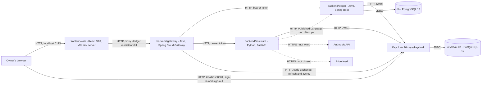

<div align="center">

# FinAssist

**A personal finance system for one owner: track the money, ask questions about it in plain
language, and analyse the portfolio behind it.**

[](https://github.com/NaimElijah/FinAssist/actions/workflows/ci.yml)
[](LICENSE)

[Requirements](docs/requirements/requirements.md) · [Architecture](docs/architecture/architecture.md) · [ADRs](docs/ADRs/) · [Changelog](CHANGELOG.md)

</div>

> [!IMPORTANT]
> **All six bounded contexts have a domain and an application layer, and every business request
> is authenticated.** The browser signs in with OIDC at a backend-for-frontend gateway, against a
> self-hosted Keycloak; the gateway keeps the tokens server-side and relays each call to the
> ledger or the assistant, and each of those validates the token and decides from its own role
> table what the caller may do. The ledger is persisted in PostgreSQL and served over HTTP —
> accounting, budgeting and planning under `/api/v1`, with a published OpenAPI contract — and
> records who wrote each journal row. The assistant serves `portfolio` under `/api/v1` too, with
> its own published contract, but its data comes only from an opt-in development seed, off by
> default — no ledger client and no price feed exist. The web client signs in and out; its
> accounting area lists and opens accounts, records a transaction by hand, and clears, reconciles
> or voids one; its budgeting area lists and defines budgets, reviews spend against one, and adds
> categorisation rules; its planning area plans flows, defines scenarios, charts a scenario's
> projection with its first shortfall, and compares scenarios against a baseline — all over the
> ledger's API. Its portfolio area looks up a holding, shows its position and valuation, and
> prices a disposal without recording it, over the assistant's. See
> [Known limitations](#status-and-limitations) for what does not exist yet.

## Contents

[What and why](#what-and-why) · [Scope](#scope) · [Quick start](#quick-start) ·
[Using the web client](#using-the-web-client) · [Tech stack](#tech-stack) ·
[Architecture](#architecture) · [Project structure](#project-structure) ·
[Development](#development) · [Testing](#testing) · [Configuration](#configuration) ·
[Design decisions](#design-decisions) · [Status](#status-and-limitations)

This README is ordered for a contributor rather than an evaluator — Quick start comes before
Architecture — because the project has one owner and no external audience yet.

## What and why

Personal finance tools generally do one of three things well: they record transactions, they
answer questions, or they analyse holdings. Using three of them means the answers come from
whichever tool happens to hold the data, and nothing reconciles them. FinAssist keeps one
ledger as the record of truth and puts both the natural-language assistant and the portfolio
analysis on top of that same ledger, so an answer and a balance cannot disagree.

It is deliberately not financial advice, not a multi-tenant product, and not a system that
moves money — it records and explains, and nothing more. See
[non-goals](docs/requirements/requirements.md#non-goals).

## Scope

There is no feature list, because much of the confirmed scope below is not built yet — listing
one here that outruns the code would be a bug report waiting to be filed. What does work, end to
end through the web client: signing in and out, as an `owner` who may change data or a `viewer`
who may only read it; opening an account, recording a transaction by hand and moving it through
Clear, Reconcile and Void; defining a budget for a month with a limit per category, reviewing
spend against it and adding categorisation rules; planning flows, defining scenarios, and
projecting and comparing them — all against the ledger; and looking up a holding, seeing its
position and valuation, and pricing a disposal, against the assistant, whose figures come only
from its development seed until a data source exists. The confirmed scope is four capability
areas:

- **Tracking** — accounts, transactions, categorisation, budgets.
- **Assistance** — natural-language questions answered over the owner's own ledger data.
- **Analysis** — portfolio composition and performance over holdings.
- **Planning** — planned flows, projected balances over time, and comparison of strategies.

What each must do is stated in [requirements](docs/requirements/requirements.md), still `TODO`
where a decision waits on its owner; the
[open questions](docs/requirements/requirements.md#open-questions) are those decisions.

## Quick start

**Prerequisites:**

- **Docker with Compose v2**, to run the stack. The ledger's and the gateway's test suites need
  it too: they start real containers through Testcontainers, and fail rather than skip when
  Docker is absent ([ADR-025](docs/ADRs/ADR-025-integration-tests-on-testcontainers.md)).
- **Node 24 and npm**, for the web client (`frontend/web/.nvmrc`).
- For the native inner loop, **a JDK 21 and [uv](https://docs.astral.sh/uv/)**. uv fetches its
  own Python 3.13, so no system Python upgrade is needed.

```bash
git clone https://github.com/NaimElijah/FinAssist.git
cd FinAssist
cp .env.example .env        # then set every secret in the table below, before starting anything
```

**Set every secret first.** `.env.example` leaves each one blank, and `docker-compose.yml`
requires each through `${VAR:?}` — `GRAFANA_ADMIN_PASSWORD` only for the `monitoring` profile —
so until they are set Compose refuses to start, printing
`required variable X is missing a value: set X in .env` for every one still missing, once for each
service that uses it. **An `.env` copied before authentication arrived lacks the five identity
secrets below**, from `KEYCLOAK_DB_PASSWORD` to `ASSISTANT_CLIENT_SECRET`; add them, or
`docker compose up` refuses to start.

| Secret | What to put in it |
|---|---|
| `POSTGRES_PASSWORD` | Any strong value, for the ledger's database |
| `LEDGER_DB_PASSWORD` | The same value as `POSTGRES_PASSWORD`: the ledger connects as the role Compose creates |
| `KEYCLOAK_DB_PASSWORD` | Any strong value, for Keycloak's own database, `keycloak-db` |
| `KEYCLOAK_ADMIN_PASSWORD` | Any strong value, for Keycloak's admin console |
| `FINASSIST_OWNER_INITIAL_PASSWORD` | The owner's one-time password, used once at [first sign-in](#first-sign-in). It must satisfy the realm's policy: `length(12) and notUsername and notEmail and passwordHistory(3)` |
| `GATEWAY_CLIENT_SECRET` | Any strong value. Keycloak sets the `finassist-gateway` client's secret from it, and the gateway signs in to Keycloak with it |
| `ASSISTANT_CLIENT_SECRET` | Any strong value. Keycloak sets the `finassist-assistant` client's secret from it |
| `GRAFANA_ADMIN_PASSWORD` | Any strong value. Needed only with the `monitoring` profile |

Under Compose, Keycloak and the gateway read `GATEWAY_CLIENT_SECRET` from the same `.env` entry,
so the two cannot disagree. `ASSISTANT_CLIENT_SECRET` is read by Keycloak and the smoke check
alone, since the assistant has no ledger client to use it yet
([#62](https://github.com/NaimElijah/FinAssist/issues/62)). Keycloak copies both client secrets
and the owner's initial password into the realm when it first imports it, and only then, so
changing one of them later changes nothing in Keycloak until the realm is imported again (see
[Changing the realm or its secrets](docs/operations/operations.md#changing-the-realm-or-its-secrets)).

Upgrading a `db-data` volume from before `V1_2`? See [Upgrading an existing ledger volume](docs/operations/operations.md#upgrading-an-existing-ledger-volume).

With every secret set, start the stack:

```bash
docker compose up --build
```

It starts PostgreSQL 18, Keycloak and its own database, the ledger, the gateway and the
assistant, with every published port bound to `127.0.0.1` only (ADR-030).

**The first `docker compose up` takes a couple of minutes, and that is expected, not a hang.**
Keycloak imports the `finassist` realm into the empty `keycloak-db-data` volume before it reports
ready, and the ledger, the gateway and the assistant each wait for that before they start. The
ledger applies its Flyway migrations at start-up.

Restarts, log limits and the realm's secret placeholders: see [Operations](docs/operations/operations.md#restarts-and-logs).

Once it is up:

```bash
curl http://localhost:8080/actuator/health
# {"groups":["liveness","readiness"],"status":"UP"}
curl http://localhost:8000/health
# {"status":"UP"}
curl http://localhost:8090/actuator/health
# the gateway; its "status" is "UP"
curl http://localhost:8081/realms/finassist/.well-known/openid-configuration
# the realm's discovery document; "issuer" reads "http://localhost:8081/realms/finassist"
curl -i http://localhost:8080/api/v1/accounts
# 401 with WWW-Authenticate: Bearer and a problem whose code is UNAUTHENTICATED —
# every business endpoint needs a bearer token, which only a signed-in session gets
```

Then start the web client, in a second terminal, and sign in:

```bash
cd frontend/web && npm ci && npm run dev
```

### First sign-in

Keycloak seeds one user, `FINASSIST_OWNER_USERNAME` (`owner` by default), with the `owner` role
and a *temporary* password, `FINASSIST_OWNER_INITIAL_PASSWORD`. Its first sign-in must set a real
password and enrol a TOTP device, so it is done by hand:

1. Open [http://localhost:5173](http://localhost:5173) — `localhost`, never `127.0.0.1` (see
   [Using the web client](#using-the-web-client)). With nobody signed in, it shows a sign-in
   screen.
2. Click **Sign in with Keycloak**, and sign in on Keycloak's own page with
   `FINASSIST_OWNER_USERNAME` and `FINASSIST_OWNER_INITIAL_PASSWORD`.
3. Keycloak asks for a new password, under the policy above, and then for a TOTP device: scan the
   QR code with any authenticator app, or note the secret and generate a code by hand.
4. Keycloak sends you back to [http://localhost:5173](http://localhost:5173), on Accounts, with
   your name in the header.

**Adding a viewer.** No `viewer` is seeded. Sign in to the admin console at
[http://localhost:8081/admin](http://localhost:8081/admin) with
`KEYCLOAK_ADMIN_USERNAME`/`KEYCLOAK_ADMIN_PASSWORD`, open the `finassist` realm, create a user,
give it a password under **Credentials**, and assign it the realm role `viewer` under
**Role mapping**. A viewer sees every area and is offered no control that changes data.

For the faster native inner loop, start only the databases and Keycloak under Compose, and run
the services outside it. Run natively, no service reads `.env`: each takes its settings from the
environment alone, so export what it needs in the shell that starts it — `LEDGER_DB_PASSWORD` for
the ledger, and for the gateway `GATEWAY_CLIENT_SECRET`, holding the same value as `.env`, which is
what Keycloak imported:

```bash
docker compose up -d db keycloak-db keycloak
cd backend/ledger && ./mvnw spring-boot:run
cd backend/assistant && uv run python -m finassist_assistant.adapters
cd backend/gateway && ./mvnw spring-boot:run
```

> [!NOTE]
> `make` is a convenience here, not a prerequisite, and it is not installed on the author's
> Windows machine. Every target is a one-line wrapper — the raw command is given alongside
> it throughout this README, and in the [Makefile](Makefile) itself. See
> [ADR-005](docs/ADRs/ADR-005-docker-compose-as-the-run-mechanism.md).

## Using the web client

The web client is a Vite dev server that forwards `/ledger/…`, `/assistant/…` and `/bff/…` to the
gateway, path intact — never straight to the ledger or the assistant — and the gateway's own
routes strip the prefix and relay each call once it authenticates
([ADR-026](docs/ADRs/ADR-026-web-client-calls-both-services-through-one-origin.md), extended by
[ADR-030](docs/ADRs/ADR-030-oidc-authentication-through-a-bff-gateway.md)). Start it once the
stack is up — under Compose, or with the ledger, the assistant and the gateway run natively, as in
[Quick start](#quick-start):

```bash
cd frontend/web && npm ci && npm run dev
```

and open [http://localhost:5173](http://localhost:5173) — `localhost`, never `127.0.0.1`: the
gateway's session cookie is keyed to the host name `GATEWAY_PUBLIC_URL` names, which defaults to
`localhost`, so opening the other address signs in against a different, cookie-less origin.

**The whole app is gated on a signed-in gateway session.** With nobody signed in it shows a
sign-in screen, never an Accounts, Budgets, Planning or Portfolio page answering 401. "Sign in
with Keycloak" is a plain link, so the browser actually navigates to Keycloak's login page rather
than a script following the redirect invisibly; the sign-in itself is described in
[First sign-in](#first-sign-in). Keycloak sends the browser back to `http://localhost:5173/` once
you are signed in; a failed sign-in sends it back to `?signin=failed` instead, which the sign-in
screen shows as an explanation. "Sign out", beside your name, ends the gateway's session and
Keycloak's own, and clears everything the app had cached. A `viewer` sees a "Read-only" badge
beside their name, and every area without the controls that change data; pricing a disposal,
which records nothing, stays offered. The ledger and the assistant enforce the same rule
themselves, whatever the browser shows.

Once signed in, Accounts, Budgets and Planning read and write through the ledger. Portfolio reads
through the assistant, which holds no real data yet, so every lookup answers that nothing is held
until the assistant starts with its development seed. Under Compose, set `ASSISTANT_DEV_SEED=true`
in `.env`, which Compose reads to fill in `docker-compose.yml`, or pass it for one run. The
natively run assistant never reads `.env` — its settings come from the environment alone — so
export the variable in the shell that starts it:

```bash
ASSISTANT_DEV_SEED=true docker compose up --build    # under Compose, for one run

export ASSISTANT_DEV_SEED=true                       # natively, in the shell that runs it
cd backend/assistant && uv run python -m finassist_assistant.adapters
```

then look up `VOO` or `DEMO`. The seeded lots and quotes are invented, and no figure on any screen
is financial advice.

## Tech stack

| Layer | Technology | Version | Why |
|---|---|---:|---|
| Ledger language | Java | 21 (LTS) | Records and sealed types make illegal ledger states unrepresentable rather than merely tested |
| Ledger framework | Spring Boot | 4.1.1 | Actuator gives health, readiness and metrics without bespoke code; the domain stays framework-free |
| Ledger build | Maven (wrapper) | 3.9.6 | Committed wrapper, so a clone needs only a JDK |
| Ledger format | Spotless + palantir-java-format | 3.10.1 / 2.97.0 | One authoritative formatter; `spotless:check` gates CI |
| Ledger OpenAPI | springdoc-openapi, API starter | 3.1.1 | Generates the ledger's contract from its controllers, with no Swagger UI; `LedgerContractIT` pins it to `contracts/` ([ADR-028](docs/ADRs/ADR-028-http-wire-conventions.md)) |
| Gateway framework | Spring Cloud Gateway Server Web MVC | 5.0.3 (release train 2025.1.3) | The backend-for-frontend: OIDC sign-in, tokens held in the server-side session, and `TokenRelay` to both services, on the ledger's servlet stack ([ADR-030](docs/ADRs/ADR-030-oidc-authentication-through-a-bff-gateway.md)) |
| Identity provider | Keycloak | 26.7.4 | Self-hosted OIDC, with its realm committed as code and every secret in it a placeholder ([ADR-031](docs/ADRs/ADR-031-keycloak-as-the-identity-provider.md)) |
| Assistant language | Python | 3.13 | Native home for the Anthropic SDK and the pandas numerical stack |
| Assistant framework | FastAPI | 0.141.1 | Typed request and response validation from the same Pydantic models the domain uses |
| Assistant packaging | uv | not pinned | Resolves, locks and fetches the interpreter in one tool; CI installs the latest release |
| Assistant lint, format, types | Ruff + mypy | 0.16.5 / 2.3.1 | Ruff replaces flake8 + isort + black; mypy runs `--strict` |
| Assistant token verification | PyJWT, `crypto` extra | 2.15.0 | RS256 signature checks and JWKS fetching; the time checks are redone against the injected clock ([ADR-032](docs/ADRs/ADR-032-role-based-authorization-per-service.md)) |
| Ledger architecture tests | ArchUnit | 1.5.0 | Layering, context isolation, the no-floating-point-money rule, and the two rules fencing the composition root, all fail the build |
| Coverage | JaCoCo + pytest-cov + coverage-v8 | 0.8.13 / 7.1.0 / 4.1.11 | Measured in all four codebases, published by CI, gating nothing ([ADR-017](docs/ADRs/ADR-017-test-strategy.md)) |
| Mutation testing | PIT | 1.19.1 | Answers what coverage cannot: would a test notice this line being wrong? Opt-in profile, not in CI |
| Property-based tests | Seeded `Random` (Java) + Hypothesis (Python) | — / 6.167.0 | Deterministic on both sides. jqwik is unusable on JUnit Platform 6; see ADR-017 |
| Telemetry | OpenTelemetry + Micrometer | 1.44.0 (Python) / 4.1.1 starter (Java) | Vendor-neutral by decision: the backend is an environment variable, not a rewrite ([ADR-019](docs/ADRs/ADR-019-opentelemetry-and-structured-logging.md)) |
| Monitoring | OTel Collector + Prometheus + Grafana | 0.139.0 / v3.7.3 / 12.3.1 | Local only, behind a Compose profile; dashboards provisioned from files, never clicked in |
| Web framework | React + Vite | 19.2 / 8.2 | A static bundle; no Node server to operate for a single-owner tool |
| Web language | TypeScript | 6.0.3 | Pinned below 7 because `typescript-eslint` caps at `<6.1.0`; type-aware linting is worth more than the newer compiler |
| Web runtime | Node | 24 | The major CI runs, pinned in `.nvmrc` and `engines`, because tests pin dates and amounts as that major's ICU data formats them |
| Web routing | React Router | 8.3.1 | URLs, history and deep links across every screen, in data mode ([ADR-029](docs/ADRs/ADR-029-web-client-stack.md)) |
| Web server state | TanStack Query | 5.102.8 | Caching, request races and invalidating what a mutation changed, instead of fetch hooks written per feature ([ADR-029](docs/ADRs/ADR-029-web-client-stack.md)) |
| Web contract types | @hey-api/openapi-ts | 0.99.0 | Types generated from all three committed contracts, and no client; CI fails when they drift ([ADR-029](docs/ADRs/ADR-029-web-client-stack.md)) |
| Web test, lint, format | Vitest + Testing Library + ESLint + Prettier | 4.1 / 16.3 / 10.9 / 3.9 | Type-aware rules; they caught a `HeadersInit` bug before any code used it, and there is now a test for it |
| Store | PostgreSQL | 18.6 | `NUMERIC` for exact money, and real constraints behind the domain's own |
| Keycloak's store | PostgreSQL | 17.11 | The newest major Keycloak 26.7 is tested against, kept apart from the ledger's |

Every version above but uv's is pinned in `backend/ledger/pom.xml`, `backend/gateway/pom.xml`,
`backend/assistant/pyproject.toml`, `backend/assistant/uv.lock`, `frontend/web/package.json`,
`frontend/web/.nvmrc`, `ops/keycloak/Dockerfile` or `docker-compose.yml` — not in this table.

## Architecture

Three independently deployable backend services, a web client, an identity provider, and two
databases. The ledger owns the records, and the assistant reads them through the ledger's API,
never its database. The gateway signs the browser in and relays each of its calls to the service
that owns the data; Keycloak issues every token. This is the overview diagram from
[docs/architecture/architecture.md](docs/architecture/architecture.md#architecture-overview),
which walks through each edge:



A solid edge carries traffic today; a dotted one has no caller yet. **Every call the web client
makes goes through the gateway**, which keeps the browser's tokens in its server-side session —
the browser holds only a session cookie and a CSRF token — and attaches the access token to each
relayed call. The ledger and the assistant each validate that token and decide from their own
role table what it may do ([ADR-030](docs/ADRs/ADR-030-oidc-authentication-through-a-bff-gateway.md),
[ADR-032](docs/ADRs/ADR-032-role-based-authorization-per-service.md)). Each service publishes a
contract: the ledger's `/api/v1` as
[contracts/ledger-v1.openapi.json](contracts/ledger-v1.openapi.json), the assistant's
`portfolio` endpoints as [contracts/assistant-v1.openapi.json](contracts/assistant-v1.openapi.json),
and the gateway's own `/bff/me` and `/bff/logout` as
[contracts/gateway-v1.openapi.json](contracts/gateway-v1.openapi.json). The assistant has no
ledger client yet.

**Six bounded contexts**, each owned by exactly one service, each one directory
([ADR-010](docs/ADRs/ADR-010-bounded-context-map.md), extended by
[ADR-015](docs/ADRs/ADR-015-planning-as-a-sixth-bounded-context.md)):

| Context | Owner | UI feature |
|---|---|---|
| `accounting` — accounts, entries, balances | ledger | yes |
| `budgeting` — budgets, categories, rules | ledger | yes |
| `portfolio` — holdings, positions, valuation | assistant | yes |
| `assistance` — questions and grounded answers | assistant | no — excluded until the privacy question is answered |
| `marketdata` — instruments and quotes, feed not chosen | assistant | no |
| `planning` — planned flows, projections, strategy comparison | ledger | yes |

The ledger and the assistant are both hexagonal, but **only the ledger uses tactical DDD** —
aggregates, value objects and domain events protect invariants, and the analysis side has none to
protect ([ADR-007](docs/ADRs/ADR-007-asymmetric-hexagonal-architecture.md)). The assistant gets
ports and a pure-function core instead.

In strategic DDD terms the ledger is the upstream **Supplier**, the OpenAPI contract is the
**Published Language**, and `adapters/outbound/ledger/` is the assistant's
**anti-corruption layer** — the one place a ledger DTO may be translated into the
assistant's own model. Nothing inward may reach it, and that is asserted per package rather
than assumed.

Dependency direction is enforced by the build in every codebase that holds a bounded context
(the gateway holds none): ArchUnit in the ledger,
source-parsing rules in the assistant, and a walk of the file tree in the web client.

Full description: [docs/architecture/architecture.md](docs/architecture/architecture.md).
Rationale: [docs/ADRs/](docs/ADRs/).

## Project structure

Context first, hexagon inside: a context is one directory and can be extracted by moving it.

```
backend/ledger/         Java 21 + Spring Boot - full tactical DDD; sole writer of the store
  accounting/             domain/{account,entry,event}/ application/{port/in,port/out,service}/
                          adapter/{in/web,out/persistence}/
  budgeting/              same hexagon, its own aggregates
  planning/               domain/{plan,forecast}/ - what is intended, never what happened
  shared/                 Money, Currency - in-language kernel
  composition/            Spring wiring, security, and the two cross-context translations
backend/gateway/        Java 21 + Spring Cloud Gateway - the backend-for-frontend; no domain
  composition/            security chain, Keycloak login, Host allow-list, /bff/me, relay errors
backend/assistant/      Python 3.13 + FastAPI - pure-function cores, no aggregates
  portfolio/              domain/{model,analysis}/ application/{port,usecase}/
                          adapters/{inbound/api,outbound/ledger}/   <- the ACL
  assistance/             ... adapters/outbound/llm/
  marketdata/             ... adapters/outbound/feed/               <- ACL, no feed chosen
  shared/
  adapters/               the composition root: app, wiring, settings, auth, observability
frontend/web/           React 19 + Vite 8 - one feature per user-facing context
  src/features/           accounting/ budgeting/ planning/ portfolio/ assistance/
  src/shared/             ui/ api/ lib/
  src/app/                the only place that knows every feature at once; session/ gates it
contracts/              Versioned OpenAPI contracts - the Published Language, and the gateway's own
ops/                    Infrastructure configuration, not application code
  keycloak/               Dockerfile and finassist-realm.json, the realm imported at start-up
  smoke/                  auth_smoke.py - the opt-in Compose check of the authentication wiring
  backup/                 backup.py - backs up, restores and proves a restore of each database (ADR-038)
  grafana/                dashboards and provisioning; beside it the collector and Prometheus files
docs/                   requirements/, architecture/, ADRs/ - read before proposing work
.github/                CI workflow and Dependabot configuration
```

Java packages sit under `backend/ledger/src/main/java/io/github/naimelijah/finassist/ledger/`
and `backend/gateway/src/main/java/io/github/naimelijah/finassist/gateway/`; Python packages
under `backend/assistant/src/finassist_assistant/`.

## Development

The Makefile is the single definition of every command; CI calls the same targets, so the
pipeline and the local commands cannot drift.

| Task | Make target | Raw command |
|---|---|---|
| Set up | `make setup` | `test -f .env \|\| cp .env.example .env`; `cd backend/ledger && ./mvnw -B -q dependency:go-offline`; `cd backend/gateway && ./mvnw -B -q dependency:go-offline`; `cd backend/assistant && uv sync --locked --extra dev`; `cd frontend/web && npm ci` |
| Run | `make run` | `docker compose up --build` |
| Run with monitoring | `make run-monitoring` | `docker compose --profile monitoring up --build` |
| Stop the stack | `make stop` | `docker compose down`, keeping volumes |
| Stop the monitoring profile too | `make stop-monitoring` | `docker compose --profile monitoring down`, keeping volumes |
| Run identity only | `make run-identity` | `docker compose up -d keycloak-db keycloak` — for signing in or testing against Keycloak without the rest of the stack |
| Back up both databases | `make backup` | `uv run ops/backup/backup.py backup`, with `db` and `keycloak-db` running — see [Backing up and restoring](docs/operations/operations.md#backing-up-and-restoring) |
| Prove a backup restores | `make restore-check BACKUP=<folder>` | `uv run ops/backup/backup.py check <folder>` — only ever as the Compose project `finassist-restore-check` |
| Restore a backup | `make restore BACKUP=<folder> [DATABASE=ledger\|keycloak]` | `uv run ops/backup/backup.py restore <folder> [--database ledger\|keycloak]`, into empty databases with `ledger` and `keycloak` stopped |
| Smoke-test authentication (opt-in) | `make smoke-auth` | `docker compose --profile smoke run --rm auth-smoke` — see [Smoke-testing authentication](docs/operations/operations.md#smoke-testing-authentication) |
| Test everything | `make test` | the five test rows below; all but `test-backup` measure coverage |
| Test the ledger | `make test-ledger` | `cd backend/ledger && ./mvnw -B verify` |
| Test the gateway | `make test-gateway` | `cd backend/gateway && ./mvnw -B verify` |
| Test the assistant | `make test-assistant` | `cd backend/assistant && uv run pytest --cov --cov-report=term-missing --cov-report=xml` |
| Test the backup CLI | `make test-backup` | `cd backend/assistant && uv run pytest -c pyproject.toml ../../ops/backup/tests` |
| Test the web client | `make test-web` | `cd frontend/web && npm run test:coverage` |
| Build the web bundle | `make build-web` | `cd frontend/web && npm run build` |
| Regenerate the web client's contract types | `make generate-web-api` | `cd frontend/web && npm run generate:api` |
| Mutation-test the ledger | `make mutation-ledger` | `cd backend/ledger && ./mvnw -B -Pmutation test-compile org.pitest:pitest-maven:mutationCoverage` |
| Lint and types | `make lint` | `./mvnw -B spotless:check` (ledger and gateway); `uv run ruff check .`, `ruff format --check .`, `mypy src tests`; for the smoke check (`make lint-smoke`) and the backup CLI (`make lint-backup`), `uv run ruff check`, `ruff format --check` and `mypy --strict` over `../../ops/smoke` and `../../ops/backup` respectively, all from `backend/assistant`; `npm run lint`, `format:check`, `typecheck` |
| Format | `make format` | `./mvnw -B spotless:apply` (ledger and gateway); `uv run ruff format . ../../ops/smoke ../../ops/backup`, `uv run ruff check --fix . ../../ops/smoke ../../ops/backup`; `npm run format` |
| Audit | `make audit` | `cd backend/assistant && uv run pip-audit`; `cd frontend/web && npm audit --audit-level=high` |
| Re-lock Python deps | `make lock` | `cd backend/assistant && uv lock` |
| Regenerate the ledger's OpenAPI contract | — | `cd backend/ledger && ./mvnw -B verify -Dtest=NONE -Dsurefire.failIfNoSpecifiedTests=false -Dit.test=LedgerContractIT` (Docker running); on a mismatch, copy `target/contracts/ledger-v1.openapi.json` over `contracts/ledger-v1.openapi.json` |
| Regenerate the assistant's OpenAPI contract | — | `cd backend/assistant && uv run pytest tests/test_contract.py` (no container needed); on a mismatch, copy `.contract-drift/assistant-v1.openapi.json` over `contracts/assistant-v1.openapi.json` |
| Regenerate the gateway's OpenAPI contract | — | `cd backend/gateway && ./mvnw -B verify -Dtest=NONE -Dsurefire.failIfNoSpecifiedTests=false -Dit.test=GatewayContractIT` (no container needed); on a mismatch, copy `target/contracts/gateway-v1.openapi.json` over `contracts/gateway-v1.openapi.json` |
| Run a single test | — | `cd backend/ledger && ./mvnw -B test -Dtest=LedgerArchitectureTest`; `cd backend/assistant && uv run pytest tests/test_architecture.py -k <name>`; `cd frontend/web && npx vitest run -t <name>` |
| Remove build output | `make clean` | `./mvnw -B -q clean` in `backend/ledger` and `backend/gateway`, then delete the assistant's caches and coverage files and the web client's `dist/` and `coverage/`; `.env` and Docker volumes are left alone |

Commits follow [Conventional Commits](https://www.conventionalcommits.org/)
(`type(scope): imperative subject`, subject under 72 characters); branches are
`type/short-kebab-description`. Documentation changes ship in the same commit as the
behaviour they describe.

> [!WARNING]
> Editing `backend/assistant/pyproject.toml` dependencies without running `make lock` will fail CI,
> which installs with `uv sync --locked` and refuses a stale lockfile.

Smoke-testing authentication, changing the realm, and backing up and restoring are in [Operations](docs/operations/operations.md).

## Testing

Every suite, test by test, is in [Testing](docs/testing/testing.md).

**What CI gates on:** every push and pull request to `main` and `dev` must pass five jobs —
the ledger's format check, build and tests; the gateway's format check, build and tests,
`KeycloakRealmIT` included; the assistant's lint, format check, `mypy --strict`, tests and
`pip-audit`, plus the lint and types of the smoke check and the backup CLI (`make lint-smoke`,
`make lint-backup`); the web client's
contract types, regenerated from `contracts/` with no changed or new file, then lint, format
check, typecheck, tests, production build and `npm audit`; and a `docker compose config`
validation, with the `monitoring` and `smoke` profiles included, that also fails any long-running
service without the shared restart policy and log bound, `auth-smoke` with either, and a
ledger, gateway, assistant or Keycloak healthcheck that probes anything but readiness. No CI job starts the
Compose stack.

**Coverage is measured everywhere and gates nothing.** JaCoCo, `pytest-cov` and
`@vitest/coverage-v8` run as part of the test targets, and each CI job publishes its report as
a build artefact. There is no threshold in any of the three, by decision rather than by
oversight ([ADR-017](docs/ADRs/ADR-017-test-strategy.md)) — coverage counts lines that ran, and
says nothing about whether a test would notice them being wrong.

**What answers that question is mutation testing**, on demand and also gated on nothing:

```bash
cd backend/ledger && ./mvnw -B -Pmutation test-compile org.pitest:pitest-maven:mutationCoverage
```

It earned its place on the first run, finding that deleting `requireSameCurrency` from
`Money.minus` broke no test — the cross-currency refusal was asserted for `plus` and
`compareTo` and never for `minus`, in either language.

## Configuration

Copy `.env.example` to `.env` and fill it in. `.env` is git-ignored; no value in it belongs
in the repository, the logs or an error message.

| Variable | Purpose | Default | Required |
|---|---|---|---|
| `POSTGRES_PASSWORD` | Database password | none | **Yes** — Compose refuses to start without it |
| `POSTGRES_DB` | Database name | `finassist` | No |
| `POSTGRES_USER` | Database user | `finassist` | No |
| `LEDGER_DB_PASSWORD` | Ledger database password. The ledger connects as the role Compose creates, so this must match `POSTGRES_PASSWORD` until it gets its own role | none | **Yes** — the ledger refuses to start without it |
| `ANTHROPIC_API_KEY` | The LLM behind the assistant | none | No — the assistant only registers it for redaction, and nothing uses it until an LLM adapter is wired, which waits on the privacy question |
| `GRAFANA_ADMIN_PASSWORD` | Grafana admin password | none | **Yes** when using the `monitoring` profile |
| `GATEWAY_CLIENT_SECRET` | The `finassist-gateway` Keycloak client's secret: any strong value. Keycloak sets the client's secret from it when it imports the realm, and the gateway signs in to Keycloak with it. It never leaves the gateway: the browser holds a session cookie and a CSRF token, never a token ([ADR-030](docs/ADRs/ADR-030-oidc-authentication-through-a-bff-gateway.md)) | none | **Yes** — the gateway and Keycloak both refuse to start without it |
| `KEYCLOAK_ADMIN_PASSWORD` | Keycloak's own bootstrap admin password, for its admin console at `http://localhost:8081/admin` ([ADR-031](docs/ADRs/ADR-031-keycloak-as-the-identity-provider.md)) | none | **Yes** — Keycloak refuses to start without it |
| `KEYCLOAK_DB_PASSWORD` | `keycloak-db`'s password. Its own database, its own volume, no published port ([ADR-031](docs/ADRs/ADR-031-keycloak-as-the-identity-provider.md)) | none | **Yes** — both Keycloak and its database refuse to start without it |
| `FINASSIST_OWNER_INITIAL_PASSWORD` | The owner's temporary password in the `finassist` realm. Must satisfy the realm's password policy; used once, at [first sign-in](#first-sign-in) | none | **Yes** — Keycloak refuses to start without it |
| `ASSISTANT_CLIENT_SECRET` | The `finassist-assistant` Keycloak client's secret — a confidential, service-account-only client holding the `assistant` role ([ADR-032](docs/ADRs/ADR-032-role-based-authorization-per-service.md)): any strong value. Keycloak sets the client's secret from it when it imports the realm | none | **Yes** — Keycloak refuses to start without it |

<details>

<summary>The remaining variables</summary>

| Variable | Purpose | Default |
|---|---|---|
| `LEDGER_PORT` | Ledger HTTP port | `8080` |
| `LEDGER_ADDRESS` | Interface the ledger binds. Loopback by default, kept as defence in depth now that the gateway fronts it too ([ADR-030](docs/ADRs/ADR-030-oidc-authentication-through-a-bff-gateway.md)); `0.0.0.0` only inside a container | `127.0.0.1` |
| `LEDGER_ALLOWED_HOSTS` | Comma-separated host names the ledger answers to. An entry containing a `:`, a `[` or a `]`, which covers a port and every IPv6 literal, is refused at start-up. Any other `Host` header is refused with 403, which stops a DNS-rebound page in the owner's browser ([ADR-030](docs/ADRs/ADR-030-oidc-authentication-through-a-bff-gateway.md)) | `localhost,127.0.0.1` |
| `LEDGER_DB_URL` | JDBC URL. Compose sets this itself, to the service name `db`, for the `ledger` container; this default targets a native `./mvnw spring-boot:run` at the Compose `db` service's published port | `jdbc:postgresql://localhost:5432/finassist` |
| `LEDGER_DB_USERNAME` | Ledger database user | `finassist` |
| `LEDGER_OIDC_ISSUER` | The issuer every token's `iss` claim must name. Always the public URL a browser signed in against, never an internal one ([ADR-030](docs/ADRs/ADR-030-oidc-authentication-through-a-bff-gateway.md), [ADR-031](docs/ADRs/ADR-031-keycloak-as-the-identity-provider.md)) | `http://localhost:8081/realms/finassist` |
| `LEDGER_OIDC_JWKS_URI` | Where the ledger fetches signing keys, service-to-service. Compose overrides this with the internal address; this default targets a native `./mvnw spring-boot:run` against Keycloak's published port | `http://localhost:8081/realms/finassist/protocol/openid-connect/certs` |
| `KEYCLOAK_PORT` | Keycloak HTTP port | `8081` |
| `KEYCLOAK_ADMIN_USERNAME` | Keycloak's own bootstrap admin username — not one of FinAssist's own roles | `admin` |
| `FINASSIST_OWNER_USERNAME` | The owner's sign-in username in the `finassist` realm, seeded with the `owner` role | `owner` |
| `GATEWAY_PORT` | Gateway HTTP port | `8090` |
| `GATEWAY_ADDRESS` | Interface the gateway binds. Loopback by default, matching the ledger and the assistant, kept as defence in depth alongside the OIDC sign-in ([ADR-030](docs/ADRs/ADR-030-oidc-authentication-through-a-bff-gateway.md)); `0.0.0.0` only inside a container | `127.0.0.1` |
| `GATEWAY_ALLOWED_HOSTS` | Comma-separated host names the gateway answers to. An entry containing a `:`, a `[` or a `]`, which covers a port and every IPv6 literal, is refused at start-up. Any other `Host` header is refused with 403, which stops a DNS-rebound page in the owner's browser ([ADR-030](docs/ADRs/ADR-030-oidc-authentication-through-a-bff-gateway.md)) | `localhost,127.0.0.1` |
| `GATEWAY_PUBLIC_URL` | The origin the browser reaches FinAssist through — the Vite dev server, which proxies `/bff` to the gateway. Every redirect the gateway issues is absolute and built from this, never from a forwarded header. Open `localhost`, not `127.0.0.1`: cookies are keyed by host name, so the other one cannot find the sign-in's own session | `http://localhost:5173` |
| `GATEWAY_OIDC_PUBLIC_URL` | Keycloak as the browser sees it. The sign-in and sign-out URLs handed to the browser are built from this, and so is the issuer every token must name | `http://localhost:8081` |
| `GATEWAY_OIDC_INTERNAL_URL` | Keycloak as the gateway itself reaches it. The same value when running natively; under Compose it is the container name, which the browser cannot resolve — which is why the two are separate | `http://localhost:8081` |
| `GATEWAY_COOKIE_SECURE` | Whether the session and CSRF cookies carry `Secure`. `false` for development, which is plain HTTP on loopback; must be `true` behind TLS | `false` |
| `GATEWAY_LEDGER_URI` | Where the gateway relays a request under `/ledger/api/v1/**`, once its prefix is stripped, the browser's `Authorization`, `Cookie`, CSRF and `HTTP2-Settings` headers removed and the session's own access token attached | `http://localhost:8080` |
| `GATEWAY_ASSISTANT_URI` | The same, for `/assistant/api/v1/**` | `http://localhost:8000` |
| `ASSISTANT_PORT` | Assistant HTTP port | `8000` |
| `LEDGER_BASE_URL` | Where the assistant reaches the ledger | `http://ledger:8080` |
| `POSTGRES_PORT` | Host port mapped to Postgres. Change it, and `LEDGER_DB_URL` with it, if something already owns 5432 — a natively installed PostgreSQL will otherwise answer instead of the container | `5432` |
| `OTEL_EXPORTER_OTLP_ENDPOINT` | Collector base URL; each service appends its own signal path | `http://localhost:4318` |
| `OTEL_EXPORT_ENABLED` | Whether to export telemetry at all — traces, metrics, and the ledger's OTLP log export, which nothing feeds yet. Paired with the endpoint so a stale one goes quiet rather than retrying | `false` |
| `ASSISTANT_LOG_LEVEL` | Threshold for the assistant's structured logger; one of `DEBUG`, `INFO`, `WARNING`, `ERROR`, `CRITICAL` | `INFO` |
| `ASSISTANT_HOST` | Interface the assistant binds. Loopback by default, kept as defence in depth now that the gateway fronts it too ([ADR-030](docs/ADRs/ADR-030-oidc-authentication-through-a-bff-gateway.md)); `0.0.0.0` only inside a container, where Compose sets it | `127.0.0.1` |
| `ASSISTANT_ALLOWED_HOSTS` | Comma-separated host names the assistant answers to. An entry containing a `:` or a `[`, which covers a port and every IPv6 literal, or a wildcard, is refused at start-up. Any other `Host` header is refused with 403, which stops a DNS-rebound page in the owner's browser ([ADR-030](docs/ADRs/ADR-030-oidc-authentication-through-a-bff-gateway.md)) | `localhost,127.0.0.1` |
| `ASSISTANT_OIDC_ISSUER` | The issuer every bearer token's `iss` claim must name. Always the public URL a browser signed in against, never an internal one ([ADR-030](docs/ADRs/ADR-030-oidc-authentication-through-a-bff-gateway.md), [ADR-031](docs/ADRs/ADR-031-keycloak-as-the-identity-provider.md)) - the same value the ledger is configured with. Refused at start-up unless it is an http(s) URL | `http://localhost:8081/realms/finassist` |
| `ASSISTANT_OIDC_JWKS_URI` | Where the assistant fetches signing keys, service-to-service. Compose overrides this with the internal address, `http://keycloak:8080/realms/finassist/protocol/openid-connect/certs`; this default targets a native run against Keycloak's own published port. Also refused at start-up unless it is an http(s) URL | `http://localhost:8081/realms/finassist/protocol/openid-connect/certs` |
| `ASSISTANT_DEV_SEED` | Loads a small set of fictional holdings and quotes at start-up, so the portfolio screens have something to show by hand. Invented data, never meant for real use | `false` |
| `OTLP_HTTP_PORT`, `OTLP_GRPC_PORT` | Host ports for the collector | `4318`, `4317` |
| `PROMETHEUS_PORT`, `GRAFANA_PORT` | Host ports for the monitoring profile | `9090`, `3000` |

</details>

**The gateway's outbound HTTP timeouts are not an environment variable.** Spring Cloud Gateway
Server Web MVC has no timeout property of its own for a relayed call, so
`backend/gateway/src/main/resources/application.yml` sets Boot's own
`spring.http.clients.connect-timeout` (`5s`) and `read-timeout` (`10s`) directly. Both bound
every outbound HTTP call the gateway makes. The relay to the ledger or the assistant gets that
for free, because Spring Cloud Gateway builds its client from Boot's own builder. The gateway's
three calls to Keycloak — the authorization-code exchange, the `refresh_token` grant, and the
JWK-set fetch that verifies an ID token at sign-in — do not: Spring Security builds each from a
static factory that never consults Boot's builder, so `KeycloakRegistration` rebuilds all three
from it deliberately. Unbounded, a Keycloak that accepts the connection and then stops answering
would park a Tomcat thread for ever while the browser spins with no error; `GatewayKeycloakTimeoutIT`
drives exactly that failure against all three. Raising either budget is a one-line change to that
file.

## Deployment and operations

Not deployed anywhere, and there is no target environment or migration strategy yet —
stating one here would be fiction. Every build artefact stays on the machine that built it:
`./mvnw package` produces the ledger's executable jar, `npm run build` the web client's static
bundle, and `docker compose up --build` an image for each backend service from its own
Dockerfile.

| Concern | Endpoint or format | State |
|---|---|---|
| Liveness | `GET /actuator/health/liveness` (ledger and gateway), `GET /health` (assistant) | Live, returns `UP` |
| Readiness | `GET /actuator/health/readiness` (ledger and gateway), `GET /ready` (assistant); Keycloak's `/health/ready` on its management port, 9000, inside its container only | Live. Compose's healthcheck probes each of these, never a liveness path, so `service_healthy` means ready to serve. It judges Keycloak by that endpoint's HTTP status line alone, and the ledger, the gateway and the assistant wait for it |
| Metrics | `GET /actuator/metrics`, `GET /actuator/prometheus` (ledger) | Live, and scraped by the monitoring profile; no domain metric yet |
| Traces | OTLP to `$OTEL_EXPORTER_OTLP_ENDPOINT` | Live when `OTEL_EXPORT_ENABLED=true`; dropped otherwise, and the services start either way |
| Logs | JSON on stdout, carrying a W3C trace id | Live — ECS in the ledger and the gateway, structlog in the assistant. Redaction is enforced at the assistant's and the web client's logging boundaries; the ledger and the gateway log no credential at all — a refused token as its reason category alone, a failed sign-in as its OAuth2 error code — and the ledger does not expose `/actuator/env` |
| Dashboards | Grafana, provisioned from `ops/grafana/` | Live under the `monitoring` profile |
| Audit trail | The append-only journal | Live — the database refuses an `UPDATE` or a `DELETE` on a recorded transaction, its entries or its states; a lifecycle change appends rather than overwrites ([ADR-020](docs/ADRs/ADR-020-audit-trail-follows-persistence.md), [ADR-024](docs/ADRs/ADR-024-jdbc-persistence-and-append-only-schema.md)) |
| Ledger API | `GET/POST /api/v1/...`, each needing a bearer token that grants `ledger:read` or `ledger:write`; OpenAPI document at `GET /v3/api-docs`, pinned as [`contracts/ledger-v1.openapi.json`](contracts/ledger-v1.openapi.json) | Live for accounting, budgeting and planning; the web client's screens for all three call it, through the gateway |
| Assistant API | `GET/POST /api/v1/portfolio/...`, each needing a bearer token that grants `portfolio:read`; OpenAPI document at `GET /openapi.json`, pinned as [`contracts/assistant-v1.openapi.json`](contracts/assistant-v1.openapi.json) | Live for portfolio, answering from the development seed or from nothing; the web client's portfolio screens call it, through the gateway |
| Gateway | The login entry and callback, `GET /bff/me` and `POST /bff/logout` under `/bff/`, and the relays under `/ledger/api/v1/**` and `/assistant/api/v1/**`; its contract is pinned as [`contracts/gateway-v1.openapi.json`](contracts/gateway-v1.openapi.json), and its own `/v3/api-docs` stays denied | Live; the web client's dev proxy sends it every call |
| Backups | `make backup`: a `pg_dump` of each database into `backups/<UTC time>/`; `make restore-check` proves one restores; `make restore` puts one back into empty databases | On demand, and checked by hand, never in CI; no schedule and no recovery-point target yet ([ADR-038](docs/ADRs/ADR-038-back-up-each-database-as-a-logical-dump.md)) |
| Identity | Keycloak at `http://localhost:8081`: the admin console at `/admin`, the owner's account console at `/realms/finassist/account` | Live under Compose, published on `127.0.0.1` only |

The telemetry backend: see [Running the telemetry backend](docs/operations/operations.md#running-the-telemetry-backend).

## Design decisions

**Two languages instead of one**
([ADR-001](docs/ADRs/ADR-001-polyglot-java-python-split.md)) — the ledger is
invariant-heavy and suits Java's sealed types; the assistant and analysis are ecosystem-heavy
and have no Java peer libraries. The single-language recommendation was Python only; the
owner chose the split knowingly. Cost: two toolchains, two CI jobs and a versioned wire
contract before any feature exists. The ADR records the concrete threshold for collapsing
back to one language.

**Double-entry bookkeeping**
([ADR-011](docs/ADRs/ADR-011-double-entry-bookkeeping.md)) — a transaction's entries must sum to
zero, checked in the constructor, so an unbalanced one is never constructed. Balances are
derived by summing entries; there is no balance field to drift. Single entry was rejected
because it leaves the domain almost nothing to enforce, which would make ADR-001's reason for
choosing Java here hollow. Cost: every purchase needs a category account to balance against, so
a bare "I spent 12.50" is not expressible.

**Context first, hexagon inside**
([ADR-010](docs/ADRs/ADR-010-bounded-context-map.md)) — six bounded contexts, each one
directory with its own hexagon, so a context is extractable by moving it. No context may
depend on another; that rule is enforced in every codebase that holds one and was proved by
making it fail. The alternative — layers on top, contexts nested inside — leaves a context's code
in three distant trees and lets cross-context imports accumulate unopposed. Cost: deeper nesting,
and `shared` is exempt, so it is where coupling can still accrue quietly.

**Tactical DDD in the ledger only**
([ADR-007](docs/ADRs/ADR-007-asymmetric-hexagonal-architecture.md)) — aggregates and value
objects exist to protect invariants. The ledger is dense with them; computing a rolling
return protects nothing, so aggregates there would wrap dataframes in DDD vocabulary.
Alternatives were symmetric DDD in both services, and a strategic split by bounded context.
Cost: two mental models in one repository, and `Money` implemented twice with no compiler to
catch divergence.

**Compose is the mechanism, the Makefile only an interface**
([ADR-005](docs/ADRs/ADR-005-docker-compose-as-the-run-mechanism.md)) — the development
machine has no `make`, no `just` and no `bash` on `PATH`, so a Makefile alone would document
commands that do not run where they were written. Cost: the logic is split across two files,
and containers iterate more slowly than native runs.

**`backend/` and `frontend/` at the root**
([ADR-008](docs/ADRs/ADR-008-backend-frontend-root-layout.md)) — one home per tier, once a web
client joined. The cost was accepted knowingly: the grouping carries no domain meaning and
implies the ledger and assistant are one layer, when they are separate contexts in separate
languages talking over a versioned contract.

**The assistant never touches the ledger's database**
([ADR-004](docs/ADRs/ADR-004-http-openapi-service-contract.md), Accepted) — a shared
database would be the cheapest thing to build and the most expensive to own. Cost: JSON over
HTTP carries no runtime schema, and contract drift is silent until CI compares the documents.

**Sign-in through a gateway, permissions decided by each service**
([ADR-030](docs/ADRs/ADR-030-oidc-authentication-through-a-bff-gateway.md),
[ADR-031](docs/ADRs/ADR-031-keycloak-as-the-identity-provider.md),
[ADR-032](docs/ADRs/ADR-032-role-based-authorization-per-service.md)) — built. None of the
triggers that had deferred authentication had fired; the owner chose to build it to a
professional standard anyway. The browser signs in with OIDC at a backend-for-frontend gateway
that keeps access and refresh tokens on the server, a self-hosted Keycloak with its realm
committed as code issues the tokens, and the ledger and the assistant each validate a bearer
token and decide from their own role table what it may do, denying anything unlisted. Tokens held
in the browser were rejected because any script on the page could read them, and authorising at
the gateway because the assistant will call the ledger without passing through it. Cost: a third
deployable and two more containers in the inner loop, sessions that end when the gateway
restarts, including when Docker restarts it after a crash, and no TLS while everything stays on
loopback.

## Status and limitations

**Pre-alpha.** Shipped: the repository baseline and architecture, plus the **domain and
application layers of all six bounded contexts** with the invariants and tests that make them
real — double-entry accounting, periodic budgets, FIFO cost basis, grounded answers, quote
staleness, deterministic projections and strategy comparison, and `Money` in both languages.
Use cases sit behind ports and are wired by constructor, and the ledger's are backed by
**PostgreSQL**: a schema per bounded context, Flyway migrations, hand-written SQL, and a journal
the database itself refuses to rewrite. **The ledger now serves accounting, budgeting and
planning over HTTP** under `/api/v1`, behind a Host allow-list and problem+json error handling,
with its generated OpenAPI document pinned by `LedgerContractIT` and published as
[`contracts/ledger-v1.openapi.json`](contracts/ledger-v1.openapi.json); it runs under Compose as
well as natively. **Every business request is authenticated**: the browser signs in with OIDC at
a backend-for-frontend gateway against a self-hosted Keycloak, the ledger and the assistant each
validate a bearer token and deny by default, and every journal row written from `V1_2` onward
names who wrote it. Every architecture rule is live rather than dormant, and
each was confirmed to fail against a planted violation — including dropping the append-only
trigger and planting a foreign key across a schema boundary. CI gates build, lint, format and
dependency audit across five jobs, and publishes a coverage report from each of the four that
run tests.

**Four slices now run end to end**: the web client's accounting area opens an account, records a
transaction by hand, and moves one through `Clear`, `Reconcile` and `Void`; its budgeting area
lists and defines budgets, reviews spend against one — overspent, unbudgeted and uncategorised —
and adds categorisation rules in order; its planning area plans flows and moves them through their
lifecycle, defines scenarios, charts a scenario's projection against chosen accounts with its
first shortfall, and compares scenarios against a baseline — these three against the ledger's live
HTTP API; and its portfolio area looks up a holding, shows its position and valuation, and prices a
disposal without recording it, against the assistant's. Planned next, in order: resolve the
[open questions](docs/requirements/requirements.md#open-questions), then give the assistant a
ledger client behind its own `LedgerPort`.

Known limitations:

- **The backend HTTP APIs have one caller so far: the web client, through the gateway.** The
  ledger serves accounting, budgeting and planning under `/api/v1`, with an OpenAPI document
  pinned by `LedgerContractIT`; the assistant serves `portfolio` under `/api/v1`, pinned by
  `tests/test_contract.py`. The web client's accounting, budgeting and planning screens call the
  ledger's, and its portfolio screens the assistant's. The assistant has no ledger client of its
  own — `LedgerPort` is still an in-memory stand-in.
- **Sessions live in memory.** Restarting the gateway signs everyone out, and that includes the
  automatic restart after a crash, so a gateway caught in a crash loop signs everyone out on each
  pass. A second gateway instance would need a shared session store
  ([ADR-030](docs/ADRs/ADR-030-oidc-authentication-through-a-bff-gateway.md)).
- **There is no TLS.** Everything is plain HTTP on loopback, which is what makes that acceptable;
  `GATEWAY_COOKIE_SECURE` must become `true` behind TLS, and a port reachable from a network would
  carry tokens and cookies in clear text (ADR-030).
- **A realm change needs a fresh `keycloak-db-data` volume or `kc.sh import --override true`.**
  Keycloak imports `ops/keycloak/finassist-realm.json` — with the client secrets and the owner's
  initial password from `.env` — only into an empty `keycloak-db-data` volume, so editing any of
  them changes nothing for an existing one until the realm is imported again, and either way of
  doing that deletes the realm's users: see
  [Changing the realm or its secrets](docs/operations/operations.md#changing-the-realm-or-its-secrets). Never recreate the
  volume with `docker compose down -v`, which deletes the ledger's `db-data` volume too. The smoke
  check sees a stale `ASSISTANT_CLIENT_SECRET`, but not a stale gateway secret or stale redirect
  URIs ([ADR-031](docs/ADRs/ADR-031-keycloak-as-the-identity-provider.md),
  [ADR-034](docs/ADRs/ADR-034-keep-the-compose-smoke-check-manual.md)).
- **Backups are taken by hand, onto the same disk.** `make backup` dumps both databases when
  asked, and nothing schedules it, because no recovery-point target has been set. A dump guards
  against a bad migration or a deleted volume, not the loss of the machine
  ([ADR-038](docs/ADRs/ADR-038-back-up-each-database-as-a-logical-dump.md)).
- **Nothing serves the built bundle** ([#61](https://github.com/NaimElijah/FinAssist/issues/61)).
  `npm run build` produces it, but only the Vite dev and preview servers, with their proxy to the
  gateway, stand in front of the web client, and no deployment target has been chosen.
- **Roles refresh only at the next sign-in.** The web client shows the roles `GET /bff/me` reads
  from the ID token issued at sign-in, so a role changed in Keycloak reaches what it shows and
  offers only once that person signs in again
  ([ADR-032](docs/ADRs/ADR-032-role-based-authorization-per-service.md)).
- **Clock drift under WSL2 can refuse a valid token.** The ledger and the assistant check `exp`,
  `nbf` and `iat` with 30 seconds of leeway. WSL2's virtual machine is known to drift further,
  typically after the host sleeps, and then a fresh token looks expired or not yet valid: it is
  answered 401 and logged with the reason `lifetime`. Restarting the virtual machine resyncs its
  clock: `wsl --shutdown`, then start Docker Desktop again.
- **The assistant's portfolio data comes only from an opt-in development seed.**
  `ASSISTANT_DEV_SEED`, off by default, loads a small set of fictional lots and quotes from the
  composition root so the endpoints have something to answer by hand; it is a development aid,
  not a data source, and no ledger client or price feed exists yet. Without it, the web client's
  portfolio screens answer every lookup with nothing held.
- **The audit trail says who, from `V1_2` onward, but does not show it yet.** Every journal
  insert now names the authenticated subject that wrote it — `TransactionController` builds an
  `Actor` from the request's `java.security.Principal` — but a row written before that migration
  honestly names nobody, and the value is stored, never exposed through the API
  ([#63](https://github.com/NaimElijah/FinAssist/issues/63))
  ([ADR-020](docs/ADRs/ADR-020-audit-trail-follows-persistence.md),
  [ADR-033](docs/ADRs/ADR-033-the-journal-records-who.md)).
- **Docker is required to test the ledger and the gateway**, not only to run them. The ledger's
  store is tested against a real PostgreSQL and the gateway's `KeycloakRealmIT` against the real
  Keycloak image, and both suites fail rather than skip when no daemon answers
  ([ADR-025](docs/ADRs/ADR-025-integration-tests-on-testcontainers.md)).
- **Domain events have no subscriber.** They are raised, recorded in an append-only in-memory
  log and asserted by tests, and read by no production code. That is the cost
  [ADR-023](docs/ADRs/ADR-023-domain-events-in-the-ledger.md) accepts, with the trigger that
  discharges it.
- **`AnswerQuestion` is written and not wired.** An LLM adapter would decide by implication
  whether the owner's financial data may be sent to a third-party API, which is the project's
  central open question and belongs in its own ADR.
- **Six contexts is a guess.** They are derived from the four capability areas, not from a
  working slice, and some may turn out to be wrong boundaries. ADR-010 names the signal:
  contexts that always change together should be merged.
- **`planning` sits in the ledger against ADR-007's own criterion.** Forecasting is
  transformation-dense, which is the assistant's profile, and it was placed in the ledger for
  its lifecycle and its future persistence. If `PlanState` goes unused, the context belongs in
  Python ([ADR-015](docs/ADRs/ADR-015-planning-as-a-sixth-bounded-context.md)).
- **A projection is a single deterministic line.** It states no uncertainty, so a long-horizon
  figure looks far more precise than it is
  ([ADR-016](docs/ADRs/ADR-016-deterministic-per-currency-projection.md)).
- **Shortfall detection sees only step boundaries.** An overdraft that opens and closes within
  one step goes unreported — a big payment covered by a salary later the same month reads as
  untroubled at a monthly cadence. Pinned by a test, narrowed by projecting more finely, closed
  by nothing yet.
- **The grounding rule checks a citation points at evidence that was gathered, not that it
  supports the figure.** `AnswerQuestion` now drops a citation naming a record the answer was
  never given, so a wholly invented reference no longer grounds anything — but a model citing a
  *real* balance while stating a different number still passes
  ([ADR-014](docs/ADRs/ADR-014-grounded-answers-require-citations.md)).
- **No cross-currency total is possible**, by design — so there is no single net-worth figure
  across accounts in different currencies, and a projection covers one currency only
  ([ADR-012](docs/ADRs/ADR-012-multi-currency-without-conversion.md)).
- **`marketdata` has no feed.** The anti-corruption layer exists; nothing sits behind it,
  because no price source has been chosen or licence-checked.
- **TypeScript is one minor behind.** Pinned to 6.0.3 because `typescript-eslint` 8 caps at
  `<6.1.0`; lifts when it supports 7.
- **The image tags named directly in `docker-compose.yml` are bumped by hand** — both PostgreSQL
  tags, the smoke check's Python image and the monitoring services'. Dependabot's `docker`
  ecosystem covers the ledger's, the gateway's and the assistant's own Dockerfiles and
  `ops/keycloak/Dockerfile`; there is still no `docker-compose` ecosystem for the rest.

## Licence

Proprietary — all rights reserved. See [LICENSE](LICENSE).
