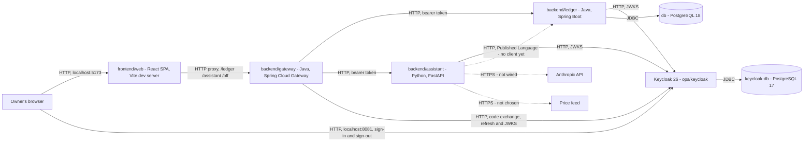

<div align="center">

# FinAssist

**A self-hosted personal finance system for one owner: double-entry books, monthly budgets,
cash-flow projections and portfolio valuation, on one ledger of record.**

[](https://github.com/NaimElijah/FinAssist/actions/workflows/ci.yml)
[](LICENSE)

[Requirements](docs/requirements/requirements.md) · [Architecture](docs/architecture/architecture.md) · [Operations](docs/operations/operations.md) · [Testing](docs/testing/testing.md) · [ADRs](docs/ADRs/) · [Changelog](CHANGELOG.md)

</div>



A solid edge carries traffic today; a dotted one has no caller yet. Every service runs locally
under Docker Compose, with each published port bound to `127.0.0.1`.

## Contents

[What and why](#what-and-why) · [Features](#features) · [Architecture](#architecture) ·
[Tech stack](#tech-stack) · [Quick start](#quick-start) · [Usage](#usage) ·
[Configuration](#configuration) · [Development](#development) · [Testing](#testing) ·
[Operations](#deployment-and-operations) · [Project structure](#project-structure) ·
[Design decisions](#design-decisions) · [Status](#status-and-limitations)

## What and why

Personal finance tools generally do one of three things well: they record transactions, they
answer questions, or they analyse holdings. Using three of them means the answers come from
whichever tool happens to hold the data, and nothing reconciles them. FinAssist keeps one ledger
as the record of truth and builds both the natural-language assistant and the portfolio analysis
on top of that same ledger, so an answer and a balance cannot disagree. The books, budgets, plans
and portfolio views run today; the assistant's question answering is designed and not yet wired
([Status](#status-and-limitations)).

The confirmed scope is four capability areas — tracking, assistance, analysis and planning — and
[requirements](docs/requirements/requirements.md) states what each must do, still `TODO` where a
decision waits on its owner. It is deliberately not financial advice, not a multi-tenant product,
and not a system that moves money — it records and explains, and nothing more. See
[non-goals](docs/requirements/requirements.md#non-goals).

## Features

- **Keep double-entry books.** Open accounts in ILS, USD, EUR, GBP or JPY, record a balanced
  transaction by hand, and move it through Clear, Reconcile or Void. Every balance is summed from
  entries, never stored.
- **Budget by the month.** Define a budget with a limit per category, review spend against it —
  overspent, unbudgeted and uncategorised — and add categorisation rules, tried in order.
- **Plan ahead.** Plan future flows, define scenarios, chart a scenario's projection against the
  accounts you choose with its first shortfall, and compare scenarios against a baseline.
- **Value a holding.** Look up a position and its valuation, and price a disposal by FIFO cost
  basis without recording it. The figures come from a development seed until a data source exists.
- **Sign in once, with each service guarding itself.** OIDC through Keycloak, the owner with a TOTP
  second factor; an `owner` may change data, a `viewer` only read it, and the ledger and the
  assistant each enforce that on their own.
- **Back up, and prove the backup.** Dump both databases on demand, then restore one into an
  isolated stack to check it before you need it.
- **Watch it run.** Structured JSON logs carrying a trace id, OTLP traces and Prometheus metrics,
  with an opt-in collector, Prometheus and Grafana.

## Architecture

Three independently deployable backend services, a web client, an identity provider and two
databases. The ledger owns the records; the assistant is designed to read them through the
ledger's API, never its database. Keycloak issues every token, and every call the web client
makes goes through the gateway, which keeps the tokens in its server-side session — the browser
holds only a session cookie and a CSRF token. The ledger and the assistant each validate the
relayed token and decide from their own role table what it may do, denying anything unlisted
([ADR-030](docs/ADRs/ADR-030-oidc-authentication-through-a-bff-gateway.md),
[ADR-032](docs/ADRs/ADR-032-role-based-authorization-per-service.md)).

**One request, end to end.** Recording a transaction, the browser posts JSON to
`/ledger/api/v1/transactions` on the Vite dev server, which forwards it, path intact, to the
gateway. The gateway checks the session and its `X-FINASSIST-XSRF-TOKEN` header, strips the
`/ledger` prefix, removes the browser's cookies, and relays the call to the ledger with the
session's access token attached (`TokenRelay`). The ledger verifies the token against Keycloak's
keys, and `TransactionController` turns the body into a `RecordTransactionCommand` naming the
signed-in subject. `TransactionService`, behind the `RecordTransactionUseCase` in-port, checks each
entry's currency against its account, and `Transaction.record` refuses entries that do not sum to
zero. `JdbcTransactionRepository` appends the result to a journal the database itself refuses to
update or delete, and the ledger answers `201` with what it recorded.

**Six bounded contexts**, each owned by exactly one service, each one directory
([ADR-010](docs/ADRs/ADR-010-bounded-context-map.md), extended by
[ADR-015](docs/ADRs/ADR-015-planning-as-a-sixth-bounded-context.md)):

| Context | Owner | UI feature |
|---|---|---|
| `accounting` — accounts, entries, balances | ledger | yes |
| `budgeting` — budgets, categories, rules | ledger | yes |
| `portfolio` — holdings, positions, valuation | assistant | yes |
| `assistance` — questions and grounded answers | assistant | no — excluded until the privacy question is answered |
| `marketdata` — instruments and quotes, feed not chosen | assistant | no |
| `planning` — planned flows, projections, strategy comparison | ledger | yes |

The ledger and the assistant are both hexagonal, but only the ledger uses tactical DDD —
aggregates, value objects and domain events protect invariants, and the analysis side has none to
protect ([ADR-007](docs/ADRs/ADR-007-asymmetric-hexagonal-architecture.md)). The assistant gets
ports and a pure-function core instead, and `adapters/outbound/ledger/` is its anti-corruption
layer: the one place a ledger DTO may become the assistant's own model. No context may import
another, and dependencies point inward everywhere; the build enforces both — ArchUnit in the
ledger, source-parsing rules in the assistant, a walk of the file tree in the web client.

The full description, edge by edge:
[docs/architecture/architecture.md](docs/architecture/architecture.md#architecture-overview).
Rationale: [docs/ADRs/](docs/ADRs/).

## Tech stack

| Layer | Technology | Version | Why |
|---|---|---:|---|
| Ledger | Java + Spring Boot | 21 / 4.1.1 | Records and sealed types make illegal ledger states unrepresentable; Actuator gives health and readiness without bespoke code |
| Ledger store | PostgreSQL, Flyway, hand-written SQL over `JdbcClient` | 18.6 | `NUMERIC` for exact money, a schema per context, and a journal the database refuses to rewrite ([ADR-024](docs/ADRs/ADR-024-jdbc-persistence-and-append-only-schema.md)) |
| Gateway | Spring Cloud Gateway Server Web MVC | 5.0.3 (train 2025.1.3) | OIDC sign-in, tokens kept in the server-side session, and `TokenRelay` to both services ([ADR-030](docs/ADRs/ADR-030-oidc-authentication-through-a-bff-gateway.md)) |
| Identity | Keycloak, on its own PostgreSQL | 26.7.4 / 17.11 | Self-hosted OIDC, its realm committed as code with every secret a placeholder ([ADR-031](docs/ADRs/ADR-031-keycloak-as-the-identity-provider.md)) |
| Assistant | Python + FastAPI | 3.13 / 0.141.1 | Native home for the Anthropic SDK and pandas; typed validation from the same Pydantic models the domain uses |
| Assistant tooling | uv, Ruff, mypy `--strict`, PyJWT `crypto` | not pinned / 0.16.5 / 2.3.1 / 2.15.0 | One tool resolves, locks and fetches the interpreter; RS256 tokens checked against the injected clock |
| Web | React + Vite + TypeScript | 19.2 / 8.2 / 6.0.3 | A static bundle, no Node server to run; TypeScript held below 6.1 because `typescript-eslint` caps there |
| Web data | React Router, TanStack Query, @hey-api/openapi-ts | 8.3.1 / 5.102.8 / 0.99.0 | Deep links, cached server state, and types generated from all three contracts ([ADR-029](docs/ADRs/ADR-029-web-client-stack.md)) |
| Web runtime | Node | 24 | Pinned in `.nvmrc` and `engines`, because tests pin dates and amounts as that major's ICU data formats them |
| Contracts | springdoc-openapi (API starter only) | 3.1.1 | Each service's OpenAPI document is generated, then pinned by a test to `contracts/` |
| Architecture tests | ArchUnit | 1.5.0 | Layering, context isolation, no floating-point money, a one-way composition root |
| Tests | JUnit + Testcontainers, pytest + Hypothesis, Vitest + Testing Library | Boot-managed / 9.1.1 + 6.167.0 / 4.1 + 16.3 | Integration tests against a real PostgreSQL and a real Keycloak image; property tests seeded on both sides |
| Coverage, mutation | JaCoCo, pytest-cov, coverage-v8; PIT | 0.8.13 / 7.1.0 / 4.1.11; 1.19.1 | Measured and gating nothing; mutation testing answers whether a test would notice ([ADR-017](docs/ADRs/ADR-017-test-strategy.md)) |
| Format and lint | Spotless + palantir-java-format, ESLint + Prettier | 3.10.1 / 2.97.0, 10.9 / 3.9 | One authoritative formatter per language, checked in CI |
| Telemetry | OpenTelemetry + Micrometer; Collector, Prometheus, Grafana | 1.44.0 (Python) / Boot 4.1.1 starter; 0.139.0 / v3.7.3 / 12.3.1 | Vendor-neutral: the backend is an environment variable, not a rewrite ([ADR-019](docs/ADRs/ADR-019-opentelemetry-and-structured-logging.md)) |

Every version but uv's is pinned in `backend/ledger/pom.xml`, `backend/gateway/pom.xml`,
`backend/assistant/pyproject.toml`, `backend/assistant/uv.lock`, `frontend/web/package.json`,
`frontend/web/.nvmrc`, `ops/keycloak/Dockerfile` or `docker-compose.yml` — not in this table.

## Quick start

**Prerequisites:**

- **Docker with Compose v2**, to run the stack.
- **Node 24 and npm**, for the web client (`frontend/web/.nvmrc`).
- **A JDK 21 and [uv](https://docs.astral.sh/uv/)**, for the native inner loop and the tests. uv
  fetches its own Python 3.13, so no system Python upgrade is needed.

```bash
git clone https://github.com/NaimElijah/FinAssist.git
cd FinAssist
cp .env.example .env        # then set every secret in the table below, before starting anything
```

> [!IMPORTANT]
> **Set every secret first.** `.env.example` leaves each one blank, and `docker-compose.yml`
> requires each through `${VAR:?}` — `GRAFANA_ADMIN_PASSWORD` only for the `monitoring` profile —
> so until they are set Compose refuses to start, printing
> `required variable X is missing a value: set X in .env` for every one still missing. An `.env`
> copied before authentication arrived lacks the five identity secrets, from
> `KEYCLOAK_DB_PASSWORD` to `ASSISTANT_CLIENT_SECRET`.

| Secret | What to put in it |
|---|---|
| `POSTGRES_PASSWORD` | Any strong value, for the ledger's database |
| `LEDGER_DB_PASSWORD` | The same value as `POSTGRES_PASSWORD`: the ledger connects as the role Compose creates |
| `KEYCLOAK_DB_PASSWORD` | Any strong value, for Keycloak's own database, `keycloak-db` |
| `KEYCLOAK_ADMIN_PASSWORD` | Any strong value, for Keycloak's admin console |
| `FINASSIST_OWNER_INITIAL_PASSWORD` | The owner's one-time password, used once at [first sign-in](#first-sign-in). It must satisfy the realm's policy: `length(12) and notUsername and notEmail and passwordHistory(3)` |
| `GATEWAY_CLIENT_SECRET` | Any strong value. Keycloak sets the `finassist-gateway` client's secret from it, and the gateway signs in to Keycloak with it |
| `ASSISTANT_CLIENT_SECRET` | Any strong value. Keycloak sets the `finassist-assistant` client's secret from it |
| `GRAFANA_ADMIN_PASSWORD` | Any strong value. Needed only with the `monitoring` profile |

Keycloak and the gateway read `GATEWAY_CLIENT_SECRET` from the same `.env` entry, so the two
cannot disagree; `ASSISTANT_CLIENT_SECRET` is read only by Keycloak and the smoke check until the
assistant has a ledger client ([#62](https://github.com/NaimElijah/FinAssist/issues/62)). Keycloak
copies the secrets into the realm at its first import, and only then
([details](docs/operations/operations.md#changing-the-realm-or-its-secrets)).

With every secret set, start the stack:

```bash
docker compose up --build
```

It starts PostgreSQL 18, Keycloak and its own database, the ledger, the gateway and the
assistant. The first start takes a couple of minutes, and that is expected, not a hang:
Keycloak imports the `finassist` realm into its empty volume before it reports ready, the other
services wait for it, and the ledger applies its Flyway migrations. Once it is up:

```bash
curl http://localhost:8080/actuator/health
# {"groups":["liveness","readiness"],"status":"UP"}       the ledger
curl http://localhost:8090/actuator/health
# {"groups":["liveness","readiness"],"status":"UP"}       the gateway
curl http://localhost:8000/health
# {"status":"UP"}                                          the assistant
curl http://localhost:8081/realms/finassist/.well-known/openid-configuration
# the realm's discovery document; "issuer" reads "http://localhost:8081/realms/finassist"
```

Then start the web client in a second terminal, and open
[http://localhost:5173](http://localhost:5173):

```bash
cd frontend/web && npm ci && npm run dev
```

### First sign-in

Keycloak seeds one user, `FINASSIST_OWNER_USERNAME` (`owner` by default), with the `owner` role
and a *temporary* password, `FINASSIST_OWNER_INITIAL_PASSWORD`. Its first sign-in must set a real
password and enrol a TOTP device, so it is done by hand:

1. Open [http://localhost:5173](http://localhost:5173) — `localhost`, never `127.0.0.1` (see
   [Usage](#usage)). With nobody signed in, it shows a sign-in screen.
2. Click **Sign in with Keycloak**, and sign in on Keycloak's own page with
   `FINASSIST_OWNER_USERNAME` and `FINASSIST_OWNER_INITIAL_PASSWORD`.
3. Keycloak asks for a new password, under the policy above, and then for a TOTP device: scan the
   QR code with any authenticator app, or note the secret and generate a code by hand.
4. Keycloak sends you back to [http://localhost:5173](http://localhost:5173), on Accounts, with
   your name in the header.

**Adding a viewer.** No `viewer` is seeded. Sign in to the admin console at
[http://localhost:8081/admin](http://localhost:8081/admin) with
`KEYCLOAK_ADMIN_USERNAME`/`KEYCLOAK_ADMIN_PASSWORD`, open the `finassist` realm, create a user,
give it a password under **Credentials**, and assign it the realm role `viewer` under
**Role mapping**. A viewer sees every area and is offered no control that changes data.

## Usage

### The web client

The web client is a Vite dev server that forwards `/ledger/…`, `/assistant/…` and `/bff/…` to the
gateway, path intact, never straight to a service
([ADR-026](docs/ADRs/ADR-026-web-client-calls-both-services-through-one-origin.md), extended by
[ADR-030](docs/ADRs/ADR-030-oidc-authentication-through-a-bff-gateway.md)).

> [!WARNING]
> Open `localhost`, never `127.0.0.1`. The gateway's session cookie is keyed to the host name
> `GATEWAY_PUBLIC_URL` names, which defaults to `localhost`, so the other address signs in against
> a different, cookie-less origin.

**The whole app is gated on a signed-in session.** Signed out, it shows a sign-in screen whose
"Sign in with Keycloak" is a plain link to Keycloak's own page; a failed sign-in returns to
`?signin=failed`, which the screen explains. "Sign out", beside your name, ends the gateway's
session and Keycloak's own, and clears everything the app had cached. A `viewer` sees a
"Read-only" badge and no control that changes data — pricing a disposal, which records nothing,
stays offered — and the ledger and the assistant enforce the same rule themselves.

Accounts, Budgets and Planning read and write through the ledger. Portfolio reads through the
assistant, which holds no real data yet, so every lookup answers that nothing is held until the
assistant starts with its development seed — then look up `VOO` or `DEMO`. The seeded lots and
quotes are invented, and no figure on any screen is financial advice:

```bash
ASSISTANT_DEV_SEED=true docker compose up --build    # under Compose, for one run

export ASSISTANT_DEV_SEED=true                       # natively, in the shell that runs it
cd backend/assistant && uv run python -m finassist_assistant.adapters
```

Under Compose you can also set `ASSISTANT_DEV_SEED=true` in `.env`; a natively run assistant never
reads `.env`.

### The HTTP APIs

Each service publishes a contract, pinned by a test so a change to the API fails the build until
the document is regenerated: the ledger's `/api/v1` as
[contracts/ledger-v1.openapi.json](contracts/ledger-v1.openapi.json) (served at
`GET /v3/api-docs`), the assistant's `portfolio` endpoints as
[contracts/assistant-v1.openapi.json](contracts/assistant-v1.openapi.json) (`GET /openapi.json`),
and the gateway's own `GET /bff/me` and `POST /bff/logout` as
[contracts/gateway-v1.openapi.json](contracts/gateway-v1.openapi.json), whose own `/v3/api-docs`
stays denied. Every decimal travels as a string, never a JSON number
([ADR-028](docs/ADRs/ADR-028-http-wire-conventions.md)).

Every business endpoint needs a bearer token granting `ledger:read`, `ledger:write` or
`portfolio:read`. A signed-in session gets one through the gateway, and the assistant's service
account gets a read-only one for the ledger. Without one, the request is refused in the problem
shape all three services share:

```bash
curl -i http://localhost:8080/api/v1/accounts
# HTTP/1.1 401, with WWW-Authenticate: Bearer and Content-Type: application/problem+json
```

```json
{
  "detail": "This request needs a valid bearer token.",
  "status": 401,
  "title": "Unauthorized",
  "type": "about:blank",
  "code": "UNAUTHENTICATED"
}
```

The assistant answers the same body at `/api/v1/portfolio/…`. Through the web client's origin,
the gateway answers a request with no signed-in session the same way — 401 with the code
`UNAUTHENTICATED`, never a redirect to Keycloak — naming the sign-in entry in its `detail`.

## Configuration

Copy `.env.example` to `.env` and fill it in. `.env` is git-ignored; no value in it belongs in the
repository, the logs or an error message. Only the secrets in [Quick start](#quick-start) are
required; every other variable has a default that works on loopback, and the defaults are for
local development only.

<details>
<summary>Every variable in <code>.env.example</code>, in its order</summary>

| Variable | Purpose | Default | Required |
|---|---|---|---|
| `LEDGER_PORT` | Ledger HTTP port | `8080` | No |
| `LEDGER_ADDRESS` | Interface the ledger binds. Loopback by default, kept as defence in depth now that the gateway fronts it too ([ADR-030](docs/ADRs/ADR-030-oidc-authentication-through-a-bff-gateway.md)); `0.0.0.0` only inside a container | `127.0.0.1` | No |
| `LEDGER_ALLOWED_HOSTS` | Comma-separated host names the ledger answers to. An entry containing a `:`, a `[` or a `]`, which covers a port and every IPv6 literal, is refused at start-up. Any other `Host` header is refused with 403, which stops a DNS-rebound page in the owner's browser ([ADR-030](docs/ADRs/ADR-030-oidc-authentication-through-a-bff-gateway.md)) | `localhost,127.0.0.1` | No |
| `LEDGER_DB_URL` | JDBC URL. Compose sets this itself, to the service name `db`, for the `ledger` container; this default targets a native `./mvnw spring-boot:run` at the Compose `db` service's published port | `jdbc:postgresql://localhost:5432/finassist` | No |
| `LEDGER_DB_USERNAME` | Ledger database user | `finassist` | No |
| `LEDGER_DB_PASSWORD` | Ledger database password. The ledger connects as the role Compose creates, so this must match `POSTGRES_PASSWORD` until it gets its own role | none | Yes — the ledger refuses to start without it |
| `LEDGER_OIDC_ISSUER` | The issuer every token's `iss` claim must name. Always the public URL a browser signed in against, never an internal one ([ADR-030](docs/ADRs/ADR-030-oidc-authentication-through-a-bff-gateway.md), [ADR-031](docs/ADRs/ADR-031-keycloak-as-the-identity-provider.md)) | `http://localhost:8081/realms/finassist` | No |
| `LEDGER_OIDC_JWKS_URI` | Where the ledger fetches signing keys, service-to-service. Compose overrides this with the internal address; this default targets a native `./mvnw spring-boot:run` against Keycloak's published port | `http://localhost:8081/realms/finassist/protocol/openid-connect/certs` | No |
| `KEYCLOAK_PORT` | Keycloak HTTP port | `8081` | No |
| `KEYCLOAK_ADMIN_USERNAME` | Keycloak's own bootstrap admin username — not one of FinAssist's own roles | `admin` | No |
| `KEYCLOAK_ADMIN_PASSWORD` | Keycloak's own bootstrap admin password, for its admin console at `http://localhost:8081/admin` ([ADR-031](docs/ADRs/ADR-031-keycloak-as-the-identity-provider.md)) | none | Yes — Keycloak refuses to start without it |
| `KEYCLOAK_DB_PASSWORD` | `keycloak-db`'s password. Its own database, its own volume, no published port ([ADR-031](docs/ADRs/ADR-031-keycloak-as-the-identity-provider.md)) | none | Yes — both Keycloak and its database refuse to start without it |
| `FINASSIST_OWNER_USERNAME` | The owner's sign-in username in the `finassist` realm, seeded with the `owner` role | `owner` | No |
| `FINASSIST_OWNER_INITIAL_PASSWORD` | The owner's temporary password in the `finassist` realm. Must satisfy the realm's password policy; used once, at [first sign-in](#first-sign-in) | none | Yes — Keycloak refuses to start without it |
| `ASSISTANT_CLIENT_SECRET` | The `finassist-assistant` Keycloak client's secret — a confidential, service-account-only client holding the `assistant` role ([ADR-032](docs/ADRs/ADR-032-role-based-authorization-per-service.md)): any strong value. Keycloak sets the client's secret from it when it imports the realm | none | Yes — Keycloak refuses to start without it |
| `GATEWAY_PORT` | Gateway HTTP port | `8090` | No |
| `GATEWAY_ADDRESS` | Interface the gateway binds. Loopback by default, matching the ledger and the assistant, kept as defence in depth alongside the OIDC sign-in ([ADR-030](docs/ADRs/ADR-030-oidc-authentication-through-a-bff-gateway.md)); `0.0.0.0` only inside a container | `127.0.0.1` | No |
| `GATEWAY_ALLOWED_HOSTS` | Comma-separated host names the gateway answers to. An entry containing a `:`, a `[` or a `]`, which covers a port and every IPv6 literal, is refused at start-up. Any other `Host` header is refused with 403, which stops a DNS-rebound page in the owner's browser ([ADR-030](docs/ADRs/ADR-030-oidc-authentication-through-a-bff-gateway.md)) | `localhost,127.0.0.1` | No |
| `GATEWAY_PUBLIC_URL` | The origin the browser reaches FinAssist through — the Vite dev server, which proxies `/bff` to the gateway. Every redirect the gateway issues is absolute and built from this, never from a forwarded header. Open `localhost`, not `127.0.0.1`: cookies are keyed by host name, so the other one cannot find the sign-in's own session | `http://localhost:5173` | No |
| `GATEWAY_OIDC_PUBLIC_URL` | Keycloak as the browser sees it. The sign-in and sign-out URLs handed to the browser are built from this, and so is the issuer every token must name | `http://localhost:8081` | No |
| `GATEWAY_OIDC_INTERNAL_URL` | Keycloak as the gateway itself reaches it. The same value when running natively; under Compose it is the container name, which the browser cannot resolve — which is why the two are separate | `http://localhost:8081` | No |
| `GATEWAY_CLIENT_SECRET` | The `finassist-gateway` Keycloak client's secret: any strong value. Keycloak sets the client's secret from it when it imports the realm, and the gateway signs in to Keycloak with it. It never leaves the gateway: the browser holds a session cookie and a CSRF token, never a token ([ADR-030](docs/ADRs/ADR-030-oidc-authentication-through-a-bff-gateway.md)) | none | Yes — the gateway and Keycloak both refuse to start without it |
| `GATEWAY_COOKIE_SECURE` | Whether the session and CSRF cookies carry `Secure`. `false` for development, which is plain HTTP on loopback; must be `true` behind TLS | `false` | No |
| `GATEWAY_LEDGER_URI` | Where the gateway relays a request under `/ledger/api/v1/**`, once its prefix is stripped, the browser's `Authorization`, `Cookie`, CSRF and `HTTP2-Settings` headers removed and the session's own access token attached | `http://localhost:8080` | No |
| `GATEWAY_ASSISTANT_URI` | The same, for `/assistant/api/v1/**` | `http://localhost:8000` | No |
| `ASSISTANT_PORT` | Assistant HTTP port | `8000` | No |
| `ASSISTANT_HOST` | Interface the assistant binds. Loopback by default, kept as defence in depth now that the gateway fronts it too ([ADR-030](docs/ADRs/ADR-030-oidc-authentication-through-a-bff-gateway.md)); `0.0.0.0` only inside a container, where Compose sets it | `127.0.0.1` | No |
| `ASSISTANT_ALLOWED_HOSTS` | Comma-separated host names the assistant answers to. An entry containing a `:` or a `[`, which covers a port and every IPv6 literal, or a wildcard, is refused at start-up. Any other `Host` header is refused with 403, which stops a DNS-rebound page in the owner's browser ([ADR-030](docs/ADRs/ADR-030-oidc-authentication-through-a-bff-gateway.md)) | `localhost,127.0.0.1` | No |
| `ASSISTANT_OIDC_ISSUER` | The issuer every bearer token's `iss` claim must name. Always the public URL a browser signed in against, never an internal one ([ADR-030](docs/ADRs/ADR-030-oidc-authentication-through-a-bff-gateway.md), [ADR-031](docs/ADRs/ADR-031-keycloak-as-the-identity-provider.md)) - the same value the ledger is configured with. Refused at start-up unless it is an http(s) URL | `http://localhost:8081/realms/finassist` | No |
| `ASSISTANT_OIDC_JWKS_URI` | Where the assistant fetches signing keys, service-to-service. Compose overrides this with the internal address, `http://keycloak:8080/realms/finassist/protocol/openid-connect/certs`; this default targets a native run against Keycloak's own published port. Also refused at start-up unless it is an http(s) URL | `http://localhost:8081/realms/finassist/protocol/openid-connect/certs` | No |
| `ASSISTANT_LOG_LEVEL` | Threshold for the assistant's structured logger; one of `DEBUG`, `INFO`, `WARNING`, `ERROR`, `CRITICAL` | `INFO` | No |
| `LEDGER_BASE_URL` | Where the assistant reaches the ledger | `http://ledger:8080` | No |
| `ANTHROPIC_API_KEY` | The LLM behind the assistant | none | No — the assistant only registers it for redaction, and nothing uses it until an LLM adapter is wired, which waits on the privacy question |
| `ASSISTANT_DEV_SEED` | Loads a small set of fictional holdings and quotes at start-up, so the portfolio screens have something to show by hand. Invented data, never meant for real use | `false` | No |
| `POSTGRES_DB` | Database name | `finassist` | No |
| `POSTGRES_USER` | Database user | `finassist` | No |
| `POSTGRES_PASSWORD` | Database password | none | Yes — Compose refuses to start without it |
| `POSTGRES_PORT` | Host port mapped to Postgres. Change it, and `LEDGER_DB_URL` with it, if something already owns 5432 — a natively installed PostgreSQL will otherwise answer instead of the container | `5432` | No |
| `OTEL_EXPORTER_OTLP_ENDPOINT` | Collector base URL; each service appends its own signal path | `http://localhost:4318` | No |
| `OTEL_EXPORT_ENABLED` | Whether to export telemetry at all — traces, metrics, and the ledger's OTLP log export, which nothing feeds yet. Paired with the endpoint so a stale one goes quiet rather than retrying | `false` | No |
| `GRAFANA_ADMIN_PASSWORD` | Grafana admin password | none | Yes when using the `monitoring` profile |
| `OTLP_HTTP_PORT`, `OTLP_GRPC_PORT` | Host ports for the collector | `4318`, `4317` | No |
| `PROMETHEUS_PORT`, `GRAFANA_PORT` | Host ports for the monitoring profile | `9090`, `3000` | No |

</details>

**The gateway's outbound HTTP timeouts are not an environment variable.** Spring Cloud Gateway
Server Web MVC has no timeout property of its own for a relayed call, so
`backend/gateway/src/main/resources/application.yml` sets Boot's own
`spring.http.clients.connect-timeout` (`5s`) and `read-timeout` (`10s`). The relay inherits them
through Boot's client builder; the gateway's three calls to Keycloak — the authorization-code
exchange, the `refresh_token` grant and the JWK-set fetch — do not, so `KeycloakRegistration`
rebuilds all three from it deliberately, and `GatewayKeycloakTimeoutIT` proves each one gives up
in time. Raising either budget is a one-line change to that file.

## Development

> [!NOTE]
> `make` is a convenience here, not a prerequisite, and it is not installed on the author's
> Windows machine. Every target is a one-line wrapper, and the table below gives the raw command
> beside each ([ADR-005](docs/ADRs/ADR-005-docker-compose-as-the-run-mechanism.md)).

For the faster native inner loop, start only the databases and Keycloak under Compose, and run the
services outside it. Run natively, no service reads `.env`: each takes its settings from the
environment alone, so export what it needs in the shell that starts it — `LEDGER_DB_PASSWORD` for
the ledger, and for the gateway `GATEWAY_CLIENT_SECRET`, holding the same value as `.env`, which is
what Keycloak imported:

```bash
docker compose up -d db keycloak-db keycloak
cd backend/ledger && ./mvnw spring-boot:run
cd backend/assistant && uv run python -m finassist_assistant.adapters
cd backend/gateway && ./mvnw spring-boot:run
```

The everyday commands. CI calls the per-codebase targets behind them (`make test-ledger`,
`make lint-web` and the rest), so a local run and a CI job cannot drift apart:

```bash
make setup     # .env from the example, Maven and npm dependencies, the assistant's locked venv
make test      # all five suites; Docker must be running for the ledger's and the gateway's
make lint      # Spotless, Ruff, mypy, ESLint, Prettier and tsc, in check mode
make format    # the same formatters, applied
make audit     # pip-audit and npm audit --audit-level=high
```

<details>
<summary>Every make target, and the raw command behind it</summary>

| Task | Make target | Raw command |
|---|---|---|
| Set up | `make setup` | `test -f .env \|\| cp .env.example .env`; `cd backend/ledger && ./mvnw -B -q dependency:go-offline`; `cd backend/gateway && ./mvnw -B -q dependency:go-offline`; `cd backend/assistant && uv sync --locked --extra dev`; `cd frontend/web && npm ci` |
| Run | `make run` | `docker compose up --build` |
| Run with monitoring | `make run-monitoring` | `docker compose --profile monitoring up --build` |
| Stop the stack | `make stop` | `docker compose down`, keeping volumes |
| Stop the monitoring profile too | `make stop-monitoring` | `docker compose --profile monitoring down`, keeping volumes |
| Run identity only | `make run-identity` | `docker compose up -d keycloak-db keycloak` — for signing in or testing against Keycloak without the rest of the stack |
| Back up both databases | `make backup` | `uv run ops/backup/backup.py backup`, with `db` and `keycloak-db` running — see [Backing up and restoring](docs/operations/operations.md#backing-up-and-restoring) |
| Prove a backup restores | `make restore-check BACKUP=<folder>` | `uv run ops/backup/backup.py check <folder>` — only ever as the Compose project `finassist-restore-check` |
| Restore a backup | `make restore BACKUP=<folder> [DATABASE=ledger\|keycloak]` | `uv run ops/backup/backup.py restore <folder> [--database ledger\|keycloak]`, into empty databases with `ledger` and `keycloak` stopped |
| Smoke-test authentication (opt-in) | `make smoke-auth` | `docker compose --profile smoke run --rm auth-smoke` — see [Smoke-testing authentication](docs/operations/operations.md#smoke-testing-authentication) |
| Test everything | `make test` | the five test rows below; all but `test-backup` measure coverage |
| Test the ledger | `make test-ledger` | `cd backend/ledger && ./mvnw -B verify` |
| Test the gateway | `make test-gateway` | `cd backend/gateway && ./mvnw -B verify` |
| Test the assistant | `make test-assistant` | `cd backend/assistant && uv run pytest --cov --cov-report=term-missing --cov-report=xml` |
| Test the backup CLI | `make test-backup` | `cd backend/assistant && uv run pytest -c pyproject.toml ../../ops/backup/tests` |
| Test the web client | `make test-web` | `cd frontend/web && npm run test:coverage` |
| Build the web bundle | `make build-web` | `cd frontend/web && npm run build` |
| Regenerate the web client's contract types | `make generate-web-api` | `cd frontend/web && npm run generate:api` |
| Mutation-test the ledger | `make mutation-ledger` | `cd backend/ledger && ./mvnw -B -Pmutation test-compile org.pitest:pitest-maven:mutationCoverage` |
| Lint and types | `make lint` | `./mvnw -B spotless:check` (ledger and gateway); `uv run ruff check .`, `ruff format --check .`, `mypy src tests`; for the smoke check (`make lint-smoke`) and the backup CLI (`make lint-backup`), `uv run ruff check`, `ruff format --check` and `mypy --strict` over `../../ops/smoke` and `../../ops/backup` respectively, all from `backend/assistant`; `npm run lint`, `format:check`, `typecheck` |
| Format | `make format` | `./mvnw -B spotless:apply` (ledger and gateway); `uv run ruff format . ../../ops/smoke ../../ops/backup`, `uv run ruff check --fix . ../../ops/smoke ../../ops/backup`; `npm run format` |
| Audit | `make audit` | `cd backend/assistant && uv run pip-audit`; `cd frontend/web && npm audit --audit-level=high` |
| Re-lock Python deps | `make lock` | `cd backend/assistant && uv lock` |
| Regenerate the ledger's OpenAPI contract | — | `cd backend/ledger && ./mvnw -B verify -Dtest=NONE -Dsurefire.failIfNoSpecifiedTests=false -Dit.test=LedgerContractIT` (Docker running); on a mismatch, copy `target/contracts/ledger-v1.openapi.json` over `contracts/ledger-v1.openapi.json` |
| Regenerate the assistant's OpenAPI contract | — | `cd backend/assistant && uv run pytest tests/test_contract.py` (no container needed); on a mismatch, copy `.contract-drift/assistant-v1.openapi.json` over `contracts/assistant-v1.openapi.json` |
| Regenerate the gateway's OpenAPI contract | — | `cd backend/gateway && ./mvnw -B verify -Dtest=NONE -Dsurefire.failIfNoSpecifiedTests=false -Dit.test=GatewayContractIT` (no container needed); on a mismatch, copy `target/contracts/gateway-v1.openapi.json` over `contracts/gateway-v1.openapi.json` |
| Run a single test | — | `cd backend/ledger && ./mvnw -B test -Dtest=LedgerArchitectureTest`; `cd backend/assistant && uv run pytest tests/test_architecture.py -k <name>`; `cd frontend/web && npx vitest run -t <name>` |
| Remove build output | `make clean` | `./mvnw -B -q clean` in `backend/ledger` and `backend/gateway`, then delete the assistant's caches and coverage files and the web client's `dist/` and `coverage/`; `.env` and Docker volumes are left alone |

</details>

**After every endpoint change**, regenerate that service's contract with the command in the table,
then the web client's types with `make generate-web-api`; CI fails on either drifting. Editing
`backend/assistant/pyproject.toml`'s dependencies needs `make lock` too, since CI installs with
`uv sync --locked` and refuses a stale lockfile.

**Adding a ledger feature end to end.** State the rule in the context's `domain/` with a failing
test. Add the use case's in-port under `application/port/in/`, any out-port it needs under
`application/port/out/`, and the service under `application/service/` — plain Java, no framework.
Implement the out-port in `adapter/out/persistence/`, with a Flyway migration under
`src/main/resources/db/migration/<context>/`, and expose the use case from a controller in
`adapter/in/web/`. Wire it in `composition/`, and give its URL a rule in
`LedgerSecurityConfiguration` (`LedgerAuthorizationIT` fails on an endpoint without one).
Regenerate the contract and the web types, and map the new wire type in the web feature's `api/`.
`LedgerArchitectureTest` fails the build if any dependency points the wrong way.

**Conventions.** Commits follow [Conventional Commits](https://www.conventionalcommits.org/)
(`type(scope): imperative subject`, subject under 72 characters); branches are
`type/short-kebab-description`, cut from `dev`. A pull request goes into `dev`, and `dev` reaches
`main` by a merge commit. Documentation changes ship in the same commit as the behaviour they
describe, every pull request that changes code adds a line to [CHANGELOG.md](CHANGELOG.md) under
`[Unreleased]`, and a decision that shapes the architecture gets an ADR, indexed in
[docs/ADRs/README.md](docs/ADRs/README.md).

## Testing

| Suite | What it proves | Command |
|---|---|---|
| Ledger | Ten ArchUnit rules; the domain's invariants and properties from a fixed seed; every repository and the append-only journal against a real PostgreSQL; every endpoint's authorization against a named inventory; each controller's validation; the OpenAPI contract | `make test-ledger` |
| Gateway | Sign-in, CSRF and sign-out; a real code-plus-PKCE sign-in and token relay against a fake OpenID provider; Keycloak timeouts; the packaged jar starting; the realm file, read as data and run in the real Keycloak image | `make test-gateway` |
| Assistant | Source-parsing architecture rules; FIFO cost basis, grounding, staleness and Money, with Hypothesis; token verification and authorization; the problem shape; the OpenAPI contract | `make test-assistant` |
| Backup CLI | Redaction, the manifest checks and the owner-project guard, without Docker | `make test-backup` |
| Web | The file-tree architecture rules; the shared primitives; the sign-in gate; the read-only viewer; every screen end to end against a faked `fetch` | `make test-web` |
| Cross-language | Both `Money` kernels read `contracts/money-vectors.v1.json`, so a divergence fails a build ([ADR-018](docs/ADRs/ADR-018-cross-language-money-vectors.md)) | `make test-ledger`, `make test-assistant` |

**Docker must be running for the ledger's and the gateway's suites**: their integration tests
start real containers through Testcontainers, and fail rather than skip without it
([ADR-025](docs/ADRs/ADR-025-integration-tests-on-testcontainers.md)). Every suite, test by test,
is in [docs/testing/testing.md](docs/testing/testing.md).

**What CI runs:** five jobs on every push and pull request to `main` and `dev` — the ledger
(format check, build, tests); the gateway (the same, `KeycloakRealmIT` included); the assistant
(Ruff, `mypy --strict`, tests and `pip-audit`, plus the smoke check's and the backup CLI's lint);
the web client (contract types regenerated with no diff, lint, format check, typecheck, tests,
production build and `npm audit`); and `docker compose config` across every profile, which also
fails a service without the shared restart and log policy, or a healthcheck that probes anything
but readiness. No CI job starts the Compose stack. The branch rules on `main` and `dev` require a
pull request but no status check, so a green run before merging is practice, not enforcement.

**Coverage is measured everywhere and gates nothing**, by decision
([ADR-017](docs/ADRs/ADR-017-test-strategy.md)): JaCoCo, `pytest-cov` and `@vitest/coverage-v8`
publish a report from each CI job, but coverage counts the lines that ran, not whether a test
would notice them being wrong. Mutation testing answers that, on demand (`make mutation-ledger`):
its first run found that deleting `requireSameCurrency` from `Money.minus` broke no test, in
either language.

## Deployment and operations

Not deployed anywhere, and there is no target environment or migration strategy yet — stating one
here would be fiction. Every build artefact stays on the machine that built it: `./mvnw package`
produces each Java service's executable jar, `npm run build` the web client's static bundle, and
`docker compose up --build` an image for each backend service from its own Dockerfile.

| Concern | Endpoint or format | State |
|---|---|---|
| Liveness | `GET /actuator/health/liveness` (ledger and gateway), `GET /health` (assistant) | Live |
| Readiness | `GET /actuator/health/readiness` (ledger and gateway), `GET /ready` (assistant), Keycloak's `/health/ready` on its management port | Live; every Compose healthcheck probes readiness, never liveness, so `service_healthy` means ready to serve |
| Metrics | `GET /actuator/metrics`, `GET /actuator/prometheus` (ledger) | Live, scraped by the `monitoring` profile; no domain metric yet |
| Traces | OTLP to `$OTEL_EXPORTER_OTLP_ENDPOINT` | Exported only when `OTEL_EXPORT_ENABLED=true`; the services start either way |
| Logs | JSON on stdout, carrying a W3C trace id | ECS in the ledger and the gateway, structlog in the assistant; redaction at each logging boundary, and the ledger does not expose `/actuator/env` |
| Audit trail | The append-only journal | The database refuses an `UPDATE` or a `DELETE` on a recorded transaction, its entries or its states ([ADR-020](docs/ADRs/ADR-020-audit-trail-follows-persistence.md)) |
| Backups | `make backup`, `make restore-check`, `make restore` | On demand and checked by hand, never in CI ([ADR-038](docs/ADRs/ADR-038-back-up-each-database-as-a-logical-dump.md)) |
| Identity | Keycloak at `http://localhost:8081`: the admin console at `/admin`, the owner's account console at `/realms/finassist/account` | Live under Compose |

`make run-monitoring` adds an OTLP collector on `localhost:4318`, Prometheus on
[localhost:9090](http://localhost:9090) and Grafana on [localhost:3000](http://localhost:3000),
with dashboards provisioned from `ops/grafana/`.

> [!CAUTION]
> Never run `docker compose down -v`: it deletes every volume the project has, the ledger's books
> in `db-data` and the owner's identity in `keycloak-db-data` included. `make stop` keeps both.

Running the stack day to day — restarts and logs, the authentication smoke check, realm changes,
backups and restores, the telemetry backend — is in
[docs/operations/operations.md](docs/operations/operations.md).

## Project structure

Context first, hexagon inside: a context is one directory and can be extracted by moving it
([ADR-010](docs/ADRs/ADR-010-bounded-context-map.md)), under one home per tier, `backend/` and
`frontend/` ([ADR-008](docs/ADRs/ADR-008-backend-frontend-root-layout.md)).

```text
backend/ledger/         Java 21 + Spring Boot - full tactical DDD; sole writer of the store
  accounting/             domain/{account,entry,event}/ application/{port/in,port/out,service}/
                          adapter/{in/web,out/persistence}/
  budgeting/              same hexagon, its own aggregates
  planning/               domain/{plan,forecast}/ - what is intended, never what happened
  shared/                 Money, Currency - in-language kernel
  composition/            Spring wiring, security, and the two cross-context translations
backend/gateway/        Java 21 + Spring Cloud Gateway - the backend-for-frontend; no domain
  composition/            security chain, Keycloak login, Host allow-list, /bff/me, relay errors
backend/assistant/      Python 3.13 + FastAPI - pure-function cores, no aggregates
  portfolio/              domain/{model,analysis}/ application/{port,usecase}/
                          adapters/{inbound/api,outbound/ledger}/   <- the ACL
  assistance/             ... adapters/outbound/llm/
  marketdata/             ... adapters/outbound/feed/               <- ACL, no feed chosen
  shared/
  adapters/               the composition root: app, wiring, settings, auth, observability
frontend/web/           React 19 + Vite 8 - one feature per user-facing context
  src/features/           accounting/ budgeting/ planning/ portfolio/ assistance/
  src/shared/             ui/ api/ lib/
  src/app/                the only place that knows every feature at once; session/ gates it
contracts/              Versioned OpenAPI contracts - the Published Language, and the gateway's own
ops/                    Infrastructure configuration, not application code
  keycloak/               Dockerfile and finassist-realm.json, the realm imported at start-up
  smoke/                  auth_smoke.py - the opt-in Compose check of the authentication wiring
  backup/                 backup.py - backs up, restores and proves a restore of each database (ADR-038)
  grafana/                dashboards and provisioning; beside it the collector and Prometheus files
docs/                   requirements/, architecture/, ADRs/ - read before proposing work
.github/                CI workflow and Dependabot configuration
```

Java packages sit under `backend/ledger/src/main/java/io/github/naimelijah/finassist/ledger/`
and `backend/gateway/src/main/java/io/github/naimelijah/finassist/gateway/`; Python packages
under `backend/assistant/src/finassist_assistant/`.

## Design decisions

**Two languages instead of one**
([ADR-001](docs/ADRs/ADR-001-polyglot-java-python-split.md)) — the ledger is invariant-heavy and
suits Java's sealed types; the assistant and analysis are ecosystem-heavy and have no Java peer
libraries. Cost: two toolchains, two CI jobs and a versioned wire contract before any feature
existed. The ADR records the threshold for collapsing back to one language.

**Double-entry bookkeeping**
([ADR-011](docs/ADRs/ADR-011-double-entry-bookkeeping.md)) — a transaction's entries must sum to
zero, checked in the constructor, so an unbalanced one is never constructed, and balances are
derived rather than stored. Cost: every purchase needs a category account to balance against, so
a bare "I spent 12.50" is not expressible.

**Context first, with tactical DDD in the ledger only**
([ADR-010](docs/ADRs/ADR-010-bounded-context-map.md),
[ADR-007](docs/ADRs/ADR-007-asymmetric-hexagonal-architecture.md)) — six bounded contexts, each
one directory with its own hexagon, none allowed to depend on another. Aggregates protect the
ledger's invariants; computing a rolling return protects nothing, so the assistant gets pure
functions instead. Cost: two mental models in one repository, and `Money` implemented twice,
held together only by a shared vector file.

**Sign-in through a gateway, permissions decided by each service**
([ADR-030](docs/ADRs/ADR-030-oidc-authentication-through-a-bff-gateway.md),
[ADR-031](docs/ADRs/ADR-031-keycloak-as-the-identity-provider.md),
[ADR-032](docs/ADRs/ADR-032-role-based-authorization-per-service.md)) — tokens held in the
browser were rejected because any script on the page could read them, and authorising at the
gateway alone because the assistant will call the ledger without passing through it. Cost: a
third deployable and two more containers in the inner loop, sessions that end when the gateway
restarts, and no TLS while everything stays on loopback.

**The assistant never touches the ledger's database**
([ADR-004](docs/ADRs/ADR-004-http-openapi-service-contract.md)) — a shared database would be the
cheapest thing to build and the most expensive to own. Cost: JSON over HTTP carries no runtime
schema, and contract drift is silent until CI compares the documents.

## Status and limitations

**Pre-alpha.** All six bounded contexts have a domain and an application layer, wired by
constructor behind ports. The ledger stores accounting, budgeting and planning in PostgreSQL and
serves them under `/api/v1`; the assistant serves `portfolio`; every business request is
authenticated, and every journal row written from `V1_2` onward names who wrote it. The web
client's accounting, budgeting, planning and portfolio areas run end to end. Every architecture
rule was confirmed to fail against a planted violation, and CI gates build, lint, format and
dependency audit across five jobs.

**Next**, in order: resolve the
[open questions](docs/requirements/requirements.md#open-questions), then give the assistant a
ledger client behind its own `LedgerPort`.

**Known limitations**, each with its cause:

- **The assistant has no data source of its own.** Its `LedgerPort` is an in-memory stand-in and
  `marketdata` has no feed, because no price source has been chosen or licence-checked. Portfolio
  figures come only from the opt-in `ASSISTANT_DEV_SEED`; without it, every lookup finds nothing.
- **`AnswerQuestion` is written and not wired.** An LLM adapter would decide by implication whether
  the owner's financial data may be sent to a third-party API — the project's central open
  question, which belongs in its own ADR.
- **Sessions live in memory.** Restarting the gateway, Docker's automatic restart after a crash
  included, signs everyone out; a second instance would need a shared session store
  ([ADR-030](docs/ADRs/ADR-030-oidc-authentication-through-a-bff-gateway.md)).
- **There is no TLS.** Everything is plain HTTP on loopback, which is what makes that acceptable;
  behind TLS, `GATEWAY_COOKIE_SECURE` must become `true`.
- **Nothing serves the built bundle** ([#61](https://github.com/NaimElijah/FinAssist/issues/61)).
  Only the Vite dev and preview servers stand in front of the web client, and no deployment target
  has been chosen.
- **Backups are taken by hand, onto the same disk.** No recovery-point target has been set, so
  nothing schedules them, and a dump guards against a bad migration or a deleted volume, not the
  loss of the machine ([ADR-038](docs/ADRs/ADR-038-back-up-each-database-as-a-logical-dump.md)).
- **A realm change needs a re-import, and a re-import deletes the realm's users.** Keycloak imports
  the realm file and its secrets only into an empty volume
  ([recipes](docs/operations/operations.md#changing-the-realm-or-its-secrets)). The smoke check
  sees a stale `ASSISTANT_CLIENT_SECRET`, but not a stale gateway secret or stale redirect URIs.
<details>
<summary>The narrower limitations</summary>

- **Roles refresh only at the next sign-in**, because `GET /bff/me` reads them from the ID token
  issued then ([ADR-032](docs/ADRs/ADR-032-role-based-authorization-per-service.md)).
- **The audit trail records who, but does not show it.** Rows from `V1_2` onward name their writer,
  earlier ones honestly name nobody, and no endpoint exposes the value yet
  ([#63](https://github.com/NaimElijah/FinAssist/issues/63),
  [ADR-033](docs/ADRs/ADR-033-the-journal-records-who.md)).
- **Domain events have no subscriber.** They are raised, recorded in an in-memory log and asserted
  by tests — the cost [ADR-023](docs/ADRs/ADR-023-domain-events-in-the-ledger.md) accepts.
- **No cross-currency total is possible**, by design, so there is no single net-worth figure, and
  a projection covers one currency
  ([ADR-012](docs/ADRs/ADR-012-multi-currency-without-conversion.md)).
- **A projection is one deterministic line.** It states no uncertainty, so a long-horizon figure
  looks more precise than it is
  ([ADR-016](docs/ADRs/ADR-016-deterministic-per-currency-projection.md)).
- **Shortfall detection sees only step boundaries.** An overdraft that opens and closes within one
  step — a big payment covered by a salary later the same month — goes unreported.
- **The grounding rule checks that a citation points at evidence gathered, not that it supports
  the figure**, so a model citing a real balance while stating a different number still passes
  ([ADR-014](docs/ADRs/ADR-014-grounded-answers-require-citations.md)).
- **The context map is a guess.** Six contexts derived from four capability areas, not from a
  working slice, with `planning` placed in the ledger against ADR-007's own criterion;
  [ADR-010](docs/ADRs/ADR-010-bounded-context-map.md) and
  [ADR-015](docs/ADRs/ADR-015-planning-as-a-sixth-bounded-context.md) name the signals that
  would move them.
- **Clock drift under WSL2 can refuse a valid token.** Both services allow 30 seconds of leeway on
  `exp`, `nbf` and `iat`; past that a fresh token is answered 401 with the reason `lifetime`.
  `wsl --shutdown`, then starting Docker Desktop again, resyncs the clock.
- **Some versions are bumped by hand.** TypeScript is held at 6.0.3 until `typescript-eslint`
  supports 7, the image tags named directly in `docker-compose.yml` have no Dependabot ecosystem,
  and uv is not pinned at all.

</details>

## Contributing and licence

FinAssist is a single-owner project. Its work is planned as issues on the
[project board](https://github.com/users/NaimElijah/projects/2), each change lands through a pull
request into `dev`, and [Development](#development) gives the conventions it follows.

Proprietary — all rights reserved. See [LICENSE](LICENSE).
