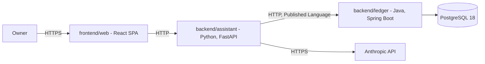

<div align="center">

# FinAssist

**A personal finance system for one owner: track the money, ask questions about it in plain
language, and analyse the portfolio behind it.**

[](https://github.com/NaimElijah/FinAssist/actions/workflows/ci.yml)
[](LICENSE)

[Requirements](docs/requirements/requirements.md) · [Architecture](docs/architecture/architecture.md) · [ADRs](docs/ADRs/) · [Changelog](CHANGELOG.md)

</div>

> [!IMPORTANT]
> **All six bounded contexts have a domain and an application layer.** The ledger is persisted in
> PostgreSQL and served over HTTP — accounting, budgeting and planning under `/api/v1`, with a
> published OpenAPI contract — and answers its Actuator health probes. The assistant has no HTTP
> API yet, and the web client renders a placeholder. See
> [Known limitations](#status-and-limitations) for what does not exist yet.

## Contents

[What and why](#what-and-why) · [Scope](#scope) · [Quick start](#quick-start) ·
[Tech stack](#tech-stack) · [Architecture](#architecture) ·
[Project structure](#project-structure) · [Development](#development) ·
[Testing](#testing) · [Configuration](#configuration) ·
[Design decisions](#design-decisions) · [Status](#status-and-limitations)

This README is ordered for a contributor rather than an evaluator — Quick start comes before
Architecture — because the project has one owner and no external audience yet.

## What and why

Personal finance tools generally do one of three things well: they record transactions, they
answer questions, or they analyse holdings. Using three of them means the answers come from
whichever tool happens to hold the data, and nothing reconciles them. FinAssist keeps one
ledger as the record of truth and puts both the natural-language assistant and the portfolio
analysis on top of that same ledger, so an answer and a balance cannot disagree.

It is deliberately not financial advice, not a multi-tenant product, and not a system that
moves money — it records and explains, and nothing more. See
[non-goals](docs/requirements/requirements.md#non-goals).

## Scope

There is no feature list, because there are no features yet — listing one here that is
absent from the code would be a bug report waiting to be filed. The confirmed scope is three
capability areas:

- **Tracking** — accounts, transactions, categorisation, budgets.
- **Assistance** — natural-language questions answered over the owner's own ledger data.
- **Analysis** — portfolio composition and performance over holdings.

The requirements within each are not yet written. See
[requirements](docs/requirements/requirements.md), and the
[open questions](docs/requirements/requirements.md#open-questions) that gate them.

## Quick start

**Prerequisites:** Docker with Compose v2 — needed to run the stack, and now also to run the
ledger's test suite, which drives the store against a real PostgreSQL and fails rather than
skips when Docker is absent ([ADR-025](docs/ADRs/ADR-025-integration-tests-on-testcontainers.md)).
For the native inner loop you also want a JDK 21 and [uv](https://docs.astral.sh/uv/) — uv
fetches its own Python 3.13, so no system Python upgrade is needed.

```bash
git clone https://github.com/NaimElijah/FinAssist.git
cd FinAssist
cp .env.example .env        # then set POSTGRES_PASSWORD and LEDGER_DB_PASSWORD to the same
                            # value; Compose refuses to start either service without them
docker compose up --build
```

That starts PostgreSQL 18 and the ledger — the only two services in the Compose file so far.
The ledger applies its Flyway migrations at start-up, then answers its API and its Actuator
probes, published on `127.0.0.1` only (ADR-027):

```bash
curl http://127.0.0.1:8080/actuator/health
# {"groups":["liveness","readiness"],"status":"UP"}
curl http://127.0.0.1:8080/api/v1/accounts
# []
```

For the faster native inner loop, run the ledger outside Compose against the same database:

```bash
docker compose up -d db
cd backend/ledger && ./mvnw spring-boot:run
```

The web client runs too, and renders a placeholder:

```bash
cd frontend/web && npm ci && npm run dev   # http://localhost:5173
```

> [!NOTE]
> `make` is a convenience here, not a prerequisite, and it is not installed on the author's
> Windows machine. Every target is a one-line wrapper — the raw command is given alongside
> it throughout this README, and in the [Makefile](Makefile) itself. See
> [ADR-005](docs/ADRs/ADR-005-docker-compose-as-the-run-mechanism.md).

## Tech stack

| Layer | Technology | Version | Why |
|---|---|---:|---|
| Ledger language | Java | 21 (LTS) | Records and sealed types make illegal ledger states unrepresentable rather than merely tested |
| Ledger framework | Spring Boot | 4.1.1 | Actuator gives health, readiness and metrics without bespoke code; the domain stays framework-free |
| Ledger build | Maven (wrapper) | 3.9.6 | Committed wrapper, so a clone needs only a JDK |
| Ledger format | Spotless + palantir-java-format | 3.10.1 / 2.97.0 | One authoritative formatter; `spotless:check` gates CI |
| Assistant language | Python | 3.13 | Native home for the Anthropic SDK and the pandas numerical stack |
| Assistant framework | FastAPI | 0.141.1 | Typed request and response validation from the same Pydantic models the domain uses |
| Assistant packaging | uv | 0.12.7 | Resolves, locks and fetches the interpreter in one pinned tool |
| Assistant lint, format, types | Ruff + mypy | 0.16.5 / 2.3.1 | Ruff replaces flake8 + isort + black; mypy runs `--strict` |
| Ledger architecture tests | ArchUnit | 1.5.0 | Layering, context isolation, the no-floating-point-money rule, and the two rules fencing the composition root, all fail the build |
| Coverage | JaCoCo + pytest-cov + coverage-v8 | 0.8.13 / 7.1.0 / 4.1.11 | Measured in all three codebases, published by CI, gating nothing ([ADR-017](docs/ADRs/ADR-017-test-strategy.md)) |
| Mutation testing | PIT | 1.19.1 | Answers what coverage cannot: would a test notice this line being wrong? Opt-in profile, not in CI |
| Property-based tests | Seeded `Random` (Java) + Hypothesis (Python) | — / 6.167.0 | Deterministic on both sides. jqwik is unusable on JUnit Platform 6; see ADR-017 |
| Telemetry | OpenTelemetry + Micrometer | 1.44.0 (Python) / 4.1.1 starter (Java) | Vendor-neutral by decision: the backend is an environment variable, not a rewrite ([ADR-019](docs/ADRs/ADR-019-opentelemetry-and-structured-logging.md)) |
| Monitoring | OTel Collector + Prometheus + Grafana | 0.139.0 / v3.7.3 / 12.3.1 | Local only, behind a Compose profile; dashboards provisioned from files, never clicked in |
| Web framework | React + Vite | 19.2 / 8.2 | A static bundle; no Node server to operate for a single-owner tool |
| Web language | TypeScript | 6.0.3 | Pinned below 7 because `typescript-eslint` caps at `<6.1.0`; type-aware linting is worth more than the newer compiler |
| Web test, lint, format | Vitest + Testing Library + ESLint + Prettier | 4.1 / 16.3 / 10.9 / 3.9 | Type-aware rules; they caught a `HeadersInit` bug before any code used it, and there is now a test for it |
| Store | PostgreSQL | 18.6 | `NUMERIC` for exact money, and real constraints behind the domain's own |

Every version above is pinned in `backend/ledger/pom.xml`, `backend/assistant/pyproject.toml`,
`backend/assistant/uv.lock` or `docker-compose.yml` — not in this table.

## Architecture

Two independently deployable backend services, a web client, and a database. The ledger owns
the records; the assistant reads them through the ledger's API, never its database.



`DB` and the ledger both run under Compose now, and `Ledger --> DB` is real: the ledger serves
its side of the `Assistant -> Ledger` edge under `/api/v1`, with an OpenAPI document to prove it
([contracts/ledger-v1.openapi.json](contracts/ledger-v1.openapi.json)). Nothing calls it yet —
the assistant has no ledger client, and the web client still renders a placeholder and calls
neither service.

**Six bounded contexts**, each owned by exactly one service, each one directory
([ADR-010](docs/ADRs/ADR-010-bounded-context-map.md), extended by
[ADR-015](docs/ADRs/ADR-015-planning-as-a-sixth-bounded-context.md)):

| Context | Owner | UI feature |
|---|---|---|
| `accounting` — accounts, entries, balances | ledger | yes |
| `budgeting` — budgets, categories, rules | ledger | yes |
| `portfolio` — holdings, positions, valuation | assistant | yes |
| `assistance` — questions and grounded answers | assistant | yes |
| `marketdata` — instruments and quotes, feed not chosen | assistant | no |
| `planning` — planned flows, projections, strategy comparison | ledger | not yet built |

Both services are hexagonal, but **only the ledger uses tactical DDD** — aggregates,
value objects and domain events protect invariants, and the analysis side has none to
protect ([ADR-007](docs/ADRs/ADR-007-asymmetric-hexagonal-architecture.md)). The assistant
gets ports and a pure-function core instead.

In strategic DDD terms the ledger is the upstream **Supplier**, the OpenAPI contract is the
**Published Language**, and `adapters/outbound/ledger/` is the assistant's
**anti-corruption layer** — the one place a ledger DTO may be translated into the
assistant's own model. Nothing inward may reach it, and that is asserted per package rather
than assumed.

Dependency direction is enforced by the build on both sides: ArchUnit in the ledger,
subprocess import tests in the assistant.

Full description: [docs/architecture/architecture.md](docs/architecture/architecture.md).
Rationale: [docs/ADRs/](docs/ADRs/).

## Project structure

Context first, hexagon inside: a context is one directory and can be extracted by moving it.

```
backend/ledger/         Java 21 + Spring Boot - full tactical DDD; sole writer of the store
  accounting/             domain/{account,entry,event}/ application/{port/in,port/out,service}/
                          adapter/{in/web,out/persistence}/
  budgeting/              same hexagon, its own aggregates
  planning/               domain/{plan,forecast}/ - what is intended, never what happened
  shared/                 Money, Currency - in-language kernel
  composition/            Spring wiring, and the two cross-context translations
backend/assistant/      Python 3.13 + FastAPI - pure-function cores, no aggregates
  portfolio/              domain/{model,analysis}/ application/{port,usecase}/
                          adapters/{inbound/api,outbound/ledger}/   <- the ACL
  assistance/             ... adapters/outbound/llm/
  marketdata/             ... adapters/outbound/feed/               <- ACL, no feed chosen
  shared/
frontend/web/           React 19 + Vite 8 - one feature per user-facing context
  src/features/           accounting/ budgeting/ portfolio/ assistance/
  src/shared/             ui/ api/ lib/
  src/app/                the only place that knows every feature at once
contracts/              Versioned OpenAPI contract - the Published Language
docs/                   requirements/, architecture/, ADRs/ - read before proposing work
.github/                CI workflow and Dependabot configuration
```

Java packages sit under `backend/ledger/src/main/java/io/github/naimelijah/finassist/ledger/`;
Python packages under `backend/assistant/src/finassist_assistant/`.

## Development

The Makefile is the single definition of every command; CI calls the same targets, so the
pipeline and the local commands cannot drift.

| Task | Make target | Raw command |
|---|---|---|
| Set up | `make setup` | `cd backend/ledger && ./mvnw -B dependency:go-offline`; `cd backend/assistant && uv sync --locked --extra dev`; `cd frontend/web && npm ci` |
| Run | `make run` | `docker compose up --build` |
| Run with monitoring | `make run-monitoring` | `docker compose --profile monitoring up --build` |
| Test everything | `make test` | the three test rows below; all three measure coverage |
| Test the ledger | `make test-ledger` | `cd backend/ledger && ./mvnw -B verify` |
| Test the assistant | `make test-assistant` | `cd backend/assistant && uv run pytest --cov --cov-report=term-missing --cov-report=xml` |
| Test the web client | `make test-web` | `cd frontend/web && npm run test:coverage` |
| Build the web bundle | `make build-web` | `cd frontend/web && npm run build` |
| Mutation-test the ledger | `make mutation-ledger` | `cd backend/ledger && ./mvnw -Pmutation test-compile org.pitest:pitest-maven:mutationCoverage` |
| Lint and types | `make lint` | `./mvnw -B spotless:check`; `uv run ruff check .`, `ruff format --check .`, `mypy src tests`; `npm run lint`, `format:check`, `typecheck` |
| Format | `make format` | `./mvnw -B spotless:apply`; `uv run ruff format .`; `npm run format` |
| Audit | `make audit` | `cd backend/assistant && uv run pip-audit`; `cd frontend/web && npm audit --audit-level=high` |
| Re-lock Python deps | `make lock` | `cd backend/assistant && uv lock` |
| Regenerate the ledger's OpenAPI contract | — | `cd backend/ledger && ./mvnw -B verify -Dtest=NONE -Dsurefire.failIfNoSpecifiedTests=false -Dit.test=LedgerContractIT` (Docker running); on a mismatch, copy `target/contracts/ledger-v1.openapi.json` over `contracts/ledger-v1.openapi.json` |

Commits follow [Conventional Commits](https://www.conventionalcommits.org/)
(`type(scope): imperative subject`, subject under 72 characters); branches are
`type/short-kebab-description`. Documentation changes ship in the same commit as the
behaviour they describe.

> [!WARNING]
> Editing `backend/assistant/pyproject.toml` dependencies without running `make lock` will fail CI,
> which installs with `uv sync --locked` and refuses a stale lockfile.

## Testing

| Layer | Covers | Command |
|---|---|---|
| Ledger architecture | Layering, **context isolation**, framework-free domain and application layers (now also forbidding Jackson 3, springdoc and Swagger types), no floating-point money, no aggregate cycles, a one-way composition root, a controller reaching only its in-ports, an outbound adapter never reaching an inbound one, and DTO simple-name uniqueness across contexts (ArchUnit, 10 rules — live, not dormant) | `make test-ledger` |
| Ledger domain | The balancing invariant, the transaction lifecycle, derived balances, budget limits, planned flows, projections and comparison, Money and Currency | `make test-ledger` |
| Ledger properties | Money's algebraic laws and Recurrence's date arithmetic, over generated inputs from a fixed seed | `make test-ledger` |
| Ledger store | Every repository against a **real PostgreSQL** in Testcontainers: the ordering both journal queries promise, the unique index that makes an account name atomic, the sealed `Recurrence` and `PlanState` round trips, and `numeric` preserving a JPY amount at scale 0 | `make test-ledger` |
| Ledger audit trail | The database refuses an `UPDATE` or a `DELETE` on a recorded transaction, its entries or its states, and a lifecycle change appends rather than overwrites ([ADR-020](docs/ADRs/ADR-020-audit-trail-follows-persistence.md)) | `make test-ledger` |
| Ledger schema boundaries | No foreign key crosses a schema, so context isolation holds in the database as well as in the bytecode | `make test-ledger` |
| Ledger smoke | The context loads and the Actuator health, liveness and readiness probes answer `UP` | `make test-ledger` |
| Assistant architecture | Every source file is parsed: no inward module imports a framework or the adapters, no module imports another context, no domain module names `float` or reads the wall clock. The scanner itself is unit-tested | `make test-assistant` |
| Assistant domain | FIFO cost basis, the grounding rule, quote staleness, Money and Currency | `make test-assistant` |
| Assistant properties | The same Money laws, plus FIFO conservation, via Hypothesis run derandomised | `make test-assistant` |
| Cross-language | Both `Money` kernels read `contracts/money-vectors.v1.json`, so a divergence fails a build ([ADR-018](docs/ADRs/ADR-018-cross-language-money-vectors.md)) | `make test-ledger`, `make test-assistant` |
| Web architecture | No feature imports another; `shared` imports no feature | `make test-web` |
| Web unit | The HTTP client's failure contracts and `Accept` header, and a jsdom render of the app shell | `make test-web` |

Deliberately absent are running test counts. Every commit that adds a source file changes the
parametrised architecture case count, so a number here would be wrong by the next pull request
and nothing checks it.

Every architecture rule above was verified by introducing a deliberate violation, confirming
the build failed, and reverting — a rule that has never failed is not evidence of anything.

All three are **static**: ArchUnit scans bytecode, the assistant parses sources with `ast`,
the web client walks the file tree. An earlier version of the assistant's rules imported
packages and read `sys.modules`, which was blind to anything outside an `__init__.py` —
review caught it, and the fix is in this repository's history rather than in a comment.

> [!NOTE]
> The ledger's ArchUnit rules are **live**. `archunit.properties`, and with it the
> `archRule.failOnEmptyShould=false` escape hatch, was deleted alongside the first domain class,
> so a rule matching nothing now fails rather than passing quietly.

Tests are named `Given<scenario>_When<action>_Then<result>` — the reason Ruff's `N802` is
disabled for `tests/**`, with the justification recorded in `backend/assistant/pyproject.toml`.

**What CI gates on:** every push and pull request to `main` and `dev` must pass four jobs —
the ledger's format check and build; the assistant's lint, format check, `mypy --strict`,
tests and `pip-audit`; the web client's lint, format check, typecheck, tests and production
build; and a `docker compose config` validation.

**Coverage is measured everywhere and gates nothing.** JaCoCo, `pytest-cov` and
`@vitest/coverage-v8` run as part of the test targets, and each CI job publishes its report as
a build artefact. There is no threshold in any of the three, by decision rather than by
oversight ([ADR-017](docs/ADRs/ADR-017-test-strategy.md)) — coverage counts lines that ran, and
says nothing about whether a test would notice them being wrong.

**What answers that question is mutation testing**, on demand and also gated on nothing:

```bash
cd backend/ledger && ./mvnw -Pmutation test-compile org.pitest:pitest-maven:mutationCoverage
```

It earned its place on the first run, finding that deleting `requireSameCurrency` from
`Money.minus` broke no test — the cross-currency refusal was asserted for `plus` and
`compareTo` and never for `minus`, in either language.

## Configuration

Copy `.env.example` to `.env` and fill it in. `.env` is git-ignored; no value in it belongs
in the repository, the logs or an error message.

| Variable | Purpose | Default | Required |
|---|---|---|---|
| `POSTGRES_PASSWORD` | Database password | none | **Yes** — Compose refuses to start without it |
| `POSTGRES_DB` | Database name | `finassist` | No |
| `POSTGRES_USER` | Database user | `finassist` | No |
| `LEDGER_DB_PASSWORD` | Ledger database password. The ledger connects as the role Compose creates, so this must match `POSTGRES_PASSWORD` until it gets its own role | none | **Yes** — the ledger refuses to start without it |
| `ANTHROPIC_API_KEY` | The LLM behind the assistant | none | Once the assistant exists |
| `GRAFANA_ADMIN_PASSWORD` | Grafana admin password | none | **Yes** when using the `monitoring` profile |

<details>

<summary>The remaining variables</summary>

| Variable | Purpose | Default |
|---|---|---|
| `LEDGER_PORT` | Ledger HTTP port | `8080` |
| `LEDGER_ADDRESS` | Interface the ledger binds. Loopback by default, because the ledger has no authentication; `0.0.0.0` only inside a container ([ADR-027](docs/ADRs/ADR-027-defer-authentication-and-bind-to-loopback.md)) | `127.0.0.1` |
| `LEDGER_ALLOWED_HOSTS` | Comma-separated host names the ledger answers to, without ports. Any other `Host` header is refused with 403, which stops a DNS-rebound page in the owner's browser ([ADR-027](docs/ADRs/ADR-027-defer-authentication-and-bind-to-loopback.md)) | `localhost,127.0.0.1` |
| `LEDGER_DB_URL` | JDBC URL. Compose sets this itself, to the service name `db`, for the `ledger` container; this default targets a native `./mvnw spring-boot:run` at the Compose `db` service's published port | `jdbc:postgresql://localhost:5432/finassist` |
| `LEDGER_DB_USERNAME` | Ledger database user | `finassist` |
| `ASSISTANT_PORT` | Assistant HTTP port | `8000` |
| `LEDGER_BASE_URL` | Where the assistant reaches the ledger | `http://ledger:8080` |
| `POSTGRES_PORT` | Host port mapped to Postgres. Change it, and `LEDGER_DB_URL` with it, if something already owns 5432 — a natively installed PostgreSQL will otherwise answer instead of the container | `5432` |
| `OTEL_EXPORTER_OTLP_ENDPOINT` | Collector base URL; each service appends its own signal path | `http://localhost:4318` |
| `OTEL_EXPORT_ENABLED` | Whether to export telemetry at all — traces and metrics both. Paired with the endpoint so a stale one goes quiet rather than retrying | `false` |
| `ASSISTANT_LOG_LEVEL` | Threshold for the assistant's structured logger; one of `DEBUG`, `INFO`, `WARNING`, `ERROR`, `CRITICAL` | `INFO` |
| `ASSISTANT_HOST` | Interface the assistant binds. Loopback by default — nothing runs it in a container yet | `127.0.0.1` |
| `OTLP_HTTP_PORT`, `OTLP_GRPC_PORT` | Host ports for the collector | `4318`, `4317` |
| `PROMETHEUS_PORT`, `GRAFANA_PORT` | Host ports for the monitoring profile | `9090`, `3000` |

</details>

## Deployment and operations

Not deployed anywhere, and there is no target environment or migration strategy yet —
stating one here would be fiction. `./mvnw package` produces an executable jar, which is the
only build artefact that exists.

| Concern | Endpoint or format | State |
|---|---|---|
| Liveness | `GET /actuator/health/liveness` (ledger), `GET /health` (assistant) | Live, returns `UP` |
| Readiness | `GET /actuator/health/readiness` (ledger), `GET /ready` (assistant) | Live, returns `UP` |
| Metrics | `GET /actuator/metrics`, `GET /actuator/prometheus` | Live, and scraped by the monitoring profile; no domain metric yet |
| Traces | OTLP to `$OTEL_EXPORTER_OTLP_ENDPOINT` | Live when `OTEL_EXPORT_ENABLED=true`; dropped otherwise, and the services start either way |
| Logs | JSON on stdout, carrying a W3C trace id | Live — ECS in the ledger, structlog in the assistant. Redaction is enforced in the assistant and the web client, where the secrets are; the ledger holds none and does not expose `/actuator/env` |
| Dashboards | Grafana, provisioned from `ops/grafana/` | Live under the `monitoring` profile |
| Audit trail | The append-only journal | Live — the database refuses an `UPDATE` or a `DELETE` on a recorded transaction, its entries or its states; a lifecycle change appends rather than overwrites ([ADR-020](docs/ADRs/ADR-020-audit-trail-follows-persistence.md), [ADR-024](docs/ADRs/ADR-024-jdbc-persistence-and-append-only-schema.md)) |
| Ledger API | `GET/POST /api/v1/...`; OpenAPI document at `GET /v3/api-docs`, pinned as [`contracts/ledger-v1.openapi.json`](contracts/ledger-v1.openapi.json) | Live for accounting, budgeting and planning; nothing calls it yet |

Run the telemetry backend with `docker compose --profile monitoring up`: Grafana on
[localhost:3000](http://localhost:3000), Prometheus on
[localhost:9090](http://localhost:9090), and an OTLP collector on `localhost:4318`. Point the
ledger at it with `OTEL_EXPORTER_OTLP_ENDPOINT=http://localhost:4318
OTEL_EXPORT_ENABLED=true ./mvnw spring-boot:run`. Traces are printed by the collector
(`docker compose logs otel-collector`) rather than stored — there is no trace backend, which
[ADR-019](docs/ADRs/ADR-019-opentelemetry-and-structured-logging.md) records as a deliberate
limit.

## Design decisions

**Two languages instead of one**
([ADR-001](docs/ADRs/ADR-001-polyglot-java-python-split.md)) — the ledger is
invariant-heavy and suits Java's sealed types; the assistant and analysis are ecosystem-heavy
and have no Java peer libraries. The single-language recommendation was Python only; the
owner chose the split knowingly. Cost: two toolchains, two CI jobs and a versioned wire
contract before any feature exists. The ADR records the concrete threshold for collapsing
back to one language.

**Double-entry bookkeeping**
([ADR-011](docs/ADRs/ADR-011-double-entry-bookkeeping.md)) — a transaction's entries must sum to
zero, checked in the constructor, so an unbalanced one is never constructed. Balances are
derived by summing entries; there is no balance field to drift. Single entry was rejected
because it leaves the domain almost nothing to enforce, which would make ADR-001's reason for
choosing Java here hollow. Cost: every purchase needs a category account to balance against, so
a bare "I spent 12.50" is not expressible.

**Context first, hexagon inside**
([ADR-010](docs/ADRs/ADR-010-bounded-context-map.md)) — six bounded contexts, each one
directory with its own hexagon, so a context is extractable by moving it. No context may
depend on another; that rule is enforced in all three codebases and was proved by making it
fail. The alternative — layers on top, contexts nested inside — leaves a context's code in
three distant trees and lets cross-context imports accumulate unopposed. Cost: deeper nesting,
and `shared` is exempt, so it is where coupling can still accrue quietly.

**Tactical DDD in the ledger only**
([ADR-007](docs/ADRs/ADR-007-asymmetric-hexagonal-architecture.md)) — aggregates and value
objects exist to protect invariants. The ledger is dense with them; computing a rolling
return protects nothing, so aggregates there would wrap dataframes in DDD vocabulary.
Alternatives were symmetric DDD in both services, and a strategic split by bounded context.
Cost: two mental models in one repository, and `Money` implemented twice with no compiler to
catch divergence.

**Compose is the mechanism, the Makefile only an interface**
([ADR-005](docs/ADRs/ADR-005-docker-compose-as-the-run-mechanism.md)) — the development
machine has no `make`, no `just` and no `bash` on `PATH`, so a Makefile alone would document
commands that do not run where they were written. Cost: the logic is split across two files,
and containers iterate more slowly than native runs.

**`backend/` and `frontend/` at the root**
([ADR-008](docs/ADRs/ADR-008-backend-frontend-root-layout.md)) — one home per tier, once a web
client joined. The cost was accepted knowingly: the grouping carries no domain meaning and
implies the ledger and assistant are one layer, when they are separate contexts in separate
languages talking over a versioned contract.

**The assistant never touches the ledger's database**
([ADR-004](docs/ADRs/ADR-004-http-openapi-service-contract.md), Accepted) — a shared
database would be the cheapest thing to build and the most expensive to own. Cost: JSON over
HTTP carries no runtime schema, and contract drift is silent until CI compares the documents.

## Status and limitations

**Pre-alpha.** Shipped: the repository baseline and architecture, plus the **domain and
application layers of all six bounded contexts** with the invariants and tests that make them
real — double-entry accounting, periodic budgets, FIFO cost basis, grounded answers, quote
staleness, deterministic projections and strategy comparison, and `Money` in both languages.
Use cases sit behind ports and are wired by constructor, and the ledger's are backed by
**PostgreSQL**: a schema per bounded context, Flyway migrations, hand-written SQL, and a journal
the database itself refuses to rewrite. **The ledger now serves accounting, budgeting and
planning over HTTP** under `/api/v1`, behind a Host allow-list and problem+json error handling,
with its generated OpenAPI document pinned by `LedgerContractIT` and published as
[`contracts/ledger-v1.openapi.json`](contracts/ledger-v1.openapi.json); it runs under Compose as
well as natively. Twenty-nine ADRs. Every architecture rule is live rather than dormant, and each
was confirmed to fail against a planted violation — including dropping the append-only trigger and
planting a foreign key across a schema boundary. CI gates build, lint, format and dependency audit
across four jobs, and publishes a coverage report from each.

Planned next, in order: resolve the
[open questions](docs/requirements/requirements.md#open-questions), give the assistant a ledger
client behind its own `LedgerPort`, then build the web client's first screen against the
ledger's published contract. That is what stands between this and the first tracking slice end
to end.

Known limitations:

- **The ledger's HTTP API has no caller yet.** It serves accounting, budgeting and planning
  under `/api/v1`, with an OpenAPI document pinned by `LedgerContractIT`, but the assistant has
  no ledger client — `LedgerPort` is still an in-memory stand-in — and the web client renders a
  placeholder and calls neither service.
- **The audit trail cannot say who.** The journal records what changed, when and — for a voided
  transaction — why, and the database refuses to let any of it be rewritten. It records no actor,
  because there is no authentication to name one. That gap is
  [ADR-020](docs/ADRs/ADR-020-audit-trail-follows-persistence.md)'s, stated in advance rather
  than discovered.
- **Docker is required to test the ledger**, not only to run it. The store is tested against a
  real PostgreSQL, and the suite fails rather than skipping when no daemon answers
  ([ADR-025](docs/ADRs/ADR-025-integration-tests-on-testcontainers.md)).
- **Domain events have no subscriber.** They are raised, recorded in an append-only in-memory
  log and asserted by tests, and read by no production code. That is the cost
  [ADR-023](docs/ADRs/ADR-023-domain-events-in-the-ledger.md) accepts, with the trigger that
  discharges it.
- **`AnswerQuestion` is written and not wired.** An LLM adapter would decide by implication
  whether the owner's financial data may be sent to a third-party API, which is the project's
  central open question and belongs in its own ADR.
- **Six contexts is a guess.** They are derived from the four capability areas, not from a
  working slice, and some may turn out to be wrong boundaries. ADR-010 names the signal:
  contexts that always change together should be merged.
- **`planning` sits in the ledger against ADR-007's own criterion.** Forecasting is
  transformation-dense, which is the assistant's profile, and it was placed in the ledger for
  its lifecycle and its future persistence. If `PlanState` goes unused, the context belongs in
  Python ([ADR-015](docs/ADRs/ADR-015-planning-as-a-sixth-bounded-context.md)).
- **A projection is a single deterministic line.** It states no uncertainty, so a long-horizon
  figure looks far more precise than it is
  ([ADR-016](docs/ADRs/ADR-016-deterministic-per-currency-projection.md)).
- **Shortfall detection sees only step boundaries.** An overdraft that opens and closes within
  one step goes unreported — a big payment covered by a salary later the same month reads as
  untroubled at a monthly cadence. Pinned by a test, narrowed by projecting more finely, closed
  by nothing yet.
- **`consume_fifo` still trusts the caller's lot order**, but the caller no longer trusts
  itself: `DisposeUnits` sorts by acquisition date before calling it, and a test hands it lots
  newest-first to prove the difference between a 1000.00 cost of sale and a 2000.00 one. The
  domain function's contract is unchanged, so reaching past the use case still gets LIFO
  ([ADR-013](docs/ADRs/ADR-013-fifo-lot-based-cost-basis.md)).
- **The grounding rule checks a citation points at evidence that was gathered, not that it
  supports the figure.** `AnswerQuestion` now drops a citation naming a record the answer was
  never given, so a wholly invented reference no longer grounds anything — but a model citing a
  *real* balance while stating a different number still passes
  ([ADR-014](docs/ADRs/ADR-014-grounded-answers-require-citations.md)).
- **No cross-currency total is possible**, by design — so there is no single net-worth figure
  across accounts in different currencies, and a projection covers one currency only
  ([ADR-012](docs/ADRs/ADR-012-multi-currency-without-conversion.md)).
- **`marketdata` has no feed.** The anti-corruption layer exists; nothing sits behind it,
  because no price source has been chosen or licence-checked.
- **TypeScript is one minor behind.** Pinned to 6.0.3 because `typescript-eslint` 8 caps at
  `<6.1.0`; lifts when it supports 7.
- **The Postgres image tag, and the monitoring services' tags, are bumped by hand.** Dependabot's
  `docker` ecosystem covers the ledger's own Dockerfile; there is still no `docker-compose`
  ecosystem for the image tags named directly in `docker-compose.yml`.

## Licence

Proprietary — all rights reserved. See [LICENSE](LICENSE).
