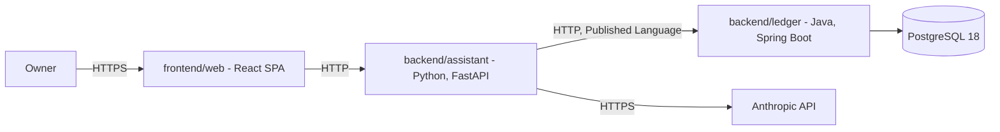

<div align="center">

# FinAssist

**A personal finance system for one owner: track the money, ask questions about it in plain
language, and analyse the portfolio behind it.**

[](https://github.com/NaimElijah/FinAssist/actions/workflows/ci.yml)
[](LICENSE)

[Requirements](docs/requirements/requirements.md) · [Architecture](docs/architecture/architecture.md) · [ADRs](docs/ADRs/) · [Changelog](CHANGELOG.md)

</div>

> [!IMPORTANT]
> **This is a skeleton.** Three codebases build, lint, type-check and test, and CI gates all
> of it. The ledger boots and answers its Actuator health probes; the assistant has no entry
> point; the web client renders a placeholder. No bounded context has domain code yet.
> Everything below describes what exists on `main`. Planned work appears only under
> [Status and limitations](#status-and-limitations).

## Contents

[What and why](#what-and-why) · [Scope](#scope) · [Quick start](#quick-start) ·
[Tech stack](#tech-stack) · [Architecture](#architecture) ·
[Project structure](#project-structure) · [Development](#development) ·
[Testing](#testing) · [Configuration](#configuration) ·
[Design decisions](#design-decisions) · [Status](#status-and-limitations)

This README is ordered for a contributor rather than an evaluator — Quick start comes before
Architecture — because the project has one owner and no external audience yet.

## What and why

Personal finance tools generally do one of three things well: they record transactions, they
answer questions, or they analyse holdings. Using three of them means the answers come from
whichever tool happens to hold the data, and nothing reconciles them. FinAssist keeps one
ledger as the record of truth and puts both the natural-language assistant and the portfolio
analysis on top of that same ledger, so an answer and a balance cannot disagree.

It is deliberately not financial advice, not a multi-tenant product, and not a system that
moves money — it records and explains, and nothing more. See
[non-goals](docs/requirements/requirements.md#non-goals).

## Scope

There is no feature list, because there are no features yet — listing one here that is
absent from the code would be a bug report waiting to be filed. The confirmed scope is three
capability areas:

- **Tracking** — accounts, transactions, categorisation, budgets.
- **Assistance** — natural-language questions answered over the owner's own ledger data.
- **Analysis** — portfolio composition and performance over holdings.

The requirements within each are not yet written. See
[requirements](docs/requirements/requirements.md), and the
[open questions](docs/requirements/requirements.md#open-questions) that gate them.

## Quick start

**Prerequisites:** Docker with Compose v2. That is enough to run what currently runs.
For the native inner loop you also want a JDK 21 and [uv](https://docs.astral.sh/uv/) — uv
fetches its own Python 3.13, so no system Python upgrade is needed.

```bash
git clone https://github.com/NaimElijah/FinAssist.git
cd FinAssist
cp .env.example .env        # then set POSTGRES_PASSWORD; Compose refuses to start without it
docker compose up
```

That starts PostgreSQL 18 and nothing else — it is the only service in the Compose file so
far. Success looks like `pg_isready` passing on the `db` container within a few seconds.

The ledger runs natively, and answers health probes and nothing else:

```bash
cd backend/ledger && ./mvnw spring-boot:run
curl http://localhost:8080/actuator/health
# {"groups":["liveness","readiness"],"status":"UP"}
```

The web client runs too, and renders a placeholder:

```bash
cd frontend/web && npm ci && npm run dev   # http://localhost:5173
```

> [!NOTE]
> `make` is a convenience here, not a prerequisite, and it is not installed on the author's
> Windows machine. Every target is a one-line wrapper — the raw command is given alongside
> it throughout this README, and in the [Makefile](Makefile) itself. See
> [ADR-005](docs/ADRs/ADR-005-docker-compose-as-the-run-mechanism.md).

## Tech stack

| Layer | Technology | Version | Why |
|---|---|---:|---|
| Ledger language | Java | 21 (LTS) | Records and sealed types make illegal ledger states unrepresentable rather than merely tested |
| Ledger framework | Spring Boot | 4.1.1 | Actuator gives health, readiness and metrics without bespoke code; the domain stays framework-free |
| Ledger build | Maven (wrapper) | 3.9.6 | Committed wrapper, so a clone needs only a JDK |
| Ledger format | Spotless + palantir-java-format | 3.10.1 / 2.97.0 | One authoritative formatter; `spotless:check` gates CI |
| Assistant language | Python | 3.13 | Native home for the Anthropic SDK and the pandas numerical stack |
| Assistant framework | FastAPI | 0.141.1 | Typed request and response validation from the same Pydantic models the domain uses |
| Assistant packaging | uv | 0.12.7 | Resolves, locks and fetches the interpreter in one pinned tool |
| Assistant lint, format, types | Ruff + mypy | 0.16.5 / 2.3.1 | Ruff replaces flake8 + isort + black; mypy runs `--strict` |
| Ledger architecture tests | ArchUnit | 1.5.0 | Layering, context isolation and the no-floating-point-money rule fail the build |
| Web framework | React + Vite | 19.2 / 8.2 | A static bundle; no Node server to operate for a single-owner tool |
| Web language | TypeScript | 6.0.3 | Pinned below 7 because `typescript-eslint` caps at `<6.1.0`; type-aware linting is worth more than the newer compiler |
| Web test, lint, format | Vitest + ESLint + Prettier | 4.1 / 10.9 / 3.9 | Type-aware rules; they caught a `HeadersInit` bug before any code used it |
| Store | PostgreSQL | 18.6 | `NUMERIC` for exact money, and real constraints behind the domain's own |

Every version above is pinned in `backend/ledger/pom.xml`, `backend/assistant/pyproject.toml`,
`backend/assistant/uv.lock` or `docker-compose.yml` — not in this table.

## Architecture

Two independently deployable services and a database. The ledger owns the records; the
assistant reads them through the ledger's API, never its database.



`DB` runs under Compose and the ledger boots with Actuator only. No edge in that diagram is
implemented.

**Five bounded contexts**, each owned by exactly one service, each one directory
([ADR-010](docs/ADRs/ADR-010-bounded-context-map.md)):

| Context | Owner | UI feature |
|---|---|---|
| `accounting` — accounts, entries, balances | ledger | yes |
| `budgeting` — budgets, categories, rules | ledger | yes |
| `portfolio` — holdings, positions, valuation | assistant | yes |
| `assistance` — questions and grounded answers | assistant | yes |
| `marketdata` — instruments and quotes, feed not chosen | assistant | no |

Both services are hexagonal, but **only the ledger uses tactical DDD** — aggregates,
value objects and domain events protect invariants, and the analysis side has none to
protect ([ADR-007](docs/ADRs/ADR-007-asymmetric-hexagonal-architecture.md)). The assistant
gets ports and a pure-function core instead.

In strategic DDD terms the ledger is the upstream **Supplier**, the OpenAPI contract is the
**Published Language**, and `adapters/outbound/ledger/` is the assistant's
**anti-corruption layer** — the one place a ledger DTO may be translated into the
assistant's own model. Nothing inward may reach it, and that is asserted per package rather
than assumed.

Dependency direction is enforced by the build on both sides: ArchUnit in the ledger,
subprocess import tests in the assistant.

Full description: [docs/architecture/architecture.md](docs/architecture/architecture.md).
Rationale: [docs/ADRs/](docs/ADRs/).

## Project structure

Context first, hexagon inside: a context is one directory and can be extracted by moving it.

```
backend/ledger/         Java 21 + Spring Boot - full tactical DDD; sole writer of the store
  accounting/             domain/{account,entry,event}/ application/{port/in,port/out,service}/
                          adapter/{in/web,out/persistence}/
  budgeting/              same hexagon, its own aggregates
  shared/                 Money, Currency - in-language kernel
backend/assistant/      Python 3.13 + FastAPI - pure-function cores, no aggregates
  portfolio/              domain/{model,analysis}/ application/{port,usecase}/
                          adapters/{inbound/api,outbound/ledger}/   <- the ACL
  assistance/             ... adapters/outbound/llm/
  marketdata/             ... adapters/outbound/feed/               <- ACL, no feed chosen
  shared/
frontend/web/           React 19 + Vite 8 - one feature per user-facing context
  src/features/           accounting/ budgeting/ portfolio/ assistance/
  src/shared/             ui/ api/ lib/
  src/app/                the only place that knows every feature at once
contracts/              Versioned OpenAPI contract - the Published Language
docs/                   requirements/, architecture/, ADRs/ - read before proposing work
.github/                CI workflow and Dependabot configuration
```

Java packages sit under `backend/ledger/src/main/java/io/github/naimelijah/finassist/ledger/`;
Python packages under `backend/assistant/src/finassist_assistant/`.

## Development

The Makefile is the single definition of every command; CI calls the same targets, so the
pipeline and the local commands cannot drift.

| Task | Make target | Raw command |
|---|---|---|
| Set up | `make setup` | `cd backend/ledger && ./mvnw -B dependency:go-offline`; `cd backend/assistant && uv sync --locked --extra dev`; `cd frontend/web && npm ci` |
| Run | `make run` | `docker compose up --build` |
| Test everything | `make test` | the three test rows below |
| Test the ledger | `make test-ledger` | `cd backend/ledger && ./mvnw -B verify` |
| Test the assistant | `make test-assistant` | `cd backend/assistant && uv run pytest` |
| Test the web client | `make test-web` | `cd frontend/web && npm test` |
| Build the web bundle | `make build-web` | `cd frontend/web && npm run build` |
| Lint and types | `make lint` | `./mvnw -B spotless:check`; `uv run ruff check .`, `ruff format --check .`, `mypy src tests`; `npm run lint`, `format:check`, `typecheck` |
| Format | `make format` | `./mvnw -B spotless:apply`; `uv run ruff format .`; `npm run format` |
| Audit | `make audit` | `cd backend/assistant && uv run pip-audit`; `cd frontend/web && npm audit --audit-level=high` |
| Re-lock Python deps | `make lock` | `cd backend/assistant && uv lock` |

Commits follow [Conventional Commits](https://www.conventionalcommits.org/)
(`type(scope): imperative subject`, subject under 72 characters); branches are
`type/short-kebab-description`. Documentation changes ship in the same commit as the
behaviour they describe.

> [!WARNING]
> Editing `backend/assistant/pyproject.toml` dependencies without running `make lock` will fail CI,
> which installs with `uv sync --locked` and refuses a stale lockfile.

## Testing

| Layer | Covers | Command |
|---|---|---|
| Ledger architecture | Layering, **context isolation**, framework-free domain, no floating-point money, no aggregate cycles (ArchUnit, 5 rules) | `make test-ledger` |
| Ledger unit | Domain rules; none yet | `make test-ledger` |
| Assistant architecture | Every inward package loads no framework, never reaches the adapters, and **never imports another context**, each checked in a subprocess (32 cases) | `make test-assistant` |
| Assistant unit | Analysis functions; none yet | `make test-assistant` |
| Web architecture | No feature imports another; `shared` imports no feature (6 cases) | `make test-web` |
| Web unit | Components; none yet | `make test-web` |

Every architecture rule above was verified by introducing a deliberate violation, confirming
the build failed, and reverting — a rule that has never failed is not evidence of anything.

> [!NOTE]
> The ledger's ArchUnit rules are **dormant** until there is production code:
> `backend/ledger/src/test/resources/archunit.properties` sets `archRule.failOnEmptyShould=false`,
> because a rule matching no classes fails rather than passes. Delete that line with the
> first domain class.

Tests are named `Given<scenario>_When<action>_Then<result>` — the reason Ruff's `N802` is
disabled for `tests/**`, with the justification recorded in `backend/assistant/pyproject.toml`.

**What CI gates on:** every push and pull request to `main` and `dev` must pass four jobs —
the ledger's format check and build; the assistant's lint, format check, `mypy --strict`,
tests and `pip-audit`; the web client's lint, format check, typecheck, tests and production
build; and a `docker compose config` validation. There is no coverage threshold; coverage is
a diagnostic here, not a target.

## Configuration

Copy `.env.example` to `.env` and fill it in. `.env` is git-ignored; no value in it belongs
in the repository, the logs or an error message.

| Variable | Purpose | Default | Required |
|---|---|---|---|
| `POSTGRES_PASSWORD` | Database password | none | **Yes** — Compose refuses to start without it |
| `POSTGRES_DB` | Database name | `finassist` | No |
| `POSTGRES_USER` | Database user | `finassist` | No |
| `ANTHROPIC_API_KEY` | The LLM behind the assistant | none | Once the assistant exists |

<details>

<summary>The remaining variables, none of which is used yet</summary>

| Variable | Purpose | Default |
|---|---|---|
| `LEDGER_PORT` | Ledger HTTP port | `8080` |
| `LEDGER_DB_URL` | JDBC URL; host is the Compose service name, not `localhost` | `jdbc:postgresql://db:5432/finassist` |
| `LEDGER_DB_USERNAME` | Ledger database user | `finassist` |
| `LEDGER_DB_PASSWORD` | Ledger database password | none |
| `ASSISTANT_PORT` | Assistant HTTP port | `8000` |
| `LEDGER_BASE_URL` | Where the assistant reaches the ledger | `http://ledger:8080` |
| `POSTGRES_PORT` | Host port mapped to Postgres | `5432` |
| `OTEL_EXPORTER_OTLP_ENDPOINT` | Collector endpoint; traces are dropped when unset | none |
| `OTEL_SERVICE_NAME` | Service name on emitted telemetry | `finassist` |

</details>

## Deployment and operations

Not deployed anywhere, and there is no target environment or migration strategy yet —
stating one here would be fiction. `./mvnw package` produces an executable jar, which is the
only build artefact that exists.

| Concern | Endpoint or format | State |
|---|---|---|
| Liveness | `GET /actuator/health/liveness` | Live, returns `UP` |
| Readiness | `GET /actuator/health/readiness` | Live, returns `UP` |
| Metrics | `GET /actuator/metrics` | Live; no domain metric yet |
| Traces | OTLP to `$OTEL_EXPORTER_OTLP_ENDPOINT` | Not wired |
| Logs | Structured, with a correlation id on every line | Not wired — Spring's default console format is what you get today |

## Design decisions

**Two languages instead of one**
([ADR-001](docs/ADRs/ADR-001-polyglot-java-python-split.md)) — the ledger is
invariant-heavy and suits Java's sealed types; the assistant and analysis are ecosystem-heavy
and have no Java peer libraries. The single-language recommendation was Python only; the
owner chose the split knowingly. Cost: two toolchains, two CI jobs and a versioned wire
contract before any feature exists. The ADR records the concrete threshold for collapsing
back to one language.

**Context first, hexagon inside**
([ADR-010](docs/ADRs/ADR-010-bounded-context-map.md)) — five bounded contexts, each one
directory with its own hexagon, so a context is extractable by moving it. No context may
depend on another; that rule is enforced in all three codebases and was proved by making it
fail. The alternative — layers on top, contexts nested inside — leaves a context's code in
three distant trees and lets cross-context imports accumulate unopposed. Cost: deeper nesting,
and `shared` is exempt, so it is where coupling can still accrue quietly.

**Tactical DDD in the ledger only**
([ADR-007](docs/ADRs/ADR-007-asymmetric-hexagonal-architecture.md)) — aggregates and value
objects exist to protect invariants. The ledger is dense with them; computing a rolling
return protects nothing, so aggregates there would wrap dataframes in DDD vocabulary.
Alternatives were symmetric DDD in both services, and a strategic split by bounded context.
Cost: two mental models in one repository, and `Money` implemented twice with no compiler to
catch divergence.

**Compose is the mechanism, the Makefile only an interface**
([ADR-005](docs/ADRs/ADR-005-docker-compose-as-the-run-mechanism.md)) — the development
machine has no `make`, no `just` and no `bash` on `PATH`, so a Makefile alone would document
commands that do not run where they were written. Cost: the logic is split across two files,
and containers iterate more slowly than native runs.

**`backend/` and `frontend/` at the root**
([ADR-008](docs/ADRs/ADR-008-backend-frontend-root-layout.md)) — one home per tier, once a web
client joined. The cost was accepted knowingly: the grouping carries no domain meaning and
implies the ledger and assistant are one layer, when they are separate contexts in separate
languages talking over a versioned contract.

**The assistant never touches the ledger's database**
([ADR-004](docs/ADRs/ADR-004-http-openapi-service-contract.md), Proposed) — a shared
database would be the cheapest thing to build and the most expensive to own. Cost: JSON over
HTTP carries no runtime schema, and contract drift is silent until CI compares the documents.

## Status and limitations

**Pre-alpha skeleton.** Shipped: the repository baseline and its architecture — pinned
toolchains for three codebases with committed lockfiles, five bounded contexts packaged
context-first, architecture tests enforcing layering and context isolation in all three,
requirements, architecture and ten ADRs, a Compose entry point, and CI gating build, lint,
format and dependency audit across four jobs.

Planned next, in order: resolve the
[open questions](docs/requirements/requirements.md#open-questions), ratify or reject
[ADR-004](docs/ADRs/ADR-004-http-openapi-service-contract.md) and
[ADR-006](docs/ADRs/ADR-006-postgresql-for-the-ledger-store.md), then write the first
tracking slice end to end.

Known limitations:

- **No business endpoint exists.** The ledger boots and answers Actuator probes; the
  assistant has no ASGI entry point; the web client renders a placeholder. No context has
  domain code.
- **Five contexts is a guess.** They are derived from the three capability areas, not from a
  working slice, and some may turn out to be wrong boundaries. ADR-010 names the signal:
  contexts that always change together should be merged.
- **The ledger's test suite passes vacuously** — there are no tests, so a green build is not
  yet evidence of anything.
- **The ledger's architecture rules are dormant.** They are written and passing, but with
  no production classes they match nothing; they begin to bite when
  `archRule.failOnEmptyShould=false` is removed alongside the first domain class.
- **Aggregate boundaries are undesigned.** The package names anticipate `Account`, `Entry`,
  `Budget` and `Category` aggregates that do not exist. Getting those wrong is the most
  expensive available mistake and no test catches it.
- **`marketdata` has no feed.** The anti-corruption layer exists; nothing sits behind it,
  because no price source has been chosen or licence-checked.
- **TypeScript is one minor behind.** Pinned to 6.0.3 because `typescript-eslint` 8 caps at
  `<6.1.0`; lifts when it supports 7.
- **Two ADRs are unratified.** Persistence and the service contract are both still open, so
  the database in Compose has no client and `contracts/` is empty.
- **`docker compose up` has not been executed** — the file validates with
  `docker compose config`, but the Docker daemon was not running when it was written.
- **The Postgres image tag is bumped by hand.** Dependabot has no `docker-compose`
  ecosystem, and its `docker` ecosystem reads Dockerfiles and Kubernetes manifests only.

## Licence

Proprietary — all rights reserved. See [LICENSE](LICENSE).
