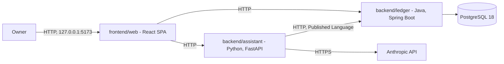

<div align="center">

# FinAssist

**A personal finance system for one owner: track the money, ask questions about it in plain
language, and analyse the portfolio behind it.**

[](https://github.com/NaimElijah/FinAssist/actions/workflows/ci.yml)
[](LICENSE)

[Requirements](docs/requirements/requirements.md) · [Architecture](docs/architecture/architecture.md) · [ADRs](docs/ADRs/) · [Changelog](CHANGELOG.md)

</div>

> [!IMPORTANT]
> **All six bounded contexts have a domain and an application layer.** The ledger is persisted in
> PostgreSQL and served over HTTP — accounting, budgeting and planning under `/api/v1`, with a
> published OpenAPI contract — and answers its Actuator health probes. The assistant now serves
> `portfolio` under `/api/v1` too, with its own published contract, but its data comes only from
> an opt-in development seed, off by default — no ledger client and no price feed exist. The web
> client's accounting area lists and opens accounts, records a transaction by hand, and clears,
> reconciles or voids one; its budgeting area lists and defines budgets, reviews spend against
> one, and adds categorisation rules; its planning area plans flows, defines scenarios, charts a
> scenario's projection with its first shortfall, and compares scenarios against a baseline — all
> over the ledger's API. Its portfolio area looks up a holding, shows its position and valuation,
> and prices a disposal without recording it, over the assistant's. See
> [Known limitations](#status-and-limitations) for what does not exist yet.

## Contents

[What and why](#what-and-why) · [Scope](#scope) · [Quick start](#quick-start) ·
[Using the web client](#using-the-web-client) · [Tech stack](#tech-stack) ·
[Architecture](#architecture) · [Project structure](#project-structure) ·
[Development](#development) · [Testing](#testing) · [Configuration](#configuration) ·
[Design decisions](#design-decisions) · [Status](#status-and-limitations)

This README is ordered for a contributor rather than an evaluator — Quick start comes before
Architecture — because the project has one owner and no external audience yet.

## What and why

Personal finance tools generally do one of three things well: they record transactions, they
answer questions, or they analyse holdings. Using three of them means the answers come from
whichever tool happens to hold the data, and nothing reconciles them. FinAssist keeps one
ledger as the record of truth and puts both the natural-language assistant and the portfolio
analysis on top of that same ledger, so an answer and a balance cannot disagree.

It is deliberately not financial advice, not a multi-tenant product, and not a system that
moves money — it records and explains, and nothing more. See
[non-goals](docs/requirements/requirements.md#non-goals).

## Scope

There is no feature list, because much of the confirmed scope below is not built yet — listing
one here that outruns the code would be a bug report waiting to be filed. What does work, end to
end through the web client: opening an account, recording a transaction by hand and moving it
through Clear, Reconcile and Void; defining a budget for a month with a limit per category,
reviewing spend against it and adding categorisation rules; planning flows, defining scenarios,
and projecting and comparing them — all against the ledger; and looking up a holding, seeing its
position and valuation, and pricing a disposal, against the assistant, whose figures come only
from its development seed until a data source exists. The confirmed scope is four capability
areas:

- **Tracking** — accounts, transactions, categorisation, budgets.
- **Assistance** — natural-language questions answered over the owner's own ledger data.
- **Analysis** — portfolio composition and performance over holdings.
- **Planning** — planned flows, projected balances over time, and comparison of strategies.

What each must do is stated in [requirements](docs/requirements/requirements.md), still `TODO`
where a decision waits on its owner; the
[open questions](docs/requirements/requirements.md#open-questions) are those decisions.

## Quick start

**Prerequisites:** Docker with Compose v2 — needed to run the stack, and now also to run the
ledger's test suite, which drives the store against a real PostgreSQL and fails rather than
skips when Docker is absent ([ADR-025](docs/ADRs/ADR-025-integration-tests-on-testcontainers.md)).
For the native inner loop you also want a JDK 21 and [uv](https://docs.astral.sh/uv/) — uv
fetches its own Python 3.13, so no system Python upgrade is needed.

```bash
git clone https://github.com/NaimElijah/FinAssist.git
cd FinAssist
cp .env.example .env        # then set POSTGRES_PASSWORD and LEDGER_DB_PASSWORD to the same
                            # value; Compose refuses to start either service without them.
                            # It also refuses to start Keycloak or the gateway without
                            # KEYCLOAK_ADMIN_PASSWORD, KEYCLOAK_DB_PASSWORD,
                            # FINASSIST_OWNER_INITIAL_PASSWORD, GATEWAY_CLIENT_SECRET and
                            # ASSISTANT_CLIENT_SECRET — an existing .env from before this
                            # section names each missing one and stops rather than starting
                            # half a stack (ADR-030, ADR-031). GATEWAY_CLIENT_SECRET and
                            # ASSISTANT_CLIENT_SECRET are each read twice, by Keycloak (to set
                            # a client's secret at import) and by the service that
                            # authenticates as that client — the two must be given the exact
                            # same value.
docker compose up --build
```

That starts PostgreSQL 18, Keycloak and its own database, the ledger, the gateway and the
assistant. The ledger applies its Flyway migrations at start-up, and Keycloak imports the
`finassist` realm at start-up too — but only into an *empty* `keycloak-db-data` volume; editing
`ops/keycloak/finassist-realm.json` later changes nothing until that volume is recreated or
`kc.sh import --override` is run by hand (ADR-031). Every service then answers its health
probe, published on `127.0.0.1` only (ADR-030, carrying [ADR-027](docs/ADRs/ADR-027-defer-authentication-and-bind-to-loopback.md)'s loopback rule forward). `docker-compose.yml`'s `:?` on
every realm placeholder is what keeps this safe: run `ops/keycloak/Dockerfile` outside that
guarded path with one of them unset, and Keycloak imports the literal, unresolved `${VAR}` text
as the credential rather than refusing to start or leaving it blank — for the owner's initial
password, that means a publicly known value, not a missing one:

```bash
curl http://127.0.0.1:8080/actuator/health
# {"groups":["liveness","readiness"],"status":"UP"}
curl http://127.0.0.1:8080/api/v1/accounts
# []
curl http://127.0.0.1:8000/health
# {"status":"UP"}
curl http://127.0.0.1:8000/api/v1/portfolio/holdings/VOO/position
# a 404 problem — the assistant has no real data source yet; see ASSISTANT_DEV_SEED below
curl http://127.0.0.1:8081/realms/finassist/.well-known/openid-configuration
# the realm's discovery document; "issuer" reads "http://localhost:8081/realms/finassist"
curl http://127.0.0.1:8090/actuator/health
# {"status":"UP"} — the gateway; neither the ledger nor the assistant validates its tokens yet
```

### First sign-in

Keycloak seeds one user, `FINASSIST_OWNER_USERNAME`, with the `owner` role and a *temporary*
password, `FINASSIST_OWNER_INITIAL_PASSWORD`. Its first sign-in must set a real password and
enrol a TOTP device — an automated check cannot do either, so this step is done by hand:

1. Open `http://localhost:8081/realms/finassist/account` in a browser.
2. Sign in with `FINASSIST_OWNER_USERNAME` and `FINASSIST_OWNER_INITIAL_PASSWORD`.
3. Keycloak asks for a new password (the realm's policy:
   `length(12) and notUsername and notEmail and passwordHistory(3)`), then a TOTP secret —
   scan it with any authenticator app, or note the secret and generate a code by hand.

The gateway itself has no login page yet to drive this through (that arrives with the web
client's own sign-in, a later task); this account console is Keycloak's own, and confirms the
realm and the owner's credentials are usable before anything else depends on them.

**Adding a viewer.** No `viewer` is seeded. Sign in to the admin console at
`http://localhost:8081/admin` with `KEYCLOAK_ADMIN_USERNAME`/`KEYCLOAK_ADMIN_PASSWORD`, open the
`finassist` realm, create a user, and assign it the realm role `viewer` under
**Role mapping**.

For the faster native inner loop, run either service outside Compose against the same database:

```bash
docker compose up -d db
cd backend/ledger && ./mvnw spring-boot:run
cd backend/assistant && uv run python -m finassist_assistant.adapters
cd backend/gateway && ./mvnw spring-boot:run
```

The web client runs on top of both backend services; see
[Using the web client](#using-the-web-client) — it does not yet go through the gateway or
Keycloak (a later task wires that up).

> [!NOTE]
> `make` is a convenience here, not a prerequisite, and it is not installed on the author's
> Windows machine. Every target is a one-line wrapper — the raw command is given alongside
> it throughout this README, and in the [Makefile](Makefile) itself. See
> [ADR-005](docs/ADRs/ADR-005-docker-compose-as-the-run-mechanism.md).

## Using the web client

The web client is a Vite dev server that forwards `/ledger/…` and `/assistant/…` to the two
services on loopback
([ADR-026](docs/ADRs/ADR-026-web-client-calls-both-services-through-one-origin.md)), so start them
first — `docker compose up --build`, or each service natively, as in
[Quick start](#quick-start) — then:

```bash
cd frontend/web && npm ci && npm run dev
```

and open [http://127.0.0.1:5173](http://127.0.0.1:5173). Accounts, Budgets and Planning read and
write through the ledger. Portfolio reads through the assistant, which holds no real data yet, so
every lookup answers that nothing is held until the assistant starts with its development seed.
Under Compose, set `ASSISTANT_DEV_SEED=true` in `.env`, which Compose reads to fill in
`docker-compose.yml`, or pass it for one run. The natively run assistant never reads `.env` — its
settings come from the environment alone — so export the variable in the shell that starts it:

```bash
ASSISTANT_DEV_SEED=true docker compose up --build    # under Compose, for one run

export ASSISTANT_DEV_SEED=true                       # natively, in the shell that runs it
cd backend/assistant && uv run python -m finassist_assistant.adapters
```

then look up `VOO` or `DEMO`. The seeded lots and quotes are invented, and no figure on any screen
is financial advice.

## Tech stack

| Layer | Technology | Version | Why |
|---|---|---:|---|
| Ledger language | Java | 21 (LTS) | Records and sealed types make illegal ledger states unrepresentable rather than merely tested |
| Ledger framework | Spring Boot | 4.1.1 | Actuator gives health, readiness and metrics without bespoke code; the domain stays framework-free |
| Ledger build | Maven (wrapper) | 3.9.6 | Committed wrapper, so a clone needs only a JDK |
| Ledger format | Spotless + palantir-java-format | 3.10.1 / 2.97.0 | One authoritative formatter; `spotless:check` gates CI |
| Ledger OpenAPI | springdoc-openapi, API starter | 3.1.1 | Generates the ledger's contract from its controllers, with no Swagger UI; `LedgerContractIT` pins it to `contracts/` ([ADR-028](docs/ADRs/ADR-028-http-wire-conventions.md)) |
| Assistant language | Python | 3.13 | Native home for the Anthropic SDK and the pandas numerical stack |
| Assistant framework | FastAPI | 0.141.1 | Typed request and response validation from the same Pydantic models the domain uses |
| Assistant packaging | uv | 0.12.7 | Resolves, locks and fetches the interpreter in one pinned tool |
| Assistant lint, format, types | Ruff + mypy | 0.16.5 / 2.3.1 | Ruff replaces flake8 + isort + black; mypy runs `--strict` |
| Ledger architecture tests | ArchUnit | 1.5.0 | Layering, context isolation, the no-floating-point-money rule, and the two rules fencing the composition root, all fail the build |
| Coverage | JaCoCo + pytest-cov + coverage-v8 | 0.8.13 / 7.1.0 / 4.1.11 | Measured in all three codebases, published by CI, gating nothing ([ADR-017](docs/ADRs/ADR-017-test-strategy.md)) |
| Mutation testing | PIT | 1.19.1 | Answers what coverage cannot: would a test notice this line being wrong? Opt-in profile, not in CI |
| Property-based tests | Seeded `Random` (Java) + Hypothesis (Python) | — / 6.167.0 | Deterministic on both sides. jqwik is unusable on JUnit Platform 6; see ADR-017 |
| Telemetry | OpenTelemetry + Micrometer | 1.44.0 (Python) / 4.1.1 starter (Java) | Vendor-neutral by decision: the backend is an environment variable, not a rewrite ([ADR-019](docs/ADRs/ADR-019-opentelemetry-and-structured-logging.md)) |
| Monitoring | OTel Collector + Prometheus + Grafana | 0.139.0 / v3.7.3 / 12.3.1 | Local only, behind a Compose profile; dashboards provisioned from files, never clicked in |
| Web framework | React + Vite | 19.2 / 8.2 | A static bundle; no Node server to operate for a single-owner tool |
| Web language | TypeScript | 6.0.3 | Pinned below 7 because `typescript-eslint` caps at `<6.1.0`; type-aware linting is worth more than the newer compiler |
| Web runtime | Node | 24 | The major CI runs, pinned in `.nvmrc` and `engines`, because tests pin dates and amounts as that major's ICU data formats them |
| Web routing | React Router | 8.3.1 | URLs, history and deep links across every screen, in data mode ([ADR-029](docs/ADRs/ADR-029-web-client-stack.md)) |
| Web server state | TanStack Query | 5.102.8 | Caching, request races and invalidating what a mutation changed, instead of fetch hooks written per feature ([ADR-029](docs/ADRs/ADR-029-web-client-stack.md)) |
| Web contract types | @hey-api/openapi-ts | 0.99.0 | Types generated from both committed contracts, and no client; CI fails when they drift ([ADR-029](docs/ADRs/ADR-029-web-client-stack.md)) |
| Web test, lint, format | Vitest + Testing Library + ESLint + Prettier | 4.1 / 16.3 / 10.9 / 3.9 | Type-aware rules; they caught a `HeadersInit` bug before any code used it, and there is now a test for it |
| Store | PostgreSQL | 18.6 | `NUMERIC` for exact money, and real constraints behind the domain's own |

Every version above is pinned in `backend/ledger/pom.xml`, `backend/assistant/pyproject.toml`,
`backend/assistant/uv.lock`, `frontend/web/package.json`, `frontend/web/.nvmrc` or
`docker-compose.yml` — not in this table.

## Architecture

Two independently deployable backend services, a web client, and a database. The ledger owns
the records; the assistant reads them through the ledger's API, never its database.



`DB`, the ledger and the assistant all run under Compose now, and `Ledger --> DB` is real: the
ledger serves `/api/v1`, with an OpenAPI document to prove it
([contracts/ledger-v1.openapi.json](contracts/ledger-v1.openapi.json)). The web client's
accounting, budgeting and planning screens call it; the assistant does not yet, having no ledger
client. The assistant serves its own `portfolio` endpoints under `/api/v1` too, published as
[contracts/assistant-v1.openapi.json](contracts/assistant-v1.openapi.json), and the web client's
portfolio screens call them.

**Six bounded contexts**, each owned by exactly one service, each one directory
([ADR-010](docs/ADRs/ADR-010-bounded-context-map.md), extended by
[ADR-015](docs/ADRs/ADR-015-planning-as-a-sixth-bounded-context.md)):

| Context | Owner | UI feature |
|---|---|---|
| `accounting` — accounts, entries, balances | ledger | yes |
| `budgeting` — budgets, categories, rules | ledger | yes |
| `portfolio` — holdings, positions, valuation | assistant | yes |
| `assistance` — questions and grounded answers | assistant | no — excluded until the privacy question is answered |
| `marketdata` — instruments and quotes, feed not chosen | assistant | no |
| `planning` — planned flows, projections, strategy comparison | ledger | yes |

Both services are hexagonal, but **only the ledger uses tactical DDD** — aggregates,
value objects and domain events protect invariants, and the analysis side has none to
protect ([ADR-007](docs/ADRs/ADR-007-asymmetric-hexagonal-architecture.md)). The assistant
gets ports and a pure-function core instead.

In strategic DDD terms the ledger is the upstream **Supplier**, the OpenAPI contract is the
**Published Language**, and `adapters/outbound/ledger/` is the assistant's
**anti-corruption layer** — the one place a ledger DTO may be translated into the
assistant's own model. Nothing inward may reach it, and that is asserted per package rather
than assumed.

Dependency direction is enforced by the build on both sides: ArchUnit in the ledger,
subprocess import tests in the assistant.

Full description: [docs/architecture/architecture.md](docs/architecture/architecture.md).
Rationale: [docs/ADRs/](docs/ADRs/).

## Project structure

Context first, hexagon inside: a context is one directory and can be extracted by moving it.

```
backend/ledger/         Java 21 + Spring Boot - full tactical DDD; sole writer of the store
  accounting/             domain/{account,entry,event}/ application/{port/in,port/out,service}/
                          adapter/{in/web,out/persistence}/
  budgeting/              same hexagon, its own aggregates
  planning/               domain/{plan,forecast}/ - what is intended, never what happened
  shared/                 Money, Currency - in-language kernel
  composition/            Spring wiring, and the two cross-context translations
backend/assistant/      Python 3.13 + FastAPI - pure-function cores, no aggregates
  portfolio/              domain/{model,analysis}/ application/{port,usecase}/
                          adapters/{inbound/api,outbound/ledger}/   <- the ACL
  assistance/             ... adapters/outbound/llm/
  marketdata/             ... adapters/outbound/feed/               <- ACL, no feed chosen
  shared/
frontend/web/           React 19 + Vite 8 - one feature per user-facing context
  src/features/           accounting/ budgeting/ planning/ portfolio/ assistance/
  src/shared/             ui/ api/ lib/
  src/app/                the only place that knows every feature at once
contracts/              Versioned OpenAPI contract - the Published Language
docs/                   requirements/, architecture/, ADRs/ - read before proposing work
.github/                CI workflow and Dependabot configuration
```

Java packages sit under `backend/ledger/src/main/java/io/github/naimelijah/finassist/ledger/`;
Python packages under `backend/assistant/src/finassist_assistant/`.

## Development

The Makefile is the single definition of every command; CI calls the same targets, so the
pipeline and the local commands cannot drift.

| Task | Make target | Raw command |
|---|---|---|
| Set up | `make setup` | `test -f .env \|\| cp .env.example .env`; `cd backend/ledger && ./mvnw -B -q dependency:go-offline`; `cd backend/gateway && ./mvnw -B -q dependency:go-offline`; `cd backend/assistant && uv sync --locked --extra dev`; `cd frontend/web && npm ci` |
| Run | `make run` | `docker compose up --build` |
| Run with monitoring | `make run-monitoring` | `docker compose --profile monitoring up --build` |
| Run identity only | `make run-identity` | `docker compose up -d keycloak-db keycloak` — for signing in or testing against Keycloak without the rest of the stack |
| Test everything | `make test` | the four test rows below; all four measure coverage |
| Test the ledger | `make test-ledger` | `cd backend/ledger && ./mvnw -B verify` |
| Test the gateway | `make test-gateway` | `cd backend/gateway && ./mvnw -B verify` |
| Test the assistant | `make test-assistant` | `cd backend/assistant && uv run pytest --cov --cov-report=term-missing --cov-report=xml` |
| Test the web client | `make test-web` | `cd frontend/web && npm run test:coverage` |
| Build the web bundle | `make build-web` | `cd frontend/web && npm run build` |
| Regenerate the web client's contract types | `make generate-web-api` | `cd frontend/web && npm run generate:api` |
| Mutation-test the ledger | `make mutation-ledger` | `cd backend/ledger && ./mvnw -B -Pmutation test-compile org.pitest:pitest-maven:mutationCoverage` |
| Lint and types | `make lint` | `./mvnw -B spotless:check` (ledger and gateway); `uv run ruff check .`, `ruff format --check .`, `mypy src tests`; `npm run lint`, `format:check`, `typecheck` |
| Format | `make format` | `./mvnw -B spotless:apply` (ledger and gateway); `uv run ruff format .`, `uv run ruff check --fix .`; `npm run format` |
| Audit | `make audit` | `cd backend/assistant && uv run pip-audit`; `cd frontend/web && npm audit --audit-level=high` |
| Re-lock Python deps | `make lock` | `cd backend/assistant && uv lock` |
| Regenerate the ledger's OpenAPI contract | — | `cd backend/ledger && ./mvnw -B verify -Dtest=NONE -Dsurefire.failIfNoSpecifiedTests=false -Dit.test=LedgerContractIT` (Docker running); on a mismatch, copy `target/contracts/ledger-v1.openapi.json` over `contracts/ledger-v1.openapi.json` |
| Regenerate the assistant's OpenAPI contract | — | `cd backend/assistant && uv run pytest tests/test_contract.py` (no container needed); on a mismatch, copy `.contract-drift/assistant-v1.openapi.json` over `contracts/assistant-v1.openapi.json` |

Commits follow [Conventional Commits](https://www.conventionalcommits.org/)
(`type(scope): imperative subject`, subject under 72 characters); branches are
`type/short-kebab-description`. Documentation changes ship in the same commit as the
behaviour they describe.

> [!WARNING]
> Editing `backend/assistant/pyproject.toml` dependencies without running `make lock` will fail CI,
> which installs with `uv sync --locked` and refuses a stale lockfile.

## Testing

| Layer | Covers | Command |
|---|---|---|
| Ledger architecture | Layering, **context isolation**, framework-free domain and application layers (now also forbidding Jackson 3, springdoc and Swagger types), no floating-point money, no aggregate cycles, a one-way composition root, a controller reaching only its in-ports, an outbound adapter never reaching an inbound one, and DTO simple-name uniqueness across contexts (ArchUnit, 10 rules — live, not dormant) | `make test-ledger` |
| Ledger domain | The balancing invariant, the transaction lifecycle, derived balances, budget limits, planned flows, projections and comparison, Money and Currency | `make test-ledger` |
| Ledger properties | Money's algebraic laws and Recurrence's date arithmetic, over generated inputs from a fixed seed | `make test-ledger` |
| Ledger store | Every repository against a **real PostgreSQL** in Testcontainers: the ordering both journal queries promise, the unique index that makes an account name atomic, the sealed `Recurrence` and `PlanState` round trips, and `numeric` preserving a JPY amount at scale 0 | `make test-ledger` |
| Ledger audit trail | The database refuses an `UPDATE` or a `DELETE` on a recorded transaction, its entries or its states, and a lifecycle change appends rather than overwrites ([ADR-020](docs/ADRs/ADR-020-audit-trail-follows-persistence.md)) | `make test-ledger` |
| Ledger schema boundaries | No foreign key crosses a schema, so context isolation holds in the database as well as in the bytecode | `make test-ledger` |
| Ledger smoke | The context loads and the Actuator health, liveness and readiness probes answer `UP` | `make test-ledger` |
| Ledger HTTP | Each controller in a `@WebMvcTest` slice — `AccountControllerTest`, `TransactionControllerTest`, `BudgetControllerTest`, `CategorisationRuleControllerTest`, `PlannedFlowControllerTest`, `ScenarioControllerTest`, `ProjectionControllerTest` and `ComparisonControllerTest` — for its request validation, including a JSON number refused where the contract requires a decimal string, and each refusal's status and problem `code`; `HostAllowListFilterTest` and `LedgerProblemHandlerTest` for the Host allow-list and the problem+json fallback; `AccountingHttpIT`, `BudgetingHttpIT` and `PlanningHttpIT`, which boot the ledger and drive it over HTTP against a real PostgreSQL; and `LedgerContractIT`, which pins the generated OpenAPI document to `contracts/ledger-v1.openapi.json` | `make test-ledger` |
| Gateway smoke | `GatewayApplicationIT` boots the backend-for-frontend, asserts its Actuator health endpoint reports `UP`, refuses a foreign `Host` header with a 403 problem, confirms the Host allow-list filter runs first in the chain the server actually built and `springSecurityFilterChain` after it, and reads the real `Set-Cookie` to hold the session cookie `HttpOnly` and `SameSite=Lax`. `HostAllowListFilterTest`, ported from the ledger, pins the allow-list's refusal, its problem shape and its start-up validation of a configured entry holding a port or an IPv6 literal | `make test-gateway` |
| Gateway sign-in | `GatewaySecurityTest` drives the security chain: an unauthenticated request answers 401 problem+json and never a 302 to Keycloak, no `/login` page is generated, `GET /bff/me` reports the subject, name and only the roles FinAssist knows, a write without the `X-FINASSIST-XSRF-TOKEN` header is refused 403 `CSRF_TOKEN_INVALID`, sign-out ends the session and names the public post-logout URI, the login entry redirects to the public authorization URI with PKCE `S256`, and an unrouted path is denied. `KeycloakRegistrationTest` pins the split between the browser-facing and backchannel URLs, the public issuer, and the gateway's refusal to start without `GATEWAY_CLIENT_SECRET`. `SpaLogoutSuccessHandlerTest` pins its two start-up refusals — no `keycloak` registration, and one with no `end_session_endpoint` ([ADR-030](docs/ADRs/ADR-030-oidc-authentication-through-a-bff-gateway.md)) | `make test-gateway` |
| Gateway relay | `GatewayLoginFlowIT` drives a real code-plus-PKCE sign-in with a JDK `HttpClient` and cookie manager against a fake OpenID provider (a real RSA-signed ID token, no mock) and two fake downstream services: PKCE is sent and the browser lands on the public URL; a relayed call to the ledger carries `Authorization: Bearer <access token>` with its prefix stripped and its `Cookie` and `X-FINASSIST-XSRF-TOKEN` headers removed; the assistant route relays the same way; a downstream problem+json response passes through unchanged; an already-expired access token is refreshed before the call; a refresh Keycloak refuses invalidates the session and answers 401, never a redirect; an unreachable ledger answers 502 `UPSTREAM_UNAVAILABLE`; an ID token from a foreign issuer fails sign-in; and a full login-and-refused-refresh run's captured logs carry no token, code or session value. The callback is deliberately sent to the gateway's own test address rather than the registered `redirect_uri`, pinning that Spring compares only `state` at the callback (R1) | `make test-gateway` |
| Keycloak realm | `KeycloakRealmTest` reads `ops/keycloak/finassist-realm.json` as data — registration, password reset and remember-me off, brute-force protection on, the password policy, token lifetimes and rotation off, the gateway client's standard-flow-only and exact PKCE/redirect configuration, the assistant client's service-account-only configuration and its `assistant` role, the flat `roles` claim on both clients, each client's audience, the owner's forced `UPDATE_PASSWORD`/`CONFIGURE_TOTP`, the owner's pinned id, and — the one guarantee that matters most — that every secret and credential in the file is an unresolved `${VAR}` placeholder, never a literal, with no `${VAR:default}` anywhere. `KeycloakRealmIT` builds `ops/keycloak/Dockerfile` with Testcontainers `ImageFromDockerfile` and runs the real image against a real PostgreSQL: the discovery document's issuer is the public URL even though the test reaches Keycloak on a random mapped port, and the assistant's client-credentials token carries `iss`, `aud=[finassist-ledger]`, `roles` containing `assistant`, a `sub`, and an RS256 `kid` present in the realm's JWKS | `make test-gateway` |
| Assistant architecture | Every source file is parsed: no inward module imports a framework or the adapters, no module imports another context, no domain module names `float` or reads the wall clock. The scanner itself is unit-tested | `make test-assistant` |
| Assistant domain | FIFO cost basis, the grounding rule, quote staleness, Money and Currency | `make test-assistant` |
| Assistant properties | The same Money laws, plus FIFO conservation, via Hypothesis run derandomised | `make test-assistant` |
| Assistant HTTP | `test_portfolio_api.py` calls the portfolio endpoints over HTTP against a seeded assembly: decimals as strings, camelCase members, 415 for a non-JSON disposal, and no amount in a URL or the access log; `test_problems.py` holds every failure to the ledger's problem shape and codes, a foreign `Host` to the ledger's 403, no exception text on a 5xx, and no rejected input in a 5xx's log line; `test_contract.py` pins the generated OpenAPI document to `contracts/assistant-v1.openapi.json` and holds its `Problem` schema identical to the ledger's | `make test-assistant` |
| Cross-language | Both `Money` kernels read `contracts/money-vectors.v1.json`, so a divergence fails a build ([ADR-018](docs/ADRs/ADR-018-cross-language-money-vectors.md)) | `make test-ledger`, `make test-assistant` |
| Web architecture | No feature imports another; `shared` imports no feature and nothing from `src/app`; `src/app` imports a feature only through its `index.ts`, and no feature imports `src/app` | `make test-web` |
| Web unit | The HTTP client's failure contracts and `Accept` header; the shared retry rule, `isRetryable` — a read retried once after a network failure or a 5xx other than a 503, a write never, and "Try again" offered on a failed read by the same rule — with focus moved to what a successful retry restores; a settled mutation cleared when its form is edited, and a pending one left alone; a jsdom render of the app shell; and the shared UI primitives: labelled fields, a pending button, a table region that is a Tab stop only while it overflows, money formatted from its exact decimal string, and dates that never shift with the timezone | `make test-web` |
| Web accounting | The accounts, account-detail and record-transaction screens end to end against a faked `fetch`: opening an account, recording a transaction by hand — including its two-entry amount mirror and the entry-row mapper's no-arithmetic sign handling — and clearing, reconciling or voiding one, offered only for the states each legally admits | `make test-web` |
| Web budgeting | The budgets, budget-review and categorisation-rules screens end to end against a faked `fetch`: listing and defining budgets, the month-to-period mapping's calendar arithmetic (including a December rollover) and a non-month period's own display-end arithmetic, reviewing spend with an overspent status and unbudgeted and uncategorised amounts, not-found by problem code, the static `/budgets/rules` route outranking the dynamic `/budgets/:budgetId` one, and adding a rule invalidating the rules list and every cached budget review, proven through the query client's own state | `make test-web` |
| Web planning | The planned-flows, scenarios, projection and comparison screens end to end against a faked `fetch`: planning a flow and moving it through its lifecycle, defining a scenario, projecting one against chosen accounts with its first shortfall and its chart, comparing scenarios against a baseline, and the account choices `src/app` adapts from accounting | `make test-web` |
| Web portfolio | The portfolio lookup and holding screens end to end against a faked `fetch`: looking a holding up by symbol, encoded as one path segment; its position and valuation with every figure's exact string, loss wording from a leading minus, and nothing held and no usable price as calm empty states; reading it afresh when its symbol is looked up again; and pricing a disposal — its `POST` body, the quantity and proceeds it priced, cost of sale, realised gain and remaining lots, its 400 and 422 failures, a result or failure cleared once an input is edited, one request per submit, no query invalidated, and a calculator that starts afresh on another holding | `make test-web` |

Deliberately absent are running test counts. Every commit that adds a source file changes the
parametrised architecture case count, so a number here would be wrong by the next pull request
and nothing checks it.

Every architecture rule above was verified by introducing a deliberate violation, confirming
the build failed, and reverting — a rule that has never failed is not evidence of anything.

All three are **static**: ArchUnit scans bytecode, the assistant parses sources with `ast`,
the web client walks the file tree. An earlier version of the assistant's rules imported
packages and read `sys.modules`, which was blind to anything outside an `__init__.py` —
review caught it, and the fix is in this repository's history rather than in a comment.

> [!NOTE]
> The ledger's ArchUnit rules are **live**. `archunit.properties`, and with it the
> `archRule.failOnEmptyShould=false` escape hatch, was deleted alongside the first domain class,
> so a rule matching nothing now fails rather than passing quietly.

Tests are named `Given<scenario>_When<action>_Then<result>` — the reason Ruff's `N802` is
disabled for `tests/**`, with the justification recorded in `backend/assistant/pyproject.toml`.

**What CI gates on:** every push and pull request to `main` and `dev` must pass five jobs —
the ledger's format check, build and tests; the gateway's format check, build and tests; the
assistant's lint, format check, `mypy --strict`, tests and `pip-audit`; the web client's
contract types, regenerated from `contracts/` with no changed or new file, then lint, format
check, typecheck, tests, production build and `npm audit`; and a `docker compose config`
validation, `monitoring` profile included.

**Coverage is measured everywhere and gates nothing.** JaCoCo, `pytest-cov` and
`@vitest/coverage-v8` run as part of the test targets, and each CI job publishes its report as
a build artefact. There is no threshold in any of the three, by decision rather than by
oversight ([ADR-017](docs/ADRs/ADR-017-test-strategy.md)) — coverage counts lines that ran, and
says nothing about whether a test would notice them being wrong.

**What answers that question is mutation testing**, on demand and also gated on nothing:

```bash
cd backend/ledger && ./mvnw -B -Pmutation test-compile org.pitest:pitest-maven:mutationCoverage
```

It earned its place on the first run, finding that deleting `requireSameCurrency` from
`Money.minus` broke no test — the cross-currency refusal was asserted for `plus` and
`compareTo` and never for `minus`, in either language.

## Configuration

Copy `.env.example` to `.env` and fill it in. `.env` is git-ignored; no value in it belongs
in the repository, the logs or an error message.

| Variable | Purpose | Default | Required |
|---|---|---|---|
| `POSTGRES_PASSWORD` | Database password | none | **Yes** — Compose refuses to start without it |
| `POSTGRES_DB` | Database name | `finassist` | No |
| `POSTGRES_USER` | Database user | `finassist` | No |
| `LEDGER_DB_PASSWORD` | Ledger database password. The ledger connects as the role Compose creates, so this must match `POSTGRES_PASSWORD` until it gets its own role | none | **Yes** — the ledger refuses to start without it |
| `ANTHROPIC_API_KEY` | The LLM behind the assistant | none | No — the assistant only registers it for redaction, and nothing uses it until an LLM adapter is wired, which waits on the privacy question |
| `GRAFANA_ADMIN_PASSWORD` | Grafana admin password | none | **Yes** when using the `monitoring` profile |
| `GATEWAY_CLIENT_SECRET` | The gateway's Keycloak client secret, taken from the realm. It never leaves the gateway: the browser holds a session cookie and a CSRF token, never a token ([ADR-030](docs/ADRs/ADR-030-oidc-authentication-through-a-bff-gateway.md)) | none | **Yes** — the gateway and Keycloak both refuse to start without it |
| `KEYCLOAK_ADMIN_PASSWORD` | Keycloak's own bootstrap admin password, for its admin console at `http://localhost:8081/admin` ([ADR-031](docs/ADRs/ADR-031-keycloak-as-the-identity-provider.md)) | none | **Yes** — Keycloak refuses to start without it |
| `KEYCLOAK_DB_PASSWORD` | `keycloak-db`'s password. Its own database, its own volume, no published port ([ADR-031](docs/ADRs/ADR-031-keycloak-as-the-identity-provider.md)) | none | **Yes** — both Keycloak and its database refuse to start without it |
| `FINASSIST_OWNER_INITIAL_PASSWORD` | The owner's temporary password in the `finassist` realm. Must satisfy the realm's password policy; used once, at [first sign-in](#first-sign-in) | none | **Yes** — Keycloak refuses to start without it |
| `ASSISTANT_CLIENT_SECRET` | The `finassist-assistant` Keycloak client's secret — a confidential, service-account-only client holding the `assistant` role ([ADR-032](docs/ADRs/ADR-032-role-based-authorization-per-service.md)) | none | **Yes** — Keycloak refuses to start without it |

<details>

<summary>The remaining variables</summary>

| Variable | Purpose | Default |
|---|---|---|
| `LEDGER_PORT` | Ledger HTTP port | `8080` |
| `LEDGER_ADDRESS` | Interface the ledger binds. Loopback by default, kept as defence in depth now that the gateway fronts it too ([ADR-030](docs/ADRs/ADR-030-oidc-authentication-through-a-bff-gateway.md), carrying [ADR-027](docs/ADRs/ADR-027-defer-authentication-and-bind-to-loopback.md)'s loopback rule forward); `0.0.0.0` only inside a container | `127.0.0.1` |
| `LEDGER_ALLOWED_HOSTS` | Comma-separated host names the ledger answers to. An entry containing a `:`, a `[` or a `]`, which covers a port and every IPv6 literal, is refused at start-up. Any other `Host` header is refused with 403, which stops a DNS-rebound page in the owner's browser ([ADR-030](docs/ADRs/ADR-030-oidc-authentication-through-a-bff-gateway.md), carrying [ADR-027](docs/ADRs/ADR-027-defer-authentication-and-bind-to-loopback.md)'s defence forward) | `localhost,127.0.0.1` |
| `LEDGER_DB_URL` | JDBC URL. Compose sets this itself, to the service name `db`, for the `ledger` container; this default targets a native `./mvnw spring-boot:run` at the Compose `db` service's published port | `jdbc:postgresql://localhost:5432/finassist` |
| `LEDGER_DB_USERNAME` | Ledger database user | `finassist` |
| `KEYCLOAK_PORT` | Keycloak HTTP port | `8081` |
| `KEYCLOAK_ADMIN_USERNAME` | Keycloak's own bootstrap admin username — not one of FinAssist's own roles | `admin` |
| `FINASSIST_OWNER_USERNAME` | The owner's sign-in username in the `finassist` realm, seeded with the `owner` role | `owner` |
| `GATEWAY_PORT` | Gateway HTTP port | `8090` |
| `GATEWAY_ADDRESS` | Interface the gateway binds. Loopback by default, matching the ledger and the assistant while neither of them enforces authentication yet; `0.0.0.0` only inside a container | `127.0.0.1` |
| `GATEWAY_ALLOWED_HOSTS` | Comma-separated host names the gateway answers to. An entry containing a `:`, a `[` or a `]`, which covers a port and every IPv6 literal, is refused at start-up. Any other `Host` header is refused with 403, which stops a DNS-rebound page in the owner's browser ([ADR-030](docs/ADRs/ADR-030-oidc-authentication-through-a-bff-gateway.md), carrying [ADR-027](docs/ADRs/ADR-027-defer-authentication-and-bind-to-loopback.md)'s defence forward) | `localhost,127.0.0.1` |
| `GATEWAY_PUBLIC_URL` | The origin the browser reaches FinAssist through — the Vite dev server, which proxies `/bff` to the gateway. Every redirect the gateway issues is absolute and built from this, never from a forwarded header. Open `localhost`, not `127.0.0.1`: cookies are keyed by host name, so the other one cannot find the sign-in's own session | `http://localhost:5173` |
| `GATEWAY_OIDC_PUBLIC_URL` | Keycloak as the browser sees it. The sign-in and sign-out URLs handed to the browser are built from this, and so is the issuer every token must name | `http://localhost:8081` |
| `GATEWAY_OIDC_INTERNAL_URL` | Keycloak as the gateway itself reaches it. The same value when running natively; under Compose it is the container name, which the browser cannot resolve — which is why the two are separate | `http://localhost:8081` |
| `GATEWAY_COOKIE_SECURE` | Whether the session and CSRF cookies carry `Secure`. `false` for development, which is plain HTTP on loopback; must be `true` behind TLS | `false` |
| `GATEWAY_LEDGER_URI` | Where the gateway relays a request under `/ledger/api/v1/**`, once its prefix is stripped, the access token attached and the browser's `Cookie` and CSRF header removed | `http://localhost:8080` |
| `GATEWAY_ASSISTANT_URI` | The same, for `/assistant/api/v1/**` | `http://localhost:8000` |
| `ASSISTANT_PORT` | Assistant HTTP port | `8000` |
| `LEDGER_BASE_URL` | Where the assistant reaches the ledger | `http://ledger:8080` |
| `POSTGRES_PORT` | Host port mapped to Postgres. Change it, and `LEDGER_DB_URL` with it, if something already owns 5432 — a natively installed PostgreSQL will otherwise answer instead of the container | `5432` |
| `OTEL_EXPORTER_OTLP_ENDPOINT` | Collector base URL; each service appends its own signal path | `http://localhost:4318` |
| `OTEL_EXPORT_ENABLED` | Whether to export telemetry at all — traces, metrics, and the ledger's OTLP log export, which nothing feeds yet. Paired with the endpoint so a stale one goes quiet rather than retrying | `false` |
| `ASSISTANT_LOG_LEVEL` | Threshold for the assistant's structured logger; one of `DEBUG`, `INFO`, `WARNING`, `ERROR`, `CRITICAL` | `INFO` |
| `ASSISTANT_HOST` | Interface the assistant binds. Loopback by default, kept as defence in depth now that the gateway fronts it too ([ADR-030](docs/ADRs/ADR-030-oidc-authentication-through-a-bff-gateway.md), carrying [ADR-027](docs/ADRs/ADR-027-defer-authentication-and-bind-to-loopback.md)'s loopback rule forward); `0.0.0.0` only inside a container, where Compose sets it | `127.0.0.1` |
| `ASSISTANT_ALLOWED_HOSTS` | Comma-separated host names the assistant answers to. An entry containing a `:` or a `[`, which covers a port and every IPv6 literal, or a wildcard, is refused at start-up. Any other `Host` header is refused with 403, which stops a DNS-rebound page in the owner's browser ([ADR-030](docs/ADRs/ADR-030-oidc-authentication-through-a-bff-gateway.md), carrying [ADR-027](docs/ADRs/ADR-027-defer-authentication-and-bind-to-loopback.md)'s defence forward) | `localhost,127.0.0.1` |
| `ASSISTANT_DEV_SEED` | Loads a small set of fictional holdings and quotes at start-up, so the portfolio screens have something to show by hand. Invented data, never meant for real use | `false` |
| `OTLP_HTTP_PORT`, `OTLP_GRPC_PORT` | Host ports for the collector | `4318`, `4317` |
| `PROMETHEUS_PORT`, `GRAFANA_PORT` | Host ports for the monitoring profile | `9090`, `3000` |

</details>

**The gateway's outbound HTTP timeouts are not an environment variable.** Spring Cloud Gateway
Server Web MVC has no timeout property of its own for a relayed call, so
`backend/gateway/src/main/resources/application.yml` sets Boot's own
`spring.http.clients.connect-timeout` (`5s`) and `read-timeout` (`10s`) directly. Both bound
every outbound HTTP call the gateway makes, not only a relay to the ledger or the assistant: the
gateway's own calls to Keycloak — the authorization-code exchange and the `refresh_token` grant
— share the same auto-configured `RestClient`. Raising either is a one-line change to that file.

## Deployment and operations

Not deployed anywhere, and there is no target environment or migration strategy yet —
stating one here would be fiction. Every build artefact stays on the machine that built it:
`./mvnw package` produces the ledger's executable jar, `npm run build` the web client's static
bundle, and `docker compose up --build` an image for each backend service from its own
Dockerfile.

| Concern | Endpoint or format | State |
|---|---|---|
| Liveness | `GET /actuator/health/liveness` (ledger), `GET /health` (assistant) | Live, returns `UP` |
| Readiness | `GET /actuator/health/readiness` (ledger), `GET /ready` (assistant) | Live, returns `UP` |
| Metrics | `GET /actuator/metrics`, `GET /actuator/prometheus` | Live, and scraped by the monitoring profile; no domain metric yet |
| Traces | OTLP to `$OTEL_EXPORTER_OTLP_ENDPOINT` | Live when `OTEL_EXPORT_ENABLED=true`; dropped otherwise, and the services start either way |
| Logs | JSON on stdout, carrying a W3C trace id | Live — ECS in the ledger, structlog in the assistant. Redaction is enforced in the assistant and the web client, where the secrets are; the ledger holds none and does not expose `/actuator/env` |
| Dashboards | Grafana, provisioned from `ops/grafana/` | Live under the `monitoring` profile |
| Audit trail | The append-only journal | Live — the database refuses an `UPDATE` or a `DELETE` on a recorded transaction, its entries or its states; a lifecycle change appends rather than overwrites ([ADR-020](docs/ADRs/ADR-020-audit-trail-follows-persistence.md), [ADR-024](docs/ADRs/ADR-024-jdbc-persistence-and-append-only-schema.md)) |
| Ledger API | `GET/POST /api/v1/...`; OpenAPI document at `GET /v3/api-docs`, pinned as [`contracts/ledger-v1.openapi.json`](contracts/ledger-v1.openapi.json) | Live for accounting, budgeting and planning; the web client's screens for all three call it |
| Assistant API | `GET/POST /api/v1/portfolio/...`; OpenAPI document at `GET /openapi.json`, pinned as [`contracts/assistant-v1.openapi.json`](contracts/assistant-v1.openapi.json) | Live for portfolio, answering from the development seed or from nothing; the web client's portfolio screens call it |

Run the telemetry backend with `docker compose --profile monitoring up`: Grafana on
[localhost:3000](http://localhost:3000), Prometheus on
[localhost:9090](http://localhost:9090), and an OTLP collector on `localhost:4318`, each published
on `127.0.0.1` only. Point the
ledger at it with `OTEL_EXPORTER_OTLP_ENDPOINT=http://localhost:4318
OTEL_EXPORT_ENABLED=true ./mvnw spring-boot:run`. Traces are printed by the collector
(`docker compose logs otel-collector`) rather than stored — there is no trace backend, which
[ADR-019](docs/ADRs/ADR-019-opentelemetry-and-structured-logging.md) records as a deliberate
limit.

## Design decisions

**Two languages instead of one**
([ADR-001](docs/ADRs/ADR-001-polyglot-java-python-split.md)) — the ledger is
invariant-heavy and suits Java's sealed types; the assistant and analysis are ecosystem-heavy
and have no Java peer libraries. The single-language recommendation was Python only; the
owner chose the split knowingly. Cost: two toolchains, two CI jobs and a versioned wire
contract before any feature exists. The ADR records the concrete threshold for collapsing
back to one language.

**Double-entry bookkeeping**
([ADR-011](docs/ADRs/ADR-011-double-entry-bookkeeping.md)) — a transaction's entries must sum to
zero, checked in the constructor, so an unbalanced one is never constructed. Balances are
derived by summing entries; there is no balance field to drift. Single entry was rejected
because it leaves the domain almost nothing to enforce, which would make ADR-001's reason for
choosing Java here hollow. Cost: every purchase needs a category account to balance against, so
a bare "I spent 12.50" is not expressible.

**Context first, hexagon inside**
([ADR-010](docs/ADRs/ADR-010-bounded-context-map.md)) — six bounded contexts, each one
directory with its own hexagon, so a context is extractable by moving it. No context may
depend on another; that rule is enforced in all three codebases and was proved by making it
fail. The alternative — layers on top, contexts nested inside — leaves a context's code in
three distant trees and lets cross-context imports accumulate unopposed. Cost: deeper nesting,
and `shared` is exempt, so it is where coupling can still accrue quietly.

**Tactical DDD in the ledger only**
([ADR-007](docs/ADRs/ADR-007-asymmetric-hexagonal-architecture.md)) — aggregates and value
objects exist to protect invariants. The ledger is dense with them; computing a rolling
return protects nothing, so aggregates there would wrap dataframes in DDD vocabulary.
Alternatives were symmetric DDD in both services, and a strategic split by bounded context.
Cost: two mental models in one repository, and `Money` implemented twice with no compiler to
catch divergence.

**Compose is the mechanism, the Makefile only an interface**
([ADR-005](docs/ADRs/ADR-005-docker-compose-as-the-run-mechanism.md)) — the development
machine has no `make`, no `just` and no `bash` on `PATH`, so a Makefile alone would document
commands that do not run where they were written. Cost: the logic is split across two files,
and containers iterate more slowly than native runs.

**`backend/` and `frontend/` at the root**
([ADR-008](docs/ADRs/ADR-008-backend-frontend-root-layout.md)) — one home per tier, once a web
client joined. The cost was accepted knowingly: the grouping carries no domain meaning and
implies the ledger and assistant are one layer, when they are separate contexts in separate
languages talking over a versioned contract.

**The assistant never touches the ledger's database**
([ADR-004](docs/ADRs/ADR-004-http-openapi-service-contract.md), Accepted) — a shared
database would be the cheapest thing to build and the most expensive to own. Cost: JSON over
HTTP carries no runtime schema, and contract drift is silent until CI compares the documents.

**Sign-in through a gateway, permissions decided by each service**
([ADR-030](docs/ADRs/ADR-030-oidc-authentication-through-a-bff-gateway.md),
[ADR-031](docs/ADRs/ADR-031-keycloak-as-the-identity-provider.md),
[ADR-032](docs/ADRs/ADR-032-role-based-authorization-per-service.md)) — decided; the gateway's
sign-in is built, the rest is not. None of the triggers that had deferred authentication had
fired; the owner chose to build it to a professional standard anyway. The browser signs in with OIDC at a backend-for-frontend
gateway that keeps access and refresh tokens on the server, a self-hosted Keycloak with its realm
committed as code issues the tokens, and the ledger and the assistant each validate a bearer
token and decide from their own role table what it may do, denying anything unlisted. Tokens held
in the browser were rejected because any script on the page could read them, and authorising at
the gateway because the assistant will call the ledger without passing through it. Cost: a third
deployable and two more containers in the inner loop, sessions that end when the gateway
restarts, and no TLS while everything stays on loopback.

## Status and limitations

**Pre-alpha.** Shipped: the repository baseline and architecture, plus the **domain and
application layers of all six bounded contexts** with the invariants and tests that make them
real — double-entry accounting, periodic budgets, FIFO cost basis, grounded answers, quote
staleness, deterministic projections and strategy comparison, and `Money` in both languages.
Use cases sit behind ports and are wired by constructor, and the ledger's are backed by
**PostgreSQL**: a schema per bounded context, Flyway migrations, hand-written SQL, and a journal
the database itself refuses to rewrite. **The ledger now serves accounting, budgeting and
planning over HTTP** under `/api/v1`, behind a Host allow-list and problem+json error handling,
with its generated OpenAPI document pinned by `LedgerContractIT` and published as
[`contracts/ledger-v1.openapi.json`](contracts/ledger-v1.openapi.json); it runs under Compose as
well as natively. Thirty-two ADRs. Every architecture rule is live rather than dormant, and each
was confirmed to fail against a planted violation — including dropping the append-only trigger and
planting a foreign key across a schema boundary. CI gates build, lint, format and dependency audit
across four jobs, and publishes a coverage report from each.

**Four slices now run end to end**: the web client's accounting area opens an account, records a
transaction by hand, and moves one through `Clear`, `Reconcile` and `Void`; its budgeting area
lists and defines budgets, reviews spend against one — overspent, unbudgeted and uncategorised —
and adds categorisation rules in order; its planning area plans flows and moves them through their
lifecycle, defines scenarios, charts a scenario's projection against chosen accounts with its
first shortfall, and compares scenarios against a baseline — these three against the ledger's live
HTTP API; and its portfolio area looks up a holding, shows its position and valuation, and prices a
disposal without recording it, against the assistant's. Planned next, in order: resolve the
[open questions](docs/requirements/requirements.md#open-questions), then give the assistant a
ledger client behind its own `LedgerPort`.

Known limitations:

- **The backend HTTP APIs have one caller so far: the web client.** The ledger serves accounting,
  budgeting and planning under `/api/v1`, with an OpenAPI document pinned by `LedgerContractIT`;
  the assistant serves `portfolio` under `/api/v1`, pinned by `tests/test_contract.py`. The web
  client's accounting, budgeting and planning screens call the ledger's, and its portfolio screens
  the assistant's. The assistant has no ledger client of its own — `LedgerPort` is still an
  in-memory stand-in.
- **The assistant's portfolio data comes only from an opt-in development seed.**
  `ASSISTANT_DEV_SEED`, off by default, loads a small set of fictional lots and quotes from the
  composition root so the endpoints have something to answer by hand; it is a development aid,
  not a data source, and no ledger client or price feed exists yet. Without it, the web client's
  portfolio screens answer every lookup with nothing held.
- **The audit trail cannot say who.** The journal records what changed, when and — for a voided
  transaction — why, and the database refuses to let any of it be rewritten. It records no actor,
  because there is no authentication to name one. That gap is
  [ADR-020](docs/ADRs/ADR-020-audit-trail-follows-persistence.md)'s, stated in advance rather
  than discovered.
- **Docker is required to test the ledger**, not only to run it. The store is tested against a
  real PostgreSQL, and the suite fails rather than skipping when no daemon answers
  ([ADR-025](docs/ADRs/ADR-025-integration-tests-on-testcontainers.md)).
- **Domain events have no subscriber.** They are raised, recorded in an append-only in-memory
  log and asserted by tests, and read by no production code. That is the cost
  [ADR-023](docs/ADRs/ADR-023-domain-events-in-the-ledger.md) accepts, with the trigger that
  discharges it.
- **`AnswerQuestion` is written and not wired.** An LLM adapter would decide by implication
  whether the owner's financial data may be sent to a third-party API, which is the project's
  central open question and belongs in its own ADR.
- **Six contexts is a guess.** They are derived from the four capability areas, not from a
  working slice, and some may turn out to be wrong boundaries. ADR-010 names the signal:
  contexts that always change together should be merged.
- **`planning` sits in the ledger against ADR-007's own criterion.** Forecasting is
  transformation-dense, which is the assistant's profile, and it was placed in the ledger for
  its lifecycle and its future persistence. If `PlanState` goes unused, the context belongs in
  Python ([ADR-015](docs/ADRs/ADR-015-planning-as-a-sixth-bounded-context.md)).
- **A projection is a single deterministic line.** It states no uncertainty, so a long-horizon
  figure looks far more precise than it is
  ([ADR-016](docs/ADRs/ADR-016-deterministic-per-currency-projection.md)).
- **Shortfall detection sees only step boundaries.** An overdraft that opens and closes within
  one step goes unreported — a big payment covered by a salary later the same month reads as
  untroubled at a monthly cadence. Pinned by a test, narrowed by projecting more finely, closed
  by nothing yet.
- **`consume_fifo` still trusts the caller's lot order**, but the caller no longer trusts
  itself: `DisposeUnits` sorts by acquisition date before calling it, and a test hands it lots
  newest-first to prove the difference between a 1000.00 cost of sale and a 2000.00 one. The
  domain function's contract is unchanged, so reaching past the use case still gets LIFO
  ([ADR-013](docs/ADRs/ADR-013-fifo-lot-based-cost-basis.md)).
- **The grounding rule checks a citation points at evidence that was gathered, not that it
  supports the figure.** `AnswerQuestion` now drops a citation naming a record the answer was
  never given, so a wholly invented reference no longer grounds anything — but a model citing a
  *real* balance while stating a different number still passes
  ([ADR-014](docs/ADRs/ADR-014-grounded-answers-require-citations.md)).
- **No cross-currency total is possible**, by design — so there is no single net-worth figure
  across accounts in different currencies, and a projection covers one currency only
  ([ADR-012](docs/ADRs/ADR-012-multi-currency-without-conversion.md)).
- **`marketdata` has no feed.** The anti-corruption layer exists; nothing sits behind it,
  because no price source has been chosen or licence-checked.
- **TypeScript is one minor behind.** Pinned to 6.0.3 because `typescript-eslint` 8 caps at
  `<6.1.0`; lifts when it supports 7.
- **The Postgres image tag, and the monitoring services' tags, are bumped by hand.** Dependabot's
  `docker` ecosystem covers the ledger's and the assistant's own Dockerfiles; there is still no
  `docker-compose` ecosystem for the image tags named directly in `docker-compose.yml`.

## Licence

Proprietary — all rights reserved. See [LICENSE](LICENSE).
