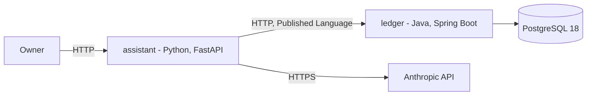

# FinAssist — architecture

The system as it actually is. *What it must do* is
[requirements](../requirements/requirements.md); *why* a given solution was chosen is
[the ADRs](../ADRs/).

> **This document describes the present, which is currently a skeleton.** Both service
> modules exist, build, lint and test, and their structural rules are enforced by the build.
> The ledger boots and answers Actuator probes; the assistant has no entry point; neither has
> domain code. Where a structure is defined but not yet inhabited, this document says so
> rather than describing the intended end state as if it were real.

## Architecture overview

FinAssist is two independently deployable services in one repository, plus a database.

The **ledger** (Java) owns financial records and the rules that govern them. The
**assistant** (Python) answers questions and computes analysis over those records, reading
them through the ledger's published API rather than its database. The split is
[ADR-001](../ADRs/ADR-001-polyglot-java-python-split.md); the internal shape of each side is
[ADR-007](../ADRs/ADR-007-asymmetric-hexagonal-architecture.md).

Of the above, `DB` runs under Compose and `Ledger` boots natively with Actuator only. No
edge in this diagram is implemented: the assistant has no entry point, and nothing connects
to the database.

### The context map

The relationship between the services, in strategic DDD terms, is what dictates the
structure inside them:

| Role | Service | Consequence |
|---|---|---|
| Upstream, Supplier | `ledger` | Owns the records and the vocabulary; free to evolve its schema |
| Downstream, Customer | `assistant` | Must not depend on the ledger's internals |
| Published Language | the OpenAPI document in [`contracts/`](../../contracts) | The only sanctioned way to read ledger data |
| Anti-corruption layer | `assistant/src/finassist_assistant/adapters/outbound/ledger/` | Translates ledger DTOs into the assistant's own model |

There is deliberately **no shared kernel**. `Money` is implemented once per language and
pinned by equivalent tests on both sides; a shared kernel across two languages would mean
two implementations obliged to stay bit-identical, which costs more than the duplication.

## Components

| Component | Responsibility | State |
|---|---|---|
| `ledger/` | Accounts, transactions, balances, and the invariants over them. Sole writer of the ledger store. Java 21, Spring Boot 4.1.1, Maven wrapper pinned to 3.9.6 | Boots and answers Actuator probes; 4 architecture rules pass; no domain code |
| `assistant/` | LLM assistant and portfolio analysis. Client of the ledger. Python 3.13, FastAPI, uv with a committed lockfile | Lints and type-checks; 12 architecture tests pass; no entry point and no domain code |
| `contracts/` | The versioned wire contract between the two services | Directory and its README only |
| PostgreSQL 18 | The ledger's store | Runs via Compose; nothing connects to it |

## Structure: asymmetric by design

Both services are hexagonal. **Tactical DDD is applied only in the ledger**, because that is
where the invariants are. The reasoning is in
[ADR-007](../ADRs/ADR-007-asymmetric-hexagonal-architecture.md); the short version is that
aggregates and value objects protect constraints, and the analysis side has none to protect.

**Ledger** — `ledger/src/main/java/io/github/naimelijah/finassist/ledger/`

| Package | Holds |
|---|---|
| `domain/account/` | `Account` aggregate root, `AccountId` |
| `domain/transaction/` | `Transaction` aggregate, sealed `TransactionState` |
| `domain/shared/` | `Money`, `Currency`, `Period` — value objects |
| `domain/event/` | Domain events |
| `application/port/in/` | Use-case interfaces (commands) |
| `application/port/out/` | Repository and gateway ports the domain owns |
| `application/service/` | Use-case implementations |
| `adapter/in/web/` | Controllers and transport DTOs |
| `adapter/out/persistence/` | Persistence entities, mapped to aggregates — an entity is not an aggregate |

**Assistant** — `assistant/src/finassist_assistant/`

| Package | Holds |
|---|---|
| `domain/analysis/` | Total, deterministic functions: returns, allocation, drawdown |
| `domain/model/` | Frozen dataclasses: `Holding`, `Position`, `Series` |
| `application/port/` | `LedgerPort`, `LlmPort` as `typing.Protocol` |
| `application/usecase/` | Orchestration only |
| `adapters/inbound/api/` | FastAPI routers and their transport models |
| `adapters/outbound/ledger/` | **The anti-corruption layer** |
| `adapters/outbound/llm/` | Anthropic client |

## Communication

- **Owner to assistant** — HTTP. The assistant is the only service a person talks to.
- **Assistant to ledger** — HTTP, request/response, described by an OpenAPI document under
  `contracts/` and versioned in the URL path
  ([ADR-004](../ADRs/ADR-004-http-openapi-service-contract.md), still Proposed).
- **Assistant to Anthropic** — HTTPS via the pinned `anthropic` SDK, behind `LlmPort`.
- **Ledger to Postgres** — JDBC ([ADR-006](../ADRs/ADR-006-postgresql-for-the-ledger-store.md),
  still Proposed; no driver is on the classpath yet).

The ledger never calls the assistant. The dependency between services points one way, which
is what allows the ledger to be extracted or replaced without touching the assistant's core.

## Data flow

No business request path exists yet. The only live path is
`GET /actuator/health` → Spring Boot's health contributors → `{"status":"UP"}`, which
touches no FinAssist code. This section is filled in from the implementation in the same
commit that creates it, not before.

`LedgerApplication` in the root package is the only Spring-annotated class outside
`adapter`. Component scanning covers the adapters beneath it; the domain and application
packages carry no annotations and are wired by constructor, not by the container.

## External dependencies and integration points

| Dependency | Used for | Pinned in |
|---|---|---|
| PostgreSQL 18.6 | Ledger store | `docker-compose.yml` (by hand — Dependabot does not cover Compose files) |
| Anthropic API | The LLM behind the assistant | `assistant/pyproject.toml`, `assistant/uv.lock` |
| Maven Central | Java dependencies | `ledger/pom.xml` |
| PyPI | Python dependencies | `assistant/uv.lock` |

Market data has no source yet; see the open questions in
[requirements](../requirements/requirements.md#open-questions).

## Structural decisions not visible from the file layout

**Dependency direction is enforced by the build, in both services.**

| Rule | Enforced by |
|---|---|
| Adapters → application → domain → nothing (ledger) | `LedgerArchitectureTest.layers_point_inward` |
| The ledger domain imports no framework | `LedgerArchitectureTest.domain_depends_on_no_framework` |
| No floating-point field in the ledger domain | `LedgerArchitectureTest.money_is_never_floating_point` |
| No package cycles in the ledger | `LedgerArchitectureTest.packages_are_free_of_cycles` |
| No inward assistant layer loads a framework | `test_architecture.py::Given_an_inward_layer_When_imported_Then_it_loads_no_framework` |
| No inward assistant layer reaches the adapters | `test_architecture.py::Given_an_inward_layer_When_imported_Then_it_loads_no_adapter` |

The ledger's rules are currently **dormant**: `ledger/src/test/resources/archunit.properties`
sets `archRule.failOnEmptyShould=false` because the three layer packages are empty, and rules
that match nothing fail rather than pass. That line is deleted with the first domain class.
The Python rules are live now, because the packages exist.

**The anti-corruption layer is the boundary that matters.** A ledger DTO reaching the
assistant's application or domain layer would make the ledger's wire shape the assistant's
model, coupling two services across a language boundary and forfeiting what the split bought.
This is asserted per package, not assumed.

**Persistence entities are not aggregates.** JPA's requirements — no-arg constructors,
mutable fields, lazy proxies — stay in `adapter/out/persistence`. Letting them into the
domain produces an anemic model wearing DDD vocabulary.

**The database is private to the ledger.** The assistant has no connection string, by
design; this is why [ADR-004](../ADRs/ADR-004-http-openapi-service-contract.md) rejects a
shared database.

**The Makefile is an interface, not a mechanism.** Every target is a thin wrapper over
`docker compose`, `./mvnw` or `uv`, and CI calls the same targets, so the pipeline and the
local commands cannot drift ([ADR-005](../ADRs/ADR-005-docker-compose-as-the-run-mechanism.md)).

**Test naming overrides the linter.** Tests are named
`Given<scenario>_When<action>_Then<result>`, which is not snake_case, so Ruff's `N802` is
disabled for `tests/**` in `assistant/pyproject.toml` with the reason recorded inline.
