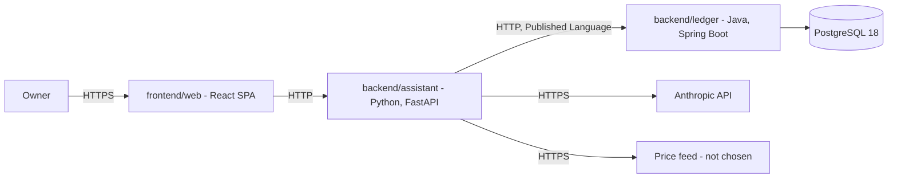

# FinAssist — architecture

The system as it actually is. *What it must do* is
[requirements](../requirements/requirements.md); *why* a given solution was chosen is
[the ADRs](../ADRs/).

> **All five contexts now have a domain layer, and nothing above it.** The models, their
> invariants and their tests exist; application services, ports, adapters, HTTP and persistence
> do not. The ledger boots and answers Actuator probes; the assistant has no entry point; the
> web client renders a placeholder. Where a structure is defined but not yet inhabited, this
> document says so.

## Architecture overview

Two independently deployable backend services, a web client, and a database.

The **ledger** (Java) owns financial records and the rules that govern them. The
**assistant** (Python) answers questions and computes analysis over those records, reading
them through the ledger's published API rather than its database. The **web client**
(TypeScript) is what a person talks to.

The split is [ADR-001](../ADRs/ADR-001-polyglot-java-python-split.md); the shape inside each
service is [ADR-007](../ADRs/ADR-007-asymmetric-hexagonal-architecture.md) as extended by
[ADR-010](../ADRs/ADR-010-bounded-context-map.md); the root layout is
[ADR-008](../ADRs/ADR-008-backend-frontend-root-layout.md).



`DB` runs under Compose and `Ledger` boots natively with Actuator only. No edge in this
diagram is implemented.

## Bounded contexts

Five contexts, each owned by exactly one service
([ADR-010](../ADRs/ADR-010-bounded-context-map.md)).

| Context | Owner | Holds | UI feature |
|---|---|---|---|
| `accounting` | `backend/ledger` | `Account`, `Entry`, `Balance` — the record of truth | yes |
| `budgeting` | `backend/ledger` | `Budget`, `Category`, `CategorisationRule` | yes |
| `portfolio` | `backend/assistant` | `Holding`, `Position`, `Valuation` | yes |
| `assistance` | `backend/assistant` | `Question`, `Evidence`, `GroundedAnswer` | yes |
| `marketdata` | `backend/assistant` | `Instrument`, `Quote` — feed not chosen | no |

### The context map

| Role | Where | Consequence |
|---|---|---|
| Upstream, Supplier | `accounting` | Owns the records and the vocabulary; free to evolve its schema |
| Downstream, Customer | `portfolio`, `assistance` | Must not depend on the ledger's internals |
| Published Language | the OpenAPI document in [`contracts/`](../../contracts) | The only sanctioned way to read ledger data |
| Anti-corruption layer | `portfolio/adapters/outbound/ledger/`, `marketdata/adapters/outbound/feed/`, `assistance/adapters/outbound/llm/` | Foreign shapes become local model types here and nowhere else |

`budgeting` references accounts **by identifier only**, never by object — separate lifecycles,
separate invariants.

There is deliberately **no shared kernel across languages**. `Money` is implemented once per
language and pinned by equivalent tests on each side; two implementations obliged to stay
bit-identical would cost more than the duplication.

## Components

| Component | Responsibility | State |
|---|---|---|
| `backend/ledger` | Accounting and budgeting. Sole writer of the ledger store. Java 21, Spring Boot 4.1.1, Maven wrapper 3.9.6 | Domain layer complete; 57 tests including 5 live architecture rules; nothing above the domain |
| `backend/assistant` | Portfolio, assistance and market data. Client of the ledger. Python 3.13, FastAPI, uv lockfile | Domain layer complete; 137 tests; no entry point, nothing above the domain |
| `frontend/web` | The only interface a person uses. React 19, Vite 8, TypeScript 6 | Builds and renders a placeholder; 6 architecture tests pass; no feature implemented |
| `contracts/` | The versioned wire contract | Directory and its README only |
| PostgreSQL 18 | The ledger's store | Runs via Compose; nothing connects to it |

## Structure: context first, hexagon inside

A context is one directory, so it can be extracted by moving it. Tactical DDD — aggregates,
value objects, domain events — is used **only in the ledger**, where the invariants are; the
assistant's cores are pure functions over frozen dataclasses.

```
backend/ledger/src/main/java/io/github/naimelijah/finassist/ledger/
  accounting/   domain/{account,entry,event}/  application/{port/in,port/out,service}/  adapter/{in/web,out/persistence}/
  budgeting/    domain/{budget,category,event}/  application/…  adapter/…
  shared/       Money, Currency — in-language kernel
  LedgerApplication.java

backend/assistant/src/finassist_assistant/
  portfolio/    domain/{model,analysis}/       application/{port,usecase}/  adapters/{inbound/api,outbound/ledger}/
  assistance/   domain/{model,grounding}/      application/…                adapters/{inbound/api,outbound/llm}/
  marketdata/   domain/{model,normalisation}/  application/…                adapters/outbound/feed/
  shared/

frontend/web/src/
  features/{accounting,budgeting,portfolio,assistance}/{api,components,hooks,types}/
  shared/{ui,api,lib}/
  app/          the only place that knows every feature at once
```

`LedgerApplication` sits in the root package so component scanning covers every context; it is
the only Spring-annotated class outside an adapter.

## Communication

- **Owner to web** — HTTPS.
- **Web to assistant** — HTTP. Whether the web client may also call the ledger directly is an
  [open question](../requirements/requirements.md#open-questions).
- **Assistant to ledger** — HTTP, described by an OpenAPI document under `contracts/` and
  versioned in the URL path ([ADR-004](../ADRs/ADR-004-http-openapi-service-contract.md),
  still Proposed).
- **Assistant to Anthropic** — HTTPS via the pinned SDK, behind `LlmPort`.
- **Assistant to price feed** — not chosen; the port and its ACL exist, the client does not.
- **Ledger to Postgres** — JDBC
  ([ADR-006](../ADRs/ADR-006-postgresql-for-the-ledger-store.md), still Proposed; no driver on
  the classpath).

The ledger never calls the assistant, and the assistant never calls the web client.

## Data flow

No business request path exists. The only live path is `GET /actuator/health` → Spring Boot's
health contributors → `{"status":"UP"}`, which touches no FinAssist code. This section is
filled in from the implementation in the same commit that creates it.

## External dependencies and integration points

| Dependency | Used for | Pinned in |
|---|---|---|
| PostgreSQL 18.6 | Ledger store | `docker-compose.yml` (by hand — Dependabot covers no Compose file) |
| Anthropic API | The LLM behind `assistance` | `backend/assistant/pyproject.toml`, `uv.lock` |
| Price feed | `marketdata` | **Not chosen** — see the open questions |
| Maven Central / PyPI / npm | Dependencies | `pom.xml`, `uv.lock`, `package-lock.json` |

## Structural decisions not visible from the file layout

**Every structural rule is enforced by a test, in all three codebases.** Each was verified by
introducing a deliberate violation and confirming the build failed, then reverting.

Alongside them, the domain enforces its own rules — the balancing invariant, derived balances,
currency isolation, the transaction lifecycle, and the grounding rule. Those are listed against
the classes and tests that enforce them in
[requirements](../requirements/requirements.md#business-rules-and-invariants).

| Rule | Enforced by |
|---|---|
| Layers point inward, in every ledger context | `LedgerArchitectureTest.layers_point_inward` |
| **No ledger context depends on another** (`shared` exempt) | `LedgerArchitectureTest.contexts_do_not_depend_on_each_other` |
| The ledger domain imports no framework | `LedgerArchitectureTest.domain_depends_on_no_framework` |
| No floating-point field in a ledger domain | `LedgerArchitectureTest.money_is_never_floating_point` |
| No cycles between aggregates in a context | `LedgerArchitectureTest.aggregates_are_free_of_cycles` |
| No inward assistant layer imports a framework | `test_architecture.py::…Then_it_imports_no_framework` |
| No inward assistant layer imports the adapters | `test_architecture.py::…Then_it_imports_no_adapter` |
| **No assistant context imports another** | `test_architecture.py::…Then_it_imports_no_other_context` |
| **No web feature imports another**, and `shared` imports no feature | `frontend/web/tests/architecture.test.ts` |

All three are **static**: ArchUnit scans bytecode, the assistant's rules parse every source
file with `ast`, and the web client's walk the source tree. None of them import the code they
check.

That matters, and was got wrong once. An earlier version of the assistant's rules imported a
package and inspected `sys.modules`; because Python does not import subpackages on its own,
importing `finassist_assistant.portfolio` executed only its `__init__.py`, and a forbidden
import inside `portfolio/domain/analysis/returns.py` was invisible. The rule passed green on a
file containing both a `pandas` import and a cross-context import. Reading the source is the
only way these rules see code that has not been written yet.

**The ledger's rules are no longer dormant.** `archunit.properties`, and with it the
`archRule.failOnEmptyShould=false` escape hatch, was deleted alongside the first domain class,
exactly as every commit since the scaffold said it would be. Two rules became provable for the
first time: a `double` field in an accounting domain class fails
`money_is_never_floating_point`, and an accounting class importing
`budgeting.domain.category.Category` fails `contexts_do_not_depend_on_each_other` — each with
exactly one violation, both reverted.

**Anti-corruption layers are per context, by design.** If `portfolio` and `assistance` both
need ledger data, each translates it into its own vocabulary. The duplicated translation is
the point: a shared translation would smuggle one context's model into the other.

**Persistence entities are not aggregates.** JPA's requirements — no-arg constructors, mutable
fields, lazy proxies — stay in `adapter/out/persistence`.

**The database is private to the ledger.** The assistant has no connection string, by design.

**The Makefile is an interface, not a mechanism.** Every target wraps `docker compose`,
`./mvnw`, `uv` or `npm`, and CI calls the same targets, so the pipeline and the local commands
cannot drift ([ADR-005](../ADRs/ADR-005-docker-compose-as-the-run-mechanism.md)).

**Two linter rules are relaxed with recorded reasons.** Ruff's `N802` for `tests/**`, because
test names are `Given<scenario>_When<action>_Then<result>`; and TypeScript is pinned to 6.0.3
rather than 7.x because `typescript-eslint` does not yet support 7
([ADR-009](../ADRs/ADR-009-react-vite-spa-for-the-web-client.md)).
