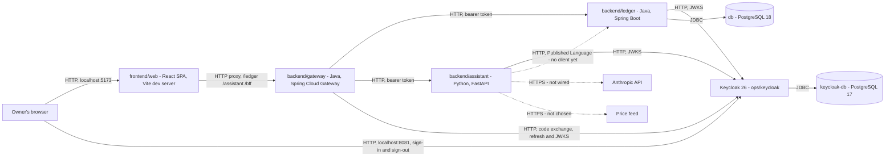
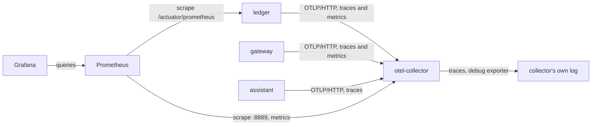

# FinAssist — architecture

The system as it actually is. *What it must do* is
[requirements](../requirements/requirements.md); *why* a given solution was chosen is
[the ADRs](../ADRs/).

> **All six contexts have a domain and an application layer. The ledger's store is PostgreSQL, the
> ledger and the assistant each serve an HTTP API, and every call the web client makes reaches them
> through a backend-for-frontend gateway that signs the browser in with OIDC against a self-hosted
> Keycloak.** Both services are resource servers: each validates a bearer token Keycloak issued for
> its own audience and decides what the caller may do from its own role table. The assistant has no
> store and no ledger client, so its use cases run over in-memory stand-ins. Everything but the web
> client runs under Compose, and the three services also run natively. Where a structure is
> defined but not yet inhabited, this document says so. What a screen does belongs in
> [requirements](../requirements/requirements.md), not here.

## Architecture overview

Three independently deployable backend services, a web client, an identity provider, and two
databases.

The **ledger** (Java) owns financial records and the rules that govern them. The **assistant**
(Python) holds the portfolio and its market data. It is to answer questions and compute analysis
over the ledger's records, reading them through the ledger's published API rather than its
database, and has no ledger client yet. The **web client** (TypeScript) is what a person talks to.
The **gateway** (Java) stands between the web client and both services: it signs the browser in,
keeps the browser's tokens, and relays each call to the service that owns its data. **Keycloak**
issues every token, from a realm committed as code, and keeps its own database, `keycloak-db`.

The split is [ADR-001](../ADRs/ADR-001-polyglot-java-python-split.md); the shape inside each
service is [ADR-007](../ADRs/ADR-007-asymmetric-hexagonal-architecture.md) as extended by
[ADR-010](../ADRs/ADR-010-bounded-context-map.md); the root layout is
[ADR-008](../ADRs/ADR-008-backend-frontend-root-layout.md); the gateway is
[ADR-030](../ADRs/ADR-030-oidc-authentication-through-a-bff-gateway.md), and Keycloak
[ADR-031](../ADRs/ADR-031-keycloak-as-the-identity-provider.md). The README shows this same
diagram; change the two together.



A solid edge carries traffic today; a dotted one is a port with nothing calling through it yet.

- **Every call the web client makes goes through the gateway.** The Vite dev server forwards
  `/ledger/…`, `/assistant/…` and `/bff/…` to it, path intact, and the gateway relays an
  authenticated `/ledger/api/v1/**` or `/assistant/api/v1/**` call to the ledger or the
  assistant, with the session's access token attached
  ([ADR-026](../ADRs/ADR-026-web-client-calls-both-services-through-one-origin.md), extended by
  ADR-030). The browser never calls either service directly.
- **The browser reaches Keycloak directly only to sign in and to sign out.** The gateway sends it
  to Keycloak's public URL, and Keycloak sends it back to the gateway's callback on the web
  client's origin.
- **Under Compose, the gateway, the ledger and the assistant reach Keycloak by its service
  name**, `http://keycloak:8080`: the gateway for the code exchange, the refresh grant and the JWK
  set it checks an ID token against, the ledger and the assistant for the signing keys they verify
  tokens against. Every token's issuer
  is still the public URL, `http://localhost:8081/realms/finassist` (ADR-031). Run natively, both
  addresses are Keycloak's published port.
- **`Assistant -> Ledger` has no caller yet.** The ledger serves its side and publishes it as a
  contract; the assistant has no ledger client
  ([#62](https://github.com/NaimElijah/FinAssist/issues/62)).
- **Where each part runs.** The two databases, Keycloak, the ledger, the gateway and the
  assistant run under Compose (`docker compose up`); the ledger, the gateway and the assistant
  also run natively, against the Compose databases and Keycloak. The web client runs as a Vite
  dev server (`npm run dev`), outside Compose.

`GatewayLoginFlowIT` proves the gateway's edges against fake services that speak real HTTP;
`KeycloakRealmIT` proves Keycloak's own behaviour against the real image, in Testcontainers; and
the opt-in smoke check, `ops/smoke/auth_smoke.py`, checks the wiring between the running
services under Compose ([ADR-034](../ADRs/ADR-034-keep-the-compose-smoke-check-manual.md)).

## Bounded contexts

Six contexts, each owned by exactly one service
([ADR-010](../ADRs/ADR-010-bounded-context-map.md), extended by
[ADR-015](../ADRs/ADR-015-planning-as-a-sixth-bounded-context.md)).

| Context | Owner | Holds | UI feature |
|---|---|---|---|
| `accounting` | `backend/ledger` | `Account`, `Entry`, `Balance` — the record of truth | yes |
| `budgeting` | `backend/ledger` | `Budget`, `Category`, `CategorisationRule` | yes |
| `portfolio` | `backend/assistant` | `Symbol`, `Lot`, `Position`, `Disposal`; `Valuation` and `Disposition` in its application layer | yes |
| `assistance` | `backend/assistant` | `EvidenceRef`, `Claim`, `GroundedAnswer`, `Ungrounded`; `Evidence` in its application layer | no — excluded until the privacy question is answered |
| `marketdata` | `backend/assistant` | `Ticker`, `Instrument`, `Quote` — feed not chosen | no |
| `planning` | `backend/ledger` | `PlannedFlow`, `Scenario`, `Projection`, `Comparison` — what is intended, not what happened | yes |

### The context map

| Role | Where | Consequence |
|---|---|---|
| Upstream, Supplier | `accounting` | Owns the records and the vocabulary; free to evolve its schema |
| Downstream, Customer | `portfolio`, `assistance` | Must not depend on the ledger's internals |
| Published Language | the OpenAPI document in [`contracts/`](../../contracts) | The only sanctioned way to read ledger data |
| Anti-corruption layer | `portfolio/adapters/outbound/ledger/`, `marketdata/adapters/outbound/feed/`, `assistance/adapters/outbound/llm/` | Foreign shapes become local model types here and nowhere else. Each holds an in-memory stand-in today |

`budgeting` and `planning` name **no accounting type at all** — not an `Account`, and not an
`AccountId` either. `contexts_do_not_depend_on_each_other` admits no exception, so a context
needing a ledger figure takes it as a `Money` handed in from above rather than reaching for it:
`Budget.remaining` takes the spend, `Projection.of` takes the opening balance. Wiring those to
real accounting data is the application layer's job: each context declares
an out-port in its own vocabulary — `SpendJournal` returning `SpendRecord`,
`OpeningPositionProvider` returning `OpeningPosition` and addressed by a local `AccountRef` —
and the translation over accounting lives in `composition`, outside every context.

`planning` is the one context in the ledger that is not invariant-dense by nature, and it was
put there by choice rather than by ADR-007's criterion; see
[ADR-015](../ADRs/ADR-015-planning-as-a-sixth-bounded-context.md) for the obligation that
creates and the trigger for moving it.

There is deliberately **no shared kernel across languages**. `Money` is implemented once per
language; two implementations obliged to stay bit-identical would cost more than the
duplication. What keeps them equivalent is `contracts/money-vectors.v1.json`, read by both
suites, so a behavioural difference fails a build rather than waiting to be noticed
([ADR-018](../ADRs/ADR-018-cross-language-money-vectors.md)).

## Components

| Component | Responsibility | State |
|---|---|---|
| `backend/ledger` | Accounting, budgeting and planning. Sole writer of the ledger store. Java 21, Spring Boot 4.1.2, Maven wrapper 3.10.0 | Domain and application layers complete, with unit, seeded-property and shared-vector tests, **live architecture rules** (layering, context isolation, both framework-free layers, the two web-adapter direction rules, DTO name uniqueness, exact money, a clock read only in the composition root, derived quantities never stored, and translations that reach their upstream only through its in-ports: eighteen rules in all), and Spring tests covering the Actuator probes, the observability wiring, the Host allow-list, the problem+json fallback and the assembled composition root; structured logs, OTLP traces and Prometheus metrics. Every repository port is backed by PostgreSQL; the in-memory ones are gone. Production keeps no domain event: `DiscardingAccountingEvents` and `DiscardingPlanningEvents` accept each one and drop it, and the recording `InMemoryAccountingEvents` and `InMemoryPlanningEvents` are test doubles under `src/test` ([ADR-048](../ADRs/ADR-048-domain-events-stay-in-process-until-a-consumer-exists.md)). **Inbound adapter**: eight component-scanned `@RestController`s across the three contexts, under `/api/v1`, calling in-ports only, with its generated OpenAPI document pinned by `LedgerContractIT`. **Resource server** (ADR-030): `LedgerSecurityConfiguration` validates every bearer token against Keycloak's JWKS and denies by default, granting `ledger:read`/`ledger:write` from a token's `roles` claim through `LedgerPermissions`, proven end to end by `LedgerAuthorizationIT` against the ledger's full, named inventory of endpoints, and `LedgerKeySourceOutageIT` for a JWKS outage. `TransactionController` passes the validated token's `sub` into every journal write as an `Actor`, stored as `recorded_by` (ADR-033). `ApplicationYmlPlaceholdersTest` resolves every `@Value` placeholder in its production code against `application.yml` alone, with no container. Runs under Compose (`build: ./backend/ledger`) as well as natively |
| `backend/assistant` | Portfolio, assistance and market data. It does not call the ledger. Python 3.13, FastAPI, uv lockfile | Domain and application layers complete, with unit, Hypothesis-property and shared-vector tests, and 13 architecture rules, each parametrised over the files of the layer it governs and guarded so that an empty layer fails the build rather than passing with nothing to check. Beyond layering and context isolation they forbid an adapter reaching across the inbound/outbound line in either direction, a clock read anywhere outside the composition root, an import made by a call, and a translation that reaches past the upstream's use case. It has an inbound adapter: `portfolio_router` under `/api/v1`, a `HostAllowList` middleware, a `RequestBodyLimit` middleware that refuses a request body over 64 KiB with 413 `CONTENT_TOO_LARGE` — a declared length before authentication and before the body is read, and a chunked body as the route reads it, which is after authentication, so an unauthenticated chunked body is answered 401 unread — and problem+json handling from the composition root, with its generated OpenAPI document pinned by `tests/test_contract.py`. `adapters/openapi.py` replaces FastAPI's own `422` on every operation with a `default` response carrying the `Problem` the assistant really sends, and adds the bearer scheme. Also serves `/health` and `/ready`. Its entry point, `adapters/__main__.py`, runs uvicorn's `h11` implementation rather than `httptools`, which bounds no header, and refuses 400 an unfinished request line and header block over 16 KiB (`MAX_HEADER_BLOCK_BYTES`) before the app sees it ([ADR-058](../ADRs/ADR-058-each-service-bounds-what-one-request-can-cost.md)). It also turns off uvicorn's proxy-header handling, so no `X-Forwarded-*` header rewrites the client address or scheme, and its `server` response header. **Resource server** (ADR-030): `BearerAuthentication`, a pure ASGI middleware added closer to the routes than the correlation middleware so a refused request still carries a correlation id, verifies every request's bearer token through `TokenVerifier` (via `run_in_threadpool`, since the verifier is synchronous) and denies by default outside `/health`, `/ready` and `/openapi.json`, storing the verified `Principal` — subject and roles alike — on the ASGI scope. `RequirePermission`, built by the composition root's `ROLE_PERMISSIONS` table and passed into `portfolio_router` as `require`, grants `portfolio:read` to `owner` and `viewer` alone; `assistant`, an unknown role, a missing `roles` claim or one that is not a list all grant nothing. Every route declares exactly one permission dependency, checked by a coverage test in `tests/test_authorization.py` that sees routes of every type, so a WebSocket or plain Starlette route, which cannot declare one, fails it; no WebSocket upgrade is served, since none is designed: the entry point runs uvicorn with `ws="none"`, so an `Upgrade: websocket` request is answered as plain HTTP, and `BearerAuthentication` still closes any `websocket` scope another launcher might deliver, before routing, whatever its path or token; the disposal route checks it before its JSON-media-type check, so a caller with no permission is refused 403 before 415, though a body declared as JSON that does not parse is answered 400 first, because FastAPI parses the body before any dependency runs. The key source it verifies against is [ADR-059](../ADRs/ADR-059-the-assistant-trusts-only-the-key-set-it-last-fetched.md)'s (see Communication). A development seed (`ASSISTANT_DEV_SEED`, off by default) loads fictional holdings and quotes from `adapters/seed.py` alone. `AnswerQuestion` is written and deliberately unwired — an LLM adapter would settle the privacy question by implication. Runs under Compose (`build: ./backend/assistant`) as well as natively |
| `frontend/web` | The only interface a person uses. React 19, Vite 8, TypeScript 6 | Four areas — accounting, budgets, planning and portfolio — each a feature under `src/features/` importing no other, composed in `src/app` inside a shared layout, under an error boundary per area; what each screen does is in [requirements](../requirements/requirements.md). **Server state** is a TanStack Query client that retries a failed read once, after a network failure or a 5xx other than a 503, and never retries a write: that rule is `isRetryable` in `src/shared/api/retry.ts` ([ADR-056](../ADRs/ADR-056-the-web-client-retries-a-failed-read-once-and-never-a-write.md)), and it also decides whether a failed read's `QueryErrorState` offers "Try again". **The app is gated on a session** (ADR-030): `SessionGate` renders the router only once `GET /bff/me` has answered, and `SignIn` — a plain link to the gateway's OIDC entry — while nobody is signed in. It provides the session once through `SessionContext`, and `WriteAccessContext`, computed by `writeAccessFor` from the session's roles, which every control that changes data reads through `useWriteAccess`, so a `viewer` is offered none: a courtesy only, since the ledger and the assistant decide access from the token (ADR-032). `queryClient.ts` rechecks the session when any other query or mutation answers 401. The session lives in `src/app/session/`, not a feature, since no bounded context owns it. **Contracts**: the accounting, budgeting and planning screens call the ledger, and the portfolio screens the assistant, through the dev proxy and the gateway. Wire types are generated from `contracts/` into `src/shared/api/contracts/` and mapped, member by member, onto each feature's own types in its `api/` layer — the anti-corruption layer ADR-029 requires. Each passes every decimal through `decimalString` (`src/shared/api/decimal.ts`), which throws `ApiBodyError` for anything but a decimal string (ADR-028). Query keys come from per-feature factories, so a mutation invalidates exactly what it can have changed. The `assistance` feature has no route. Design tokens and the shared primitives are in `src/shared/ui`, test helpers that render routes with their providers and fake `fetch` in `src/shared/testing`, the logging boundary in `shared/lib/logger.ts`, and the `traceparent` generator in `shared/lib/correlation.ts` |
| `backend/gateway` | Backend-for-frontend: terminates the browser's session, signs it in through OIDC and keeps every token server-side, and relays an authenticated request to the ledger or the assistant. Java 21, Spring Boot 4.1.2, Spring Cloud Gateway Server Web MVC 5.0.4, Maven wrapper 3.10.0 | `HostAllowListFilter` refuses an un-allow-listed `Host` before anything else, Actuator's health probes included. `RequestBodyLimitFilter`, a copy of the ledger's registered after the Host allow-list and the request observation, refuses a request body over 64 KiB, declared or chunked, with 413 `CONTENT_TOO_LARGE` before the security chain or the relay reads it ([ADR-058](../ADRs/ADR-058-each-service-bounds-what-one-request-can-cost.md)), so an over-limit write never reaches a service. `GatewaySecurityConfiguration` runs the OIDC authorization-code-plus-PKCE login against a `ClientRegistration` built by hand in `KeycloakRegistration` (no discovery, so the browser-facing and backchannel Keycloak addresses can differ under Compose); the session — held only in this process's memory — carries the access and refresh tokens through an `HttpSessionOAuth2AuthorizedClientRepository`, and the browser is left with an `HttpOnly` session cookie and a script-readable CSRF cookie, never a token. Every write must send that cookie's value back in the `X-FINASSIST-XSRF-TOKEN` header, compared as it is; `HeaderOnlyCsrfTokenRequestHandler` reads the token from that header alone, never from a `_csrf` request parameter in the query string or a form body, which Spring's own handlers would also accept ([ADR-057](../ADRs/ADR-057-a-page-on-another-localhost-port-is-treated-as-hostile.md)). What the gateway serves itself is exactly what `GatewaySecurityConfiguration` and `BffRoutes` name: the login entry `/bff/oauth2/authorization/keycloak` and the callback `/bff/login/oauth2/code/keycloak`, both public and both Spring Security filters — the login entry answers only a top-level navigation and refuses any other browser request 403 by its `Sec-Fetch-Mode` and `Sec-Fetch-Dest` (`LoginEntryNavigationFilter`), and the session it creates idles out after fifteen minutes until a sign-in completes (`PreSignInAuthorizationRequestRepository`); `GET /bff/me`, which needs a session and is its one controller, `SessionController`; `POST /bff/logout`, answered by Spring's `LogoutFilter` before any authorization rule is consulted; and Actuator's `/actuator/health/**`, public. The container's own forward to `/error` is permitted by dispatcher type, never by path. Every other permitted path — `/ledger/api/v1/**` and `/assistant/api/v1/**`, `GET` and `POST`, with a session — is a Spring Cloud Gateway MVC route matched by `Path=`/`Method=`, with `StripPrefix=1` removing the gateway's own prefix, `RemoveRequestHeader=` removing the browser's `Authorization`, `Cookie`, CSRF header and `HTTP2-Settings`, `RemoveResponseHeader=` removing from the service's answer `Server` and every header that would change the browser's state for the gateway's origin — `Set-Cookie`, `Clear-Site-Data`, `Strict-Transport-Security` and the CORS `Access-Control-*` grants — and `TokenRelay=` attaching the session's own access token, refreshing it first if it has expired; anything else is denied — the security chain ends in `anyRequest().denyAll()`, so a path no rule names is refused 401 or 403 before Spring Cloud Gateway's own routing could ever call it unmatched, and the gateway therefore never answers 404 `NOT_FOUND`; `GatewayProblems` declares no such code. A login-entry segment that does not resolve to a registration — anything but `keycloak` after `/bff/oauth2/authorization/` — is refused earlier still, by `OAuth2AuthorizationRequestRedirectFilter`'s own `LoginEntryFailureHandler`, ahead of those authorization rules, and it too answers 401 `UNAUTHENTICATED` rather than a 404 or a 500. `GatewayRelayProblems`, a `@RestControllerAdvice`, turns a refused refresh into an invalidated session and a 401, a refused connection into a 502 `UPSTREAM_UNAVAILABLE`, a refusal Spring MVC itself raised into that refusal's own status at WARN — 405 `METHOD_NOT_ALLOWED` and 406 `NOT_ACCEPTABLE`, the only two `GET /bff/me` can provoke — and anything else into a 500 logged at ERROR by exception class name alone, never a message or a token, while a downstream problem+json response passes through unchanged. A URL Spring Security's firewall refuses — an encoded dot segment or percent sign, an empty segment, a path parameter — is answered 400 `MALFORMED_REQUEST`, the ledger's code for a malformed request, by `ProblemRequestRejectedHandler` rather than Boot's error body, and still marks the request's observation as failed, as Spring Security's own handler does; a URL Tomcat refuses itself, before the servlet, keeps Tomcat's own 400. Every failure the gateway raises itself is the same RFC 9457 shape, written by `GatewayProblems`. Proven by `GatewayApplicationIT`, `GatewaySecurityTest`, `KeycloakRegistrationTest`, `HostAllowListFilterTest`, `SignInFailureHandlerTest`, `SpaLogoutSuccessHandlerTest`, `GatewayRelayProblemsTest`, `GatewayRelayTimeoutIT` and `GatewayLoginFlowIT` — the last driving a real code-plus-PKCE login against a fake OpenID provider and relaying to two fake downstream services, never a mock. `GatewayRelayRoutesTest` reads the relay routes from `application.yml` and holds their `Method=` and `Path=` predicates to every operation that `contracts/ledger-v1.openapi.json` and `contracts/assistant-v1.openapi.json` publish, and `GatewaySecurityTest` holds the security chain to the same operations, because the chain names its relay methods apart from the routes (#339). `GatewayApplicationIT` pins Actuator's web exposure to `health` alone. **It publishes its own OpenAPI document**, generated by springdoc and pinned by `GatewayContractIT`, describing `GET /bff/me`, `POST /bff/logout` — added by an `OpenApiCustomizer` in `GatewayOpenApiConfiguration`, since sign-out is a security filter and springdoc never sees it — the `sessionCookie`/`xsrfToken` security schemes, and a `Problem` schema kept identical to the ledger's by that same test. `GatewayContractIT` generates the document by calling springdoc's resource bean directly rather than over HTTP, so `/v3/api-docs` stays denied by the security chain even though its document is committed; the relay routes are deliberately absent from it, since the ledger and the assistant already publish their own. Both the ledger and the assistant validate every relayed token themselves and deny by default (see their own rows and Data flow below). Runs under Compose (`build: ./backend/gateway`) as well as natively (`./mvnw spring-boot:run`) |
| `contracts/` | The versioned wire contract, and the cross-language `Money` conformance vectors | `money-vectors.v1.json`, the README, `ledger-v1.openapi.json` — generated by springdoc, pinned by `LedgerContractIT` — `assistant-v1.openapi.json` — generated by FastAPI, pinned by `tests/test_contract.py` — and `gateway-v1.openapi.json` — generated by springdoc, pinned by `GatewayContractIT` |
| Keycloak (`ops/keycloak`) | The identity provider (ADR-031). Issues every token: the browser's, through the gateway's sign-in, and the assistant's own client-credentials token. Keycloak 26.8.1 | Built by `ops/keycloak/Dockerfile` as an optimized `kc.sh build`, with the deprecated `twitter-broker` and `identity-brokering-api` features disabled, and started with `start --optimized --import-realm` under Compose as `keycloak`, published on `127.0.0.1` only, logging JSON to the console (`KC_LOG_CONSOLE_OUTPUT`). It imports the `finassist` realm from `ops/keycloak/finassist-realm.json` at start-up, and only into an empty database. The realm holds the roles `owner`, `viewer` and `assistant`; two clients, `finassist-gateway` (standard flow, PKCE `S256`) and `finassist-assistant` (service account only), plus its own entry for the `admin-cli` client Keycloak creates in every realm, with every flow off and no full scope; and one seeded user with the `owner` role, who must set a new password and enrol TOTP at first sign-in. Neither client is allowed the realm's full scope: a realm-level `scopeMappings` entry gives the gateway `owner` and `viewer` and the assistant `assistant`, so the `roles` claim carries only FinAssist's own roles and never Keycloak's `default-roles-finassist`, `offline_access` or `uma_authorization`. Self-registration, password reset and remember-me are off, brute-force protection is on, no event listener is configured, so no sign-in event reaches Keycloak's log, and an offline session lives no longer than a browser session's ten-hour maximum. Every secret in the file is a `${VAR}` placeholder that `docker-compose.yml` requires through `:?`. `KeycloakRealmTest` pins the file, and `KeycloakRealmIT` runs the real image against a real PostgreSQL. Why the realm and the image state these settings rather than take Keycloak's defaults is [ADR-060](../ADRs/ADR-060-the-finassist-realm-and-the-keycloak-image-are-configured-not-defaulted.md) |
| `keycloak-db` | Keycloak's own store. PostgreSQL 17.11 | Runs via Compose, with its own volume, `keycloak-db-data`, and no published port, on the `identity` network, which only Keycloak shares. It shares no role, backup or failure domain with the ledger's `db` (ADR-031), and runs 17.11. Moving it to 18, which Keycloak 26.8 also supports, is a dump-and-restore recipe in [docs/operations/operations.md](../operations/operations.md) (#314) |
| `secret-check` (`ops/secret_check`) | Refuses to let the stack start on a secret that a file in the repository holds (ADR-044), or one shorter than 32 characters ([ADR-061](../ADRs/ADR-061-the-stack-refuses-a-configuration-that-weakens-a-credential.md)) | A one-shot Compose service with no profile, which `db`, `keycloak-db` and `grafana` wait on through `service_completed_successfully`. It reads the eight secrets Compose requires and the clone, mounted read-only. It searches every file git would not ignore for each value as a whole token, and refuses each value shorter than 32 characters, `MIN_SECRET_LENGTH`; it names each variable it refuses, never the value, its length or the file. It runs standard library only, as `nobody`, with no network. `ops/secret_check/tests` and CI's compose job prove it |
| `compose_check` (`ops/compose_check`) | Checks the resolved Compose file against the restart, log-bound, readiness, port-binding and profile conventions (ADR-039, [ADR-049](../ADRs/ADR-049-a-check-that-needs-cis-environment-stays-in-ci.md), [ADR-061](../ADRs/ADR-061-the-stack-refuses-a-configuration-that-weakens-a-credential.md)) | `compose_check.py`, standard library only. `make check-compose` runs `docker compose … config --format json` and pipes it to the script's standard input, so the script never runs Docker. Every long-running service must take the restart policy and the log bound exactly as the `x-restart-policy` and `x-logging` blocks set them, the one-shots `auth-smoke` and `secret-check` neither, and the ledger's, gateway's, assistant's and Keycloak's healthchecks must probe readiness. Every published port must bind `host_ip` exactly `127.0.0.1`, so a wildcard, an IPv6 address or a port with no address fails, and `keycloak-db` must publish none (ADR-030); `auth-smoke` must sit behind exactly `profiles: [smoke]` (ADR-034) and `secret-check` behind no profile (ADR-044). Every service but the two databases must take the `x-hardened` block's `cap_drop: [ALL]` and `security_opt: [no-new-privileges:true]`, and the block itself must hold exactly those; every one but the databases and Keycloak must set `read_only: true`; the script names those exemptions, never the services held to the rules, so a service added later is held to both; no service, a database included, may set `cap_add` or `privileged`; and `db` and `keycloak-db` must each attach to its own network alone, `books` or `identity`, which no service but the ledger or Keycloak may join (ADR-063). No service may set `network_mode` but `secret-check`, whose must be exactly `none`, so neither the host's network nor another container's namespace can step around those rules; and Prometheus's `command` must carry exactly one `--web.cors.origin=`, the empty regex that grants no origin ([ADR-057](../ADRs/ADR-057-a-page-on-another-localhost-port-is-treated-as-hostile.md)). The throwaway values for the variables the file requires with `:?` come from `ops/compose_check/placeholders.env`, which `make check-compose` sources before each Compose call over `.env.example` alone, so neither the owner's `.env` nor a secret exported in the shell reaches the resolved file. It also fails a `MANAGEMENT_ENDPOINTS_WEB_*`, `SPRING_APPLICATION_JSON` or `SPRING_CONFIG_*` key, under any spelling, or a JVM-options variable (`JAVA_TOOL_OPTIONS`, `JDK_JAVA_OPTIONS`, `_JAVA_OPTIONS`) in the ledger's or the gateway's environment, and a `command` or `entrypoint` on either, any of which would reopen the Actuator exposure their code pins and their tests cannot see. It fails a `LOGGING_LEVEL_*`, `LOGGING_GROUP_*`, `LOGGING_CONFIG`, `DEBUG` or `TRACE` key, under any spelling, in the gateway's environment, since its Spring Web and Security loggers write the authorization code, its PKCE verifier and the refresh grant below INFO. The script runs on the assistant's pinned Python, and the report names a service, a block, a probe path, a key or a member and never a value. `ops/compose_check/tests` feeds it crafted files and runs it as a process |
| `db` — PostgreSQL 18 | The ledger's store | Runs via Compose, on the `books` network, which only the ledger shares, with its port published on `127.0.0.1` for a natively-run ledger and the backup CLI. Three schemas — `accounting`, `budgeting`, `planning` — with no foreign key crossing one; migrated by Flyway from a directory per context. The journal is append-only in the database, enforced by triggers. The ledger connects with pgjdbc's `logServerErrorDetail` off, so a database error's message, logged with every 5xx, never carries the server's `Detail` line or the row it can quote ([ADR-058](../ADRs/ADR-058-each-service-bounds-what-one-request-can-cost.md)) |
| `otel-collector`, `prometheus`, `grafana` | The local telemetry backend, behind the `monitoring` Compose profile (ADR-019) | The collector (`ops/otel-collector.yaml`, `otel/opentelemetry-collector-contrib` 0.139.0) receives OTLP on 4318 (HTTP) and 4317 (gRPC). Traces leave only through its `debug` exporter at `basic` verbosity, which logs each batch's span count and never a span's attributes, and metrics through a Prometheus exporter on 8889. Prometheus (`ops/prometheus.yml`, 3.7.3) scrapes the collector and the ledger's `/actuator/prometheus`, and grants no origin a cross-origin read of its API: `--web.cors.origin` is set empty, where its default `.*` would echo any page's origin back as allowed ([ADR-057](../ADRs/ADR-057-a-page-on-another-localhost-port-is-treated-as-hostile.md)). Grafana's datasource queries it server-side (`access: proxy`). Grafana (12.3.1) provisions the Prometheus datasource and one dashboard, `finassist-ledger`, from `ops/grafana/`. No alerting rule exists. Nothing runs without `--profile monitoring`, and a service drops its telemetry unless `OTEL_EXPORT_ENABLED` is true |
| `auth-smoke` (`ops/smoke`) | Checks the wiring between the running services, which no one service's suite can see (ADR-034, ADR-040) | A one-shot Compose service behind `profiles: [smoke]`, run by hand with `make smoke-auth` and never by CI. It reaches Keycloak, the ledger, the assistant and the gateway by Compose service name, and exits non-zero on the first failed check, naming it and never printing a token, secret, cookie or body. Standard library only, in the stock `python:3.13.18-slim-trixie` image with the script bind-mounted |
| Backup CLI (`ops/backup`) | Backs up, restores and proves a restore of each database (ADR-038) | `ops/backup/backup.py`, standard library only, run on the host with `uv run` through `make backup`, `make restore` and `make restore-check`. It is neither a Compose service nor an image; see [Backing up and restoring](#data-flow) under Data flow |

## Structure: context first, hexagon inside

A context is one directory, so it can be extracted by moving it. Tactical DDD — aggregates,
value objects, domain events — is used **only in the ledger**, where the invariants are; the
assistant's cores are pure functions over frozen dataclasses.

```
backend/ledger/src/main/java/io/github/naimelijah/finassist/ledger/
  accounting/   domain/{account,entry,event}/  application/{port/in,port/out,service}/  adapter/{in/web,out/event,out/persistence}/
  budgeting/    domain/{budget,category}/      application/…  adapter/{in/web,out/persistence}/
  planning/     domain/{event,forecast,plan}/  application/…  adapter/{in/web,out/event,out/persistence}/
  shared/       Money, Currency, CurrencyMismatchException — in-language kernel
  composition/  the composition root: Spring wiring, security, problem handling, and the two
                cross-context translations
  LedgerApplication.java

backend/gateway/src/main/java/io/github/naimelijah/finassist/gateway/
  composition/  the whole service: GatewaySecurityConfiguration, KeycloakRegistration,
                HostAllowListFilter, SessionController, the problem writers and GatewayRelayProblems
  GatewayApplication.java

backend/assistant/src/finassist_assistant/
  portfolio/    domain/{model,analysis}/       application/{port,usecase}/  adapters/{inbound/api,outbound/ledger}/
  assistance/   domain/{model,grounding}/      application/…                adapters/{inbound/api,outbound/llm}/
  marketdata/   domain/{model,normalisation}/  application/…                adapters/outbound/feed/
  shared/       Money, Currency
  adapters/     the composition root: settings, auth, hosts, observability, problems, openapi,
                seed, the FastAPI app, and wiring.py, which assembles the use cases and holds
                MarketDataQuotes. Not a context

frontend/web/src/
  features/{accounting,budgeting,planning,portfolio,assistance}/{api,components,hooks,types}/
                each index.ts exports its area's routes; assistance has no route
  shared/{ui,api,lib,testing}/
  app/          the only place that knows every feature at once: routes.tsx composes their routes,
                PlanningAccountsBridge.tsx adapts accounting's accounts into planning's terms, and
                session/ gates the whole app on a signed-in session (SessionGate, SignIn, UserMenu)
```

`LedgerApplication` sits in the root package so component scanning covers every context. The
wiring lives in `composition`, which is Spring-aware by design and is the only ledger package
permitted to see two contexts at once; the application layer carries no annotation and is wired
by constructor ([ADR-022](../ADRs/ADR-022-ledger-composition-root.md)).

The assistant's top-level `adapters/` is its composition root: the package that wires FastAPI,
structlog and OpenTelemetry together, and the only one that may import structlog or OpenTelemetry.
It sits beside the contexts because it belongs to none, and it is named `adapters` because that is
what it is: the architecture rules key on that path segment, so the exemption it needs is one it
already earns rather than a special case. A context's own `adapters/` may import FastAPI too
(`portfolio`'s router does); only its domain and application layers may not.

The gateway has no bounded context: it holds no domain and restates no service's DTO, so
everything it has is composition — its security chain, the Keycloak registration, the Host
allow-list, `GET /bff/me`, its problem writers and its relay failures — and its two relay routes
are declared in `application.yml` rather than in Java.

Operational configuration lives in `ops/`: the collector, Prometheus and Grafana configuration
that the `monitoring` Compose profile mounts (`otel-collector.yaml`, `prometheus.yml`, `grafana/`);
`ops/keycloak/`, the `Dockerfile` that builds the identity provider and the `finassist` realm it
imports at start-up (ADR-031); `ops/smoke/auth_smoke.py`, the opt-in smoke check behind the `smoke`
profile (ADR-034); `ops/backup/backup.py`, the operator CLI that backs up, restores and proves a
restore of each database (ADR-038); `ops/secret_check/secret_check.py`, the one-shot that refuses
a published or short secret (ADR-044, ADR-061); and `ops/compose_check/compose_check.py`, the check that
`make check-compose` pipes the resolved Compose file into (ADR-049). One directory per tool, none of them a service
([ADR-052](../ADRs/ADR-052-ops-holds-operator-code-one-directory-per-tool.md)).

## Communication

- **Owner to web** — HTTP, from the owner's browser to the Vite dev server on
  `http://localhost:5173` — `localhost`, not `127.0.0.1`: the gateway's session cookie is keyed
  to the host name `GATEWAY_PUBLIC_URL` names, so opening the other one signs in against a
  different, cookie-less origin. Nothing terminates TLS: the server binds loopback only
  (ADR-030), so the connection never leaves the machine. Vite's `/__open-in-editor`, which starts
  the owner's editor on the file it names, answers only a request from the app's own page,
  `Sec-Fetch-Site: same-origin`, and refuses any other with 403 (`vite.config.ts`,
  `tests/devServer.test.ts`). The dev server and `vite preview` send
  `Content-Security-Policy: frame-ancestors 'none'` on what they answer themselves, the app shell
  included, so no page can frame the app; that is the whole policy, and the full one is
  [#165](https://github.com/NaimElijah/FinAssist/issues/165). Both turn CORS off, so no other
  origin, another `localhost` port included, may read what they serve, and leave `fs.strict` and
  `fs.allow` at Vite's defaults, which serve `frontend/web` alone. The reasoning for these controls, and for the gateway's
  against a page on another `localhost` port, is [ADR-057](../ADRs/ADR-057-a-page-on-another-localhost-port-is-treated-as-hostile.md).
- **Web to ledger, through the gateway** — HTTP, for the accounting, budgeting and planning
  screens. **Implemented on both sides for all three.** The ledger serves
  `/api/v1/accounts`, `/api/v1/transactions`,
  `/api/v1/budgets`, `/api/v1/categorisation-rules`, `/api/v1/planned-flows`, `/api/v1/scenarios`
  and `/api/v1/scenario-comparisons`. The web client's accounting screens call `GET` and
  `POST /api/v1/accounts`, `GET /api/v1/accounts/{id}/balance` — one request per account on the
  list (ADR-028) — and `GET /api/v1/accounts/{id}/transactions`, then `POST /api/v1/transactions`
  to record one and `POST /api/v1/transactions/{id}/clear`, `.../reconcile` or `.../void` to move
  it through its lifecycle. The budgeting screens call `GET` and `POST /api/v1/budgets`,
  `GET /api/v1/budgets/{id}/review` — no single-item read for a budget itself, so the review page
  takes its period and currency from the already-loaded list (ADR-028) — and `GET` and
  `POST /api/v1/categorisation-rules`. The planning screens call `GET` and
  `POST /api/v1/planned-flows`, `POST /api/v1/planned-flows/{id}/commit`, `.../realise` or
  `.../cancel`, `GET` and `POST /api/v1/scenarios`, `GET /api/v1/scenarios/{id}/projection` and
  `GET /api/v1/scenario-comparisons` — the last two carrying only ids, dates and the step in their
  query, one repeated `scenario`, `cash` or `invested` parameter per value, never an amount
  (ADR-028). In development the browser calls `/ledger/…` on the Vite origin, and the dev proxy
  forwards it, path intact, to the gateway on loopback, whose own route strips the prefix and
  relays to the ledger once the session is authenticated — one origin throughout
  ([ADR-026](../ADRs/ADR-026-web-client-calls-both-services-through-one-origin.md), extended by
  [ADR-030](../ADRs/ADR-030-oidc-authentication-through-a-bff-gateway.md)).
- **Web to assistant, through the gateway** — HTTP, for the portfolio screens, through the same
  proxy under `/assistant/…`. **Implemented on both sides.** The assistant serves
  `/api/v1/portfolio/holdings/{symbol}/position` (`GET`),
  `/api/v1/portfolio/holdings/{symbol}/valuation` (`GET`) and
  `/api/v1/portfolio/holdings/{symbol}/disposal` (`POST`, a JSON body, never query parameters,
  because its proceeds are an amount of money — ADR-028), each behind `HostAllowList` and each
  refusal a problem. The web client's holding page calls the position and the valuation side by
  side for the symbol it shows, and the disposal when the owner prices one, the symbol
  percent-encoded as one path segment. Every id or symbol in a path, on every screen, goes through
  `pathSegment` (`src/shared/api/pathSegment.ts`), which refuses an empty value, `.` or `..`
  before a request is built, since the URL parser would resolve each to another path. In development the browser calls `/assistant/…` on the Vite
  origin, and the dev proxy forwards it, path intact, to the gateway on loopback, whose own route
  strips the prefix and relays to the assistant once the session is authenticated
  ([ADR-026](../ADRs/ADR-026-web-client-calls-both-services-through-one-origin.md), extended by
  [ADR-030](../ADRs/ADR-030-oidc-authentication-through-a-bff-gateway.md), `tests/devServer.test.ts`).
- **Assistant to ledger** — HTTP, described by the ledger's OpenAPI document under `contracts/`
  and versioned in the URL path ([ADR-004](../ADRs/ADR-004-http-openapi-service-contract.md),
  Accepted). **The ledger side exists and is published as a contract; the assistant's client
  still does not.** `LedgerPort` remains an in-memory stand-in.
- **Assistant to Anthropic** — not built. `LlmPort` and its anti-corruption layer's directory
  exist with no adapter behind them, and `AnswerQuestion` is deliberately unwired
  (`adapters/wiring.py`) until the privacy question is answered.
- **Assistant to price feed** — not chosen; the port and its ACL exist, the client does not.
- **Ledger to Postgres** — JDBC, hand-written SQL over Spring's `JdbcClient`, with Flyway
  running the migrations at start-up ([ADR-006](../ADRs/ADR-006-postgresql-for-the-ledger-store.md),
  [ADR-024](../ADRs/ADR-024-jdbc-persistence-and-append-only-schema.md)). No ORM: an entity is
  not an aggregate, and every statement the ledger issues is readable in one place. Flyway runs
  **out of order** (`spring.flyway.out-of-order: true`): one history table with a major version
  per context means a new migration for any context but the highest necessarily arrives below a
  version already applied, and Flyway would otherwise refuse to start; `ReleasedMigrationsTest` holds
  the order within a context ([ADR-035](../ADRs/ADR-035-flyway-runs-out-of-order.md), corrected by
  [ADR-047](../ADRs/ADR-047-accepted-records-reconciled-with-the-system-as-built.md)). Under
  Compose the two share the `books` network and no other container joins it, so no other service
  can resolve or reach `db` (ADR-063).
- **Browser to gateway** — HTTP, everything under `/bff/` — the OIDC login entry and callback,
  `GET /bff/me` and `POST /bff/logout` — and, once authenticated, `GET`/`POST` under
  `/ledger/api/v1/**` and `/assistant/api/v1/**`. **`HostAllowListFilter` runs first, ahead of
  the session and every route** ([ADR-030](../ADRs/ADR-030-oidc-authentication-through-a-bff-gateway.md)).
  **The web client's dev proxy forwards `/ledger/…`, `/assistant/…` and `/bff/…` here, each
  path kept whole** — no prefix is stripped in `vite.config.ts` — so the gateway's own
  `StripPrefix=1` route match still sees the full `/ledger/api/v1/**` or `/assistant/api/v1/**`
  path it expects, and `/bff/**` arrives unchanged for its own routes
  ([ADR-026](../ADRs/ADR-026-web-client-calls-both-services-through-one-origin.md)). Every relay
  route still requires an authenticated session, and the web client's own `SessionGate` gates
  every screen on one: a developer running `npm run dev` with nobody signed in sees the sign-in
  screen rather than a 401 problem, and signing in through it reaches this same login entry.
  Gateway tests drive this edge with a JDK `HttpClient` directly, rather than through the
  running web client.
- **Browser to Keycloak** — HTTP, to Keycloak's public URL, `http://localhost:8081` by default:
  its login page, reached through the gateway's redirect; its end-session URL, reached through
  the URL `POST /bff/logout` answers; and its account and admin consoles, which the owner opens by
  hand. Keycloak's realm requires TLS for external addresses only (`sslRequired: external`), which
  is what lets this stay plain HTTP on loopback (ADR-030).
- **Gateway to Keycloak** — HTTP over the backchannel, `GATEWAY_OIDC_INTERNAL_URL`: the
  authorization-code exchange and the `refresh_token` grant `TokenRelay=` uses to renew an expired
  access token, and the JWK set it checks an ID token against, all from a `ClientRegistration`
  built by hand in `KeycloakRegistration` rather than discovered. Under Compose that URL is
  `http://keycloak:8080`, which only a container can resolve, while the URLs the browser is sent to
  are built from `GATEWAY_OIDC_PUBLIC_URL`. `GatewayLoginFlowIT` proves this edge against
  `composition.support.FakeOpenIdProvider`, a JDK `HttpServer` signing genuine RSA JWTs, so the
  login and refresh paths run against real HTTP and a real signature check, never a mock. All
  three calls are bounded by `spring.http.clients.connect-timeout` and `read-timeout`, because
  `KeycloakRegistration` builds each one's HTTP client from Boot's own builders; Spring
  Security's defaults for all three build theirs from a static factory that never sees those
  settings, and `GatewayKeycloakTimeoutIT` drives a Keycloak that accepts the connection and then
  never answers to prove each gives up.
- **Gateway to ledger, and gateway to assistant** — HTTP, relaying `GET`/`POST /ledger/api/v1/**`
  and `/assistant/api/v1/**` once each request is authenticated. A Spring Cloud Gateway Server Web
  MVC route strips the gateway's own path prefix, removes the browser's `Authorization`, `Cookie`,
  `X-FINASSIST-XSRF-TOKEN` and `HTTP2-Settings` headers, and attaches the session's own access
  token — refreshed first if it had expired; on the way back it removes the service's `Set-Cookie`,
  `Clear-Site-Data`, `Strict-Transport-Security`, CORS and `Server` headers. **The ledger and the assistant each validate that
  token themselves and deny by default**, deciding what it may do from their own role tables
  (ADR-032). One access token carries both audiences, `finassist-ledger` and `finassist-assistant`,
  so the one session serves both relays.
- **Ledger and assistant to Keycloak** — HTTP, fetching the signing keys a bearer token is
  verified against from an explicit, internal JWKS URI: `LEDGER_OIDC_JWKS_URI` and
  `ASSISTANT_OIDC_JWKS_URI`, `http://keycloak:8080/realms/finassist/protocol/openid-connect/certs`
  under Compose. Neither runs OIDC discovery at start-up (ADR-030). A key source that cannot be
  reached, or answers something that cannot be used as a key set — a body that is not JSON, JSON that
  is not a key set, or a key set left with no key at all, such as `{"keys": []}` — is answered 503
  `AUTHENTICATION_UNAVAILABLE` on both services, never 401, while a set lacking only the token's
  key is a 401 (ADR-037; `LedgerKeySourceOutageIT`, `LedgerJwksBodyTest`, `test_authorization.py`,
  `test_auth.py`). Each tells the two apart where it can see the difference. The ledger's
  `EmptyKeySetIsAnOutage` wraps the key selector Spring builds and raises an outage when no key
  matched and the set is empty. The assistant's `jwks_key_source` ([ADR-059](../ADRs/ADR-059-the-assistant-trusts-only-the-key-set-it-last-fetched.md)) builds a `PyJWKClient` whose
  `fetch_data`, the one method that fetches and parses the set and never sees a token, raises every
  failure as `KeySourceUnavailable`. It keeps the fetched set for five minutes and caches no signing
  key apart from it, as the ledger's Nimbus source keeps none, so a key removed from the realm stops
  verifying once the set expires, and a key source still unreachable past that lifespan is a 503
  for every token (`test_auth.py`). After a failed fetch it fetches nothing for
  `JWKS_FETCH_BACKOFF_SECONDS`, 15 seconds, three times the fetch's own five-second timeout, and
  answers every lookup that would have fetched as an outage at once.
- **Keycloak to `keycloak-db`** — JDBC, to its own PostgreSQL on the `identity` network, which no
  other container joins (ADR-063). That database publishes no port and shares no role, volume or failure domain with the ledger's `db`
  (ADR-031).
- **Services to the collector** — OTLP over HTTP to `OTEL_EXPORTER_OTLP_ENDPOINT`
  (`http://otel-collector:4318` under Compose), only when `OTEL_EXPORT_ENABLED` is true and the
  `monitoring` profile has started a collector (ADR-019). See *Telemetry* under Data flow.
- **Prometheus to the ledger and the collector** — HTTP scrapes, every 15 seconds, of the ledger's
  `/actuator/prometheus` and the collector's Prometheus exporter on 8889. **Grafana to
  Prometheus** — its provisioned datasource.
- **The backup CLI to each database** — `docker compose exec -T` into the database's own
  container, so no shell on the host handles a dump (ADR-038).
- **The smoke check to the running stack** — HTTP, by Compose service name, from inside the Compose
  network (ADR-034).

The ledger never calls the assistant, and the assistant never calls the web client.

## Data flow

**A ledger request reaches a use case.** `HostAllowListFilter` runs first, ahead of every
other filter, Actuator included (ADR-030): a request whose `Host` is not on
`LEDGER_ALLOWED_HOSTS` is refused 403 before the dispatcher sees it. After Spring MVC's request
observation, and ahead of the form-content filter and every other filter that could read a body,
`RequestBodyLimitFilter` refuses a body over `MAX_REQUEST_BODY_BYTES`, 64 KiB, with 413
`CONTENT_TOO_LARGE` ([ADR-058](../ADRs/ADR-058-each-service-bounds-what-one-request-can-cost.md)): a declared `Content-Length` over it unread, and a chunked body once it runs
one byte past it, which within the limit goes on carrying the bytes already read. Next is
`LedgerSecurityConfiguration`'s own filter chain, registered as the `springSecurityFilterChain`
servlet filter: it reads the `Authorization` header, decodes and validates the bearer token
against Keycloak's JWKS with an injected clock, and checks the permission its URL rule needs —
`ledger:read` for a `GET`, `ledger:write` for a `POST`, `denyAll` for everything else, `HEAD` and
`OPTIONS` included — before the dispatcher ever sees the request either. A missing or rejected
token is answered 401, a permission the token's role does not grant 403, and an unreachable JWKS
source 503, each by `ProblemAuthenticationEntryPoint` or `ProblemAccessDeniedHandler`, never by a
controller (ADR-030). What passes both filters reaches a component-scanned `@RestController` for
its context, which validates the body, builds a command and calls its in-port; the in-port's
implementation is a hand-wired application service, which enforces the domain's invariants and
calls its repository, which issues hand-written SQL over `JdbcClient` against PostgreSQL. A
response DTO is built from the domain result and serialised — every decimal as a string, every
sealed lifecycle flattened to a required `status` with optional `on`/`reason` members, mapped by
hand rather than by a Jackson polymorphism annotation (ADR-028): HTTP → `HostAllowListFilter` →
`RequestBodyLimitFilter` → security chain → controller → in-port → service → repository → PostgreSQL.

**A failure becomes a problem.** A well-formed request a domain or adapter rule refuses raises
`IllegalArgumentException` and is answered 422; an illegal lifecycle transition raises
`IllegalTransitionException` (accounting) or `IllegalPlanTransitionException` (planning) and is
answered 409, each by its own context's advice, which runs at the highest precedence. Spring
MVC's own failures — an unknown route, a non-JSON body, a malformed decimal or UUID — keep their
own statuses (404, 415, 400) through the composition root's fallback, `LedgerProblemHandler`, at
the lowest precedence, which answers everything no context's advice claimed. **A body declared as
multipart that cannot be parsed, one whose type names no boundary say, is 400
`MALFORMED_REQUEST`**: Spring MVC parses multipart before it chooses a route, a `GET`'s included,
and nothing in the ledger takes multipart, so the fallback treats the failure as the request's ([ADR-058](../ADRs/ADR-058-each-service-bounds-what-one-request-can-cost.md)). **A path Spring Security's
firewall refuses** — an encoded dot segment or percent sign, an empty segment, a path parameter —
**is 400 `MALFORMED_REQUEST` too**, written by `ProblemRequestRejectedHandler` before any filter of
the chain runs, with a fixed body that names nothing from the request; the observation is still
marked failed (`RequestRejectedHandlerTest`; [ADR-058](../ADRs/ADR-058-each-service-bounds-what-one-request-can-cost.md)). It is a copy of the gateway's handler, kept symmetric as `HostAllowListFilter` is. **A stored row a
JDBC mapper cannot reconstruct — an unknown enum constant, or an amount `Money` refuses — raises
`IllegalStateException`, which the fallback answers as a logged 500; only a domain refusal
reaches 422** — the accepted trade-off ADR-028 records for `IllegalArgumentException`. **A JSON
number carrying a fractional part or a decimal point — `1.5` and `1.0` alike — is refused as 400
wherever an integer field expects one**, before the domain sees it:
`spring.jackson.deserialization.accept-float-as-int: false` stops Jackson silently truncating
one. **A JSON number is refused as 400 wherever a text field expects one**, a decimal sent as
`12.50` included: `StrictTextCoercion`, registered in `composition`, stops Jackson reading the
number as text that would then pass the decimal pattern. **A date outside the years 1 to 9999 is
refused as 400 wherever one is read**, in a query parameter or a body member alike:
`SupportedDates`, registered in `composition`, bounds both Spring MVC's parsing of a query date
and Jackson's of a body date, so no date beyond ISO 8601's four-digit years reaches the store or
a projection.

**The probe and observability paths pass the same chain with no token.** The ledger's chain permits
`/actuator/health/**`, `/actuator/info`, `/actuator/prometheus`, `/actuator/metrics/**`,
`/v3/api-docs` and `/v3/api-docs.yaml`, and nothing else without a token; Actuator exposes exactly
`health`, `info`, `metrics` and `prometheus`. The ledger's readiness probe reaches Postgres: it
includes the `db` indicator, so a ledger that cannot connect reports `DOWN` rather than ready. The
assistant answers `GET /health`, `GET /ready` and `GET /openapi.json` the same way, with no
token.

**Signing in, checking the session, and signing out, from the browser (ADR-030).** `App.tsx`
renders `SessionGate` around `RouterProvider`, so nothing behind it - no route, no ledger or
assistant call - runs before a session exists → `SessionGate` calls `useSession`, which reads
`GET /bff/me` through the dev proxy to the gateway → while nobody is signed in, the gateway
answers 401 `UNAUTHENTICATED` and `SessionGate` renders `SignIn`: a plain `<a href>` to
`/bff/oauth2/authorization/keycloak`, never a `fetch`, since only a top-level browser navigation
follows the gateway's redirect to Keycloak's own login page. A failed round trip through Keycloak
sends the browser back to `?signin=failed`, which `SignIn` reads from `window.location.search`
and shows as an explanation, since it renders above the router and has no route to read a query
parameter through. Once `GET /bff/me` answers `{subject, name, roles}`, `SessionGate` provides it
once, through `SessionContext`, to everything it renders - `Layout`'s `UserMenu` reads it from
there rather than fetching it again. Any other failure from the session check - a network error, a
5xx - is a real outage, not the ordinary signed-out state, and renders a retryable
`QueryErrorState` instead of `SignIn`. **Signing out.** `UserMenu`'s "Sign out" calls `useSignOut`,
guarded by a `useRef` against a second click before the first has settled → `sessionApi.signOut`
sends `POST /bff/logout` with `sendJson`, which attaches the CSRF header → the gateway ends its
session and answers the URL that also ends Keycloak's → the whole query cache is cleared, since
everything in it was read under the session that just ended, and `browserLocation.assign`
navigates the browser there - after checking the URL parses with an `http:` or `https:` scheme, so
a tampered or malformed value from the server is refused rather than executed as a `javascript:`
URL in the page. A sign-out that fails - a refusal such as 403 `CSRF_TOKEN_INVALID`, a network
failure, or a corrupted CSRF cookie that stops `sendJson` before it sends - clears nothing, since
the session is still open, and `UserMenu` shows an alert saying so until the next attempt,
mounted afresh for each failure so a repeated one is announced again, and moves focus back to
"Sign out" when the disabled button had dropped it to the page body.
**Noticing the session end mid-visit.** Every other query and mutation still runs
its own request without checking the session first, so `queryClient.ts`'s `QueryCache` and
`MutationCache` both invalidate `sessionKeys.me` when any of them answers 401 - except the session
check's own 401, which is excluded deliberately: invalidating there would refetch it, which would
401 again, an infinite loop for what is already the ordinary signed-out state. The next render of
`SessionGate` then reads that invalidated session as failed and shows `SignIn` again, without a
poll of its own.

**Signing in, at the gateway and Keycloak (ADR-030, ADR-031).** The browser navigates to
`/bff/oauth2/authorization/keycloak` on the Vite origin, and the dev proxy forwards it to the
gateway → `LoginEntryNavigationFilter` refuses, 403 `FORBIDDEN` and before any session exists, a
browser request whose `Sec-Fetch-Mode` is anything but `navigate` or whose `Sec-Fetch-Dest` is
anything but `document`, so only a top-level navigation of the browser's own window, or a client
that sends no Fetch Metadata, can start a sign-in; the filter checks no origin (ADR-057) → Spring's
authorization endpoint, on the
`ClientRegistration` `KeycloakRegistration` builds by hand, stores the request in the session
through `PreSignInAuthorizationRequestRepository`, which gives a session created for it an idle
limit of fifteen minutes rather than thirty, and answers 302 to Keycloak's *public*
authorization endpoint, with PKCE `S256` and a `redirect_uri` of
`GATEWAY_PUBLIC_URL/bff/login/oauth2/code/keycloak` → the browser signs in on Keycloak's own page,
which, the first time, asks for a TOTP device, a new password and the owner's email and names
([First sign-in](../../README.md#first-sign-in)) → Keycloak answers 302 to that
callback, which the dev proxy forwards to the gateway → the gateway exchanges the code at
Keycloak's token endpoint over the *backchannel*, authenticating as `finassist-gateway` with
`client_secret_basic` and sending the PKCE verifier → it validates the ID token against the
public issuer and the backchannel JWK set, keeps the access and refresh tokens in the session
through `HttpSessionOAuth2AuthorizedClientRepository` and the ID token with the signed-in
principal, and gives the session, its id rotated, back the configured 30-minute idle limit → it
answers 302 to `GATEWAY_PUBLIC_URL/`, whatever the browser had been doing before,
since a `NullRequestCache` remembers nothing. From then on the browser holds `FINASSIST_SESSION`,
`HttpOnly`, and the script-readable `FINASSIST-XSRF-TOKEN` cookie, never a token. A failed
sign-in answers 302 to
`GATEWAY_PUBLIC_URL/?signin=failed` instead, and `SignInFailureHandler` logs its OAuth2 error code
alone.

**Signing out, at the gateway.** `POST /bff/logout`, with the CSRF header → Spring's
`LogoutFilter` invalidates the session, and with it every token it held, and deletes
`FINASSIST_SESSION` → `SpaLogoutSuccessHandler` answers 200 `{logoutUrl}`: Keycloak's public
end-session endpoint, carrying `client_id`, a `post_logout_redirect_uri` of
`GATEWAY_PUBLIC_URL/` and, when there was a session, the ID token as `id_token_hint` → the
browser navigates there, which ends Keycloak's own session and returns the browser to the web
client. A sign-out with no session still gets an end-session URL, without the hint.

**Recording a transaction, from the browser.** `RecordTransactionPage`'s form state → its pure
mapper, `entryRowAmount`, turns each row's debit/credit pair into the signed amount `Entry`
carries, with no arithmetic anywhere in the browser (ADR-029) → `accountingApi.recordTransaction`
maps the feature's `RecordTransactionInput` onto the generated `RecordTransactionRequest` and
calls `sendJson` → the Vite dev proxy forwards `POST /ledger/api/v1/transactions`, path intact, to
the gateway on loopback, whose own route strips `/ledger` and relays to the ledger once the
session is authenticated
([ADR-026](../ADRs/ADR-026-web-client-calls-both-services-through-one-origin.md), extended by
[ADR-030](../ADRs/ADR-030-oidc-authentication-through-a-bff-gateway.md))
→ the ledger's own path, below, runs unchanged and answers 201 with the recorded transaction, or a
problem. A 422 `RULE_VIOLATED`, `UNKNOWN_ACCOUNT` or `CURRENCY_MISMATCH`, or a 400 listing field
`errors`, comes back as `application/problem+json` and is parsed onto `ApiError.problem` by the
shared client (ADR-028); the form shows a 400's field errors on their fields and anything else in
an `ErrorState` above the form. On success, `useRecordTransaction` invalidates the balance and
transaction-list queries of every account the entries name, and never the accounts list, which
recording cannot change; the browser moves to the first entry's account.

**Recording a purchase, ledger.** `TransactionController` builds an `Actor` from the request's
`java.security.Principal#getName()` — the validated token's `sub` — and passes it into
`RecordTransactionCommand` as its `recordedBy` field, which the request body cannot set (ADR-021 still
holds: identity is generated inside the service, and an actor is who asked, never an identity for what the command creates) →
`TransactionService` loads every referenced `Account` and refuses an entry whose currency the
account does not hold → `Transaction.record` refuses entries that do not sum to zero →
`TransactionRepository.save`, which inserts the transaction, its entries, its opening state and
the actor's subject as `recorded_by` in one database transaction, and whose deferred constraint
refuses at commit anything the aggregate somehow let through → `AccountingEvents.publish`, which production discards: nothing consumes an event yet, and the
transactional outbox waits for the first consumer
([ADR-023](../ADRs/ADR-023-domain-events-in-the-ledger.md), [ADR-048](../ADRs/ADR-048-domain-events-stay-in-process-until-a-consumer-exists.md)).

**Clearing it.** `TransactionController` builds a fresh `Actor` from the clearing request's own
principal — it may name someone other than whoever recorded the transaction →
`TransactionService.clear` loads the transaction, the aggregate returns a new value in the
`Cleared` state, and `save` **appends** a row to `accounting.journal_transaction_state`, carrying
that actor's subject as its own `recorded_by`; the transaction row's `recorded_by`, written once
at insert, never changes. Nothing is overwritten and nothing is deleted; the earlier states stay
readable, which is what makes the journal the audit record, naming who wrote each row
([ADR-020](../ADRs/ADR-020-audit-trail-follows-persistence.md),
[ADR-033](../ADRs/ADR-033-the-journal-records-who.md)).

**Reviewing a budget, from the browser.** `BudgetReviewPage` reads the budget's period and
currency from `useBudgets()`'s own cache rather than a request of its own, since the ledger has
no single-item read (ADR-028), and calls `useBudgetReview(budgetId)` for the rest →
`budgetingApi.reviewBudget` calls `requestJson` against `/budgets/{id}/review` → the Vite dev
proxy forwards it, path intact, to the gateway on loopback, whose own route strips `/ledger` and
relays to the ledger once the session is authenticated
([ADR-026](../ADRs/ADR-026-web-client-calls-both-services-through-one-origin.md), extended by
[ADR-030](../ADRs/ADR-030-oidc-authentication-through-a-bff-gateway.md)) → the ledger's
own path, below, runs unchanged and answers 200 with the review, or a problem → the response maps
onto the feature's `BudgetReview`, `unbudgeted` kept as the ordered array the wire sends (ADR-028)
rather than turned into a map. A 404 `BUDGET_NOT_FOUND` - or the budget's id being absent from the
loaded list while no read of that list is in flight - renders a not-found message with a link back
to the budgets list, never a bare 404. While a list lacking the id is being read again, the page
says it is loading instead, since that list may only be out of date.
Each budgeted category's status badge reads its text from `overspent` (`Overspent` or
`Within limit`), never colour alone, and `remaining` is rendered exactly as received, negative
values included, with no arithmetic in the browser (ADR-029).

**Reviewing a budget, ledger, and the one path that crosses a context boundary.**
`ReviewBudgetUseCase` → `BudgetReviewService` loads the `Budget` → asks its own `SpendJournal`
port for spend in the budget's period and currency → `AccountingSpendJournal`, in the
composition root, calls accounting's `ViewJournalUseCase`, keeps the `EXPENSE` lines and maps
each to a `SpendRecord` → each record is categorised by the first matching `CategorisationRule`
→ `Budget.remaining` per category. Budgeting names no accounting type anywhere on that path.

**Projecting a strategy, from the browser.** `ProjectionPage`'s form holds the chosen scenario,
horizon, step and checked accounts, the accounts offered arriving through `AccountOptionsContext`,
which `PlanningAccountsBridge` fills from accounting's `useAccounts` →
`toProjectionSettings` keeps only the checked accounts in the scenario's currency, in the order
offered (ADR-012) → submitting sets the parameters `useProjection` is keyed by,
`planKeys.projection(params)` → `planningApi.projectScenario` builds the query with
`URLSearchParams.append` — `from`, `to`, `step`, then one `cash` and one `invested` per account,
never an amount (ADR-028) — and calls `requestJson` → the Vite dev proxy forwards
`GET /ledger/api/v1/scenarios/{id}/projection`, path intact, to the gateway on loopback, whose
own route strips `/ledger` and relays to the ledger once the session is authenticated
([ADR-026](../ADRs/ADR-026-web-client-calls-both-services-through-one-origin.md), extended by
[ADR-030](../ADRs/ADR-030-oidc-authentication-through-a-bff-gateway.md)) → the ledger's
own path, below, answers 200 with the projection, or a problem → the response maps onto the
feature's `Projection`, refusing one with no points, with a step or currency the contract does
not name, or with an amount that is not a decimal string →
the callout states the first shortfall, or that there is none at that cadence, with the
within-step caveat; `ProjectionChart` places each point through `scalePoints`, the one place an
amount becomes a number, and labels its extremes and horizon with the ledger's own strings through
`MoneyText` and `DateText` (ADR-029); a `DataTable` lists every step. A 404 `SCENARIO_NOT_FOUND` or
a 422 `RULE_VIOLATED` shows its detail in an `ErrorState` that takes focus and offers no retry,
since a second attempt would get the same answer; a network failure, or a 5xx other than a 503,
offers one.

**Projecting a strategy, ledger.** The controller builds the `Horizon` first, which refuses a span
over `Horizon.MAXIMUM_SPAN_YEARS`, 100 years, as 422 `RULE_VIOLATED` before any step is counted ([ADR-058](../ADRs/ADR-058-each-service-bounds-what-one-request-can-cost.md));
a comparison also refuses more than `Comparison.MAXIMUM_SCENARIOS`, ten, as 400, before the
`Comparison` constructor would refuse them itself →
`ProjectScenarioCommand`, carrying the `AccountRef`s the caller
considers cash and invested, refuses in its constructor an account named twice, on one side or
across both: `AccountSelection.requireEachNamedOnce`, shared with `CompareScenariosCommand`. It is
planning's own invariant, stated in planning's own `AccountRef`s ([ADR-051](../ADRs/ADR-051-what-a-translation-may-decide.md)).
The controller builds the command before the service looks anything up, so the duplicate is
answered first, as 422 `RULE_VIOLATED`: ahead of a projection's 404 `SCENARIO_NOT_FOUND`, ahead of
a comparison's 422 `UNKNOWN_SCENARIO` for its first scenario, and ahead of the 500 a plan missing
from the store raises → `ForecastService` loads the `Scenario` and **re-reads its flows**, so a plan
cancelled since it was named stops counting → `OpeningPositionProvider` →
`AccountingOpeningPositions` translates each `AccountRef` to an `AccountId`, refuses a reference
that names no account or a balance in another currency, and sums `ViewBalanceUseCase` →
`Projection.of`.

**Looking up and valuing a holding, from the browser.** `SymbolLookup` trims the symbol,
invalidates its `portfolioKeys.holding(symbol)` prefix, so looking up the symbol already on screen
reads it afresh, and navigates to `/portfolio/:symbol` → `HoldingPage` calls `usePosition` and
`useValuation` side by side → `portfolioApi.readPosition` and `valueHolding` call `requestJson`
against `/assistant/api/v1/portfolio/holdings/{symbol}/position` and `.../valuation`, the symbol
encoded with `encodeURIComponent` → the Vite dev proxy forwards each, path intact, to the gateway
on loopback, whose own route strips `/assistant` and relays to the assistant once the session is
authenticated
([ADR-026](../ADRs/ADR-026-web-client-calls-both-services-through-one-origin.md), extended by
[ADR-030](../ADRs/ADR-030-oidc-authentication-through-a-bff-gateway.md)) → the assistant
answers 200 or a problem, its valuation by the path below → each response maps onto the feature's
`Position` or `Valuation`, refusing a currency the contract does not name, or a quantity or
amount that is not a decimal string. A 404
`HOLDING_NOT_FOUND` on the position is a calm empty state in place of every section, and on the
valuation, which can land first, the same calm state in the valuation's section; a 503
`PRICE_UNAVAILABLE` on the valuation is one in the valuation's section alone, and the position
still shows. The app's query client retries neither: a 404 is the server's considered answer, and
a stale feed does not recover within a retry's backoff. Anything else is an `ErrorState`, offering a
retry only when `isRetryable` holds.

**Pricing a disposal, from the browser.** `DisposalSection`, mounted once the position has loaded,
holds a quantity and proceeds exactly as typed, the proceeds' currency starting at the position's
cost currency → `usePriceDisposal`, a mutation because it runs on submit and nothing should
cache it → `portfolioApi.priceDisposal` sends `{quantity, proceeds}` with `sendJson` as
`POST /assistant/api/v1/portfolio/holdings/{symbol}/disposal`, never a query string (ADR-028) →
the dev proxy forwards it, path intact, to the gateway on loopback, which relays to the assistant
once the session is authenticated, and the assistant prices the lots oldest first and records
nothing ([ADR-013](../ADRs/ADR-013-fifo-lot-based-cost-basis.md)) → the `DispositionModel` maps onto a
`Disposition`, its remaining lots in the order received, shown beside the quantity and proceeds it
priced. The mutation invalidates nothing, since nothing has changed, and editing any input clears
the result. A 400's field errors land on Quantity or Proceeds amount; a 422
`INSUFFICIENT_HOLDING`, `RULE_VIOLATED` or `CURRENCY_MISMATCH` shows its detail in an `ErrorState`
above the form, which takes focus.

**Valuing a holding, assistant, over HTTP.** `GET /api/v1/portfolio/holdings/{symbol}/valuation`
→ `HostAllowList` refuses a request whose `Host` is not on `ASSISTANT_ALLOWED_HOSTS`, the same
defence the ledger's filter runs, ahead of everything else → the correlation middleware binds the
request's trace id → `RequestBodyLimit` refuses a declared body length over 64 KiB with 413
`CONTENT_TOO_LARGE` ([ADR-058](../ADRs/ADR-058-each-service-bounds-what-one-request-can-cost.md)), and counts a body that declares none once the route reads it →
`BearerAuthentication` verifies the bearer token through `TokenVerifier`,
off the event loop, against Keycloak's JWKS and the injected clock, answering 401
`UNAUTHENTICATED` for a missing or refused token and 503 `AUTHENTICATION_UNAVAILABLE` when the
key source is unreachable, and stores the verified `Principal` on the ASGI scope → the route's
`RequirePermission` dependency refuses a principal whose roles do not grant `portfolio:read` with
403 `FORBIDDEN` (ADR-032), before the handler runs → `portfolio_router`'s handler builds a
`Symbol` and calls `ValueHolding` → `LedgerPort.lots_for` → `analysis.position` →
`QuotePort.unit_price`, satisfied by `MarketDataQuotes` in the composition root, which turns the
`Symbol` into a `Ticker`, calls marketdata's `LatestQuote`, and collapses both a missing and a
stale quote into `PriceUnavailableError` → `market_value` and `unrealised_gain` →
`ValuationModel.of` serialises the result, every decimal a string and every member camelCase
(ADR-028) → JSON. Nothing held for the symbol is `HoldingNotFoundError`, answered 404; no usable
price is `PriceUnavailableError`, answered 503 and logged at WARNING with the symbol alone, never
a traceback — each mapped by a handler in `adapters/problems.py`, the one assistant package
allowed to see every context's exceptions. A `ValueError` any other rule raises — including the
domain's own, wherever one is not given a more specific handler — is answered 422 `RULE_VIOLATED`
by the same catch-all the ledger's fallback uses for `IllegalArgumentException`, so a bug that
happens to raise `ValueError` reads as a refusal rather than a 500 (ADR-028's accepted
trade-off, mirrored here rather than narrowed to a smaller exception type).

**Relaying a request, from a signed-in session.** `HostAllowListFilter` runs first, exactly as it
does on the ledger, and refuses a foreign `Host` before a session or a route is even looked at →
`RequestBodyLimitFilter` refuses a body over 64 KiB, declared or chunked, with 413
`CONTENT_TOO_LARGE` before anything reads it ([ADR-058](../ADRs/ADR-058-each-service-bounds-what-one-request-can-cost.md)) →
Spring Security requires an authenticated session for `GET`/`POST /ledger/api/v1/**` and
`/assistant/api/v1/**` → a Spring Cloud Gateway Server Web MVC route matches the path and method →
`StripPrefix=1` removes the gateway's own segment → `RemoveRequestHeader=` removes the browser's
`Authorization` — `TokenRelay=` sets the bearer header on the ordinary path, but falls through to
the unmodified request when the session holds no authorized client, and a header the browser chose
would then reach the service — along with `Cookie`, `X-FINASSIST-XSRF-TOKEN` and `HTTP2-Settings`,
so none of the four ever leaves this process; the last because Spring Cloud Gateway's own
hop-by-hop filter strips `Upgrade` and `Connection` but not it → `TokenRelay=` asks
`OAuth2AuthorizedClientManager` for the session's access token, which refreshes it against
Keycloak first if it has expired, and attaches it as `Authorization: Bearer` → `RestClient`
proxies the request to `GATEWAY_LEDGER_URI` or `GATEWAY_ASSISTANT_URI`, over **HTTP/1.1**: the JDK
client underneath defaults to HTTP/2, which on a cleartext hop means offering an h2c upgrade that
uvicorn refuses outright when the request carries a body, so `GatewayConfiguration` pins the
version for every outbound call this process makes
([ADR-053](../ADRs/ADR-053-the-gateways-outbound-calls-speak-http-1-1-under-one-time-budget.md)). **A downstream
`application/problem+json` response passes back through unchanged** — the gateway's `RestClient`
call applies no status handler of its own, so the browser sees the ledger's or the assistant's own
refusal, not a gateway rewrite. **A failure in this path becomes a gateway problem instead**:
`GatewayRelayProblems`, a `@RestControllerAdvice`, catches an `OAuth2AuthorizationException` —
Keycloak refusing the refresh — by invalidating the session and answering 401, a
`ResourceAccessException` — the ledger or the assistant unreachable — with 502
`UPSTREAM_UNAVAILABLE`, and anything else with a 500 logged by exception class name alone, never a
message or a token. **No downstream header that changes the browser's state for the gateway's
origin reaches the browser**: `RemoveResponseHeader=` drops `Set-Cookie`, `Clear-Site-Data`,
`Strict-Transport-Security` and each CORS `Access-Control-*` header from the service's answer, and
`Server` with them, so only the gateway sets a cookie or a policy for its origin, while a cookie
the gateway itself writes on that response, such as a fresh CSRF cookie, still arrives. `GatewayLoginFlowIT` drives every step of this against fake, real HTTP
services rather than mocks.

**Telemetry (ADR-019), with the `monitoring` profile up and `OTEL_EXPORT_ENABLED` true.**



Each service pushes OTLP over HTTP to `OTEL_EXPORTER_OTLP_ENDPOINT`, and only when
`OTEL_EXPORT_ENABLED` is true: an endpoint alone never enables export. The collector batches.
Traces leave only through its `debug` exporter, which logs a span count per batch, never a span's
attributes (`docker compose logs otel-collector`), because nothing stores traces. Metrics leave through its
Prometheus exporter on 8889. Prometheus also scrapes the ledger directly. Grafana reads Prometheus
and provisions one dashboard, `finassist-ledger`. No alerting rule exists. Without the profile there
is no collector, and a service with export off starts and drops its spans.

**Smoke-checking authentication, from inside the Compose network.** `make smoke-auth` runs the
`auth-smoke` one-shot, `ops/smoke/auth_smoke.py`, which reaches Keycloak, the ledger, the assistant
and the gateway by their Compose service names. What it checks is the wiring `docker-compose.yml`
gives the running stack: the service names and ports, the issuer, the JWKS URI, the Host
allow-lists and the public URLs each service is handed, and whether Keycloak, reached over the
backchannel, still puts the public issuer in a token. It fails on the first check that does not
hold and never prints a token, a secret, a cookie or a response body. CI does not run it
([ADR-034](../ADRs/ADR-034-keep-the-compose-smoke-check-manual.md),
[ADR-040](../ADRs/ADR-040-the-smoke-check-trigger-fired.md)).

**Backing up and restoring (ADR-038).** The books and the identity store are backed up separately,
on demand. `ops/backup/backup.py`, a standard-library CLI run on the host with `uv run`, runs
`pg_dump --format=custom` inside each database's own container through `docker compose exec -T`. So
the client is always the server's major version, and no shell on the host ever handles a dump. It
requires both containers running and never starts one. It reads each dump back in full with
`pg_restore -f /dev/null`, and records each file's SHA-256 in a manifest beside it, with one digest
of the books' rows. The digest is taken before and after the dumps, and a restore must reproduce it.
Nothing schedules it, because no recovery-point target has been set. Its `restore` writes only into
a database that holds no table, with the service that uses it stopped (the ledger for `db`, Keycloak
for `keycloak-db`), and it runs `pg_restore --single-transaction`. A full restore loads data with
`COPY` before it creates triggers, and pg_dump re-adds a `NOT VALID` check as `NOT VALID`, so the
journal's append-only triggers and the `recorded_by` checks never stand in its way. Its `check`
proves a backup end to end in the Compose project `finassist-restore-check`, the only project it can
name, on ports of its own. It restores both dumps, reads the owner's OTP credentials from Keycloak's
tables before Keycloak starts, then starts Keycloak and the ledger. It asks the ledger, over HTTP
with the assistant's client-credentials token, for every account the database holds. It removes its
own containers and volumes, found by Compose's project label, however it ends.

## Cross-cutting concerns

Logging, correlation and telemetry are the same decision applied to every codebase, recorded in
[ADR-019](../ADRs/ADR-019-opentelemetry-and-structured-logging.md).

| Concern | Ledger | Gateway | Assistant | Web client |
|---|---|---|---|---|
| Log format | ECS JSON on stdout, from Spring Boot's built-in structured logging | The same | JSON on stdout, from `structlog` | JSON on the console, from `shared/lib/logger.ts` |
| Boundary | Logback, configured in `application.yml` | The same | `adapters/observability.py` | `shared/lib/logger.ts`, the only file allowed to call `console` |
| Redaction | No processor; nothing it logs carries a secret. A refused token is logged as its reason alone, and Actuator's `env` endpoint is not exposed | No processor; nothing it logs carries a header, cookie, token, session id or secret — see below | Key names plus registered values, as a `structlog` processor | Key names, depth-bounded |
| Correlation | `traceId` in the MDC, from Micrometer Tracing | The same | `contextvar`, seeded from an inbound `traceparent` | Generates the `traceparent` every request carries (`shared/lib/correlation.ts`, attached by `shared/api/client.ts`) |
| Traces | OTLP over HTTP, off unless `OTEL_EXPORT_ENABLED` is true | The same | The same | None; no browser SDK |
| Metrics | Micrometer: scraped at `/actuator/prometheus`, and pushed by OTLP when export is on | OTLP push when export is on; Actuator exposes `health` alone | None yet | None |

**The correlation id is a W3C trace context.** The browser generates a `traceparent`
(`shared/lib/correlation.ts`) and attaches it to every request; the gateway relays it with a span
id of its own and the same trace id; the assistant reads its trace-id field and binds it for the
request; the ledger's OpenTelemetry instrumentation continues the same trace. One id spans the
browser, the gateway, the ledger and the assistant, which is the reason for using the standard
rather than a private header.
`GatewayLoginFlowIT.Given_a_relayed_request_carrying_a_traceparent_When_it_arrives_Then_it_carries_the_same_trace_id`
asserts that the id survives the relay.

**Telemetry is a no-op when unconfigured.** With no collector named, the ledger and the
assistant start normally and drop their spans — asserted by `LedgerObservabilityIT` and
`test_observability.py`, because a service that refused to start without a collector would make
the collector a production dependency of local development. The gateway's suites boot it with
export off and no collector, so they show it starts; none asserts what it does with its spans.

**Rotation belongs to whatever runs the container, and under Compose that is
`docker-compose.yml`.** No service writes a log file (ADR-019). Every long-running Compose service
shares one `x-logging` block, Docker's `json-file` driver capped at three 10 MB files per
container, and one `x-restart-policy`, `unless-stopped`. Both are applied by YAML alias. The
two one-shots, `auth-smoke` and `secret-check`, carry neither.

**Under Compose every container holds only the privilege it uses** (ADR-063). Every service but
`db` and `keycloak-db` merges the `x-hardened` block, `cap_drop: [ALL]` and
`no-new-privileges:true`: each runs as a user of its own — the ledger, the gateway and the
assistant as system users their images create, Keycloak as 1000, the collector as 10001,
Prometheus as `nobody`, Grafana as 472, and the two one-shots as `nobody` by `user:` — and none
needs a capability. The PostgreSQL image's entrypoint starts as root, takes ownership of its
directories and drops to `postgres` itself, so the databases keep Docker's default capabilities,
but add none: no service, a database included, takes `cap_add` or `privileged`.
Every service but those two and Keycloak also runs on a read-only root filesystem: the ledger,
the gateway and Grafana with a tmpfs on `/tmp` (the JVMs' perf data and Tomcat's work
directories; Grafana's plugin downloads), the rest with none, Prometheus and Grafana writing only
to their volumes. Keycloak writes its transaction log under `/opt/keycloak/data`, so its root
stays writable. Each database sits on a network of its own — `db` on `books` with the ledger,
`keycloak-db` on `identity` with Keycloak — and neither network is `internal`, since `db` still
publishes its port to the host's loopback. `make check-compose` holds all three, naming only the
exemptions, so a service added later is held to the hardening and the read-only root as well.

**Redaction is a property of the boundary, not a duty of the caller.** Every event passes
through a processor that removes secret-named keys, so a new call site inherits it. This is what
the requirements mean by "redacted at the logging boundary, not at each call site". The key
fragments include the credential names authentication brought — `authorization`, `cookie`,
`csrf`, `xsrf`, `session`, `bearer` and `jwt`, on both the assistant and the web client — and
still no bare `token`, so a token count survives. On the assistant, a registered secret value is
scrubbed from every field, not only a string: an exception, `bytes` or any other object is written
as its own scrubbed text, because the renderer would otherwise turn it into text after redaction.

**An authentication failure is logged as a reason, never as the credential.**

- **Ledger and assistant.** Each logs a refused token at WARN with one reason category —
  `missing`, `malformed`, `rejected`, `lifetime`, `issuer`, `audience`, `subject` or
  `unknown_key` — and never the token or its claims: `ProblemAuthenticationEntryPoint` on the
  ledger, `BearerAuthentication` on the assistant (ADR-030). The ninth category, `key_source`, is
  the exception: an unreachable key source means nobody can authenticate at all, so both services
  log it at ERROR under a message of its own rather than the refusal line's, still carrying the
  category and nothing else (`ProblemAuthenticationEntryPointTest`,
  `LedgerKeySourceOutageIT`, `test_authorization.py`).
- **Gateway.** It logs a failed sign-in by its OAuth2 error code alone (`SignInFailureHandler`), and
  only a code RFC 6749, OpenID Connect Core or Spring Security defines, any other as `unrecognised`,
  because the callback's `error` parameter is the sender's own text; a refused refresh or an
  unreachable service as a fixed sentence, and an unexpected relay failure by exception class name
  (`GatewayRelayProblems`). It never logs a request header, a cookie, a
  token, a session id or a secret, and it strips the browser's `Authorization`, `Cookie` and
  `X-FINASSIST-XSRF-TOKEN` from every relayed request, so none reaches a service's logs.
- **Proven by sweeping the captured log**:
  `LedgerAuthorizationIT.Given_any_bad_token_When_refused_Then_the_log_never_contains_that_token`,
  `test_authorization.py::Given_a_refused_token_When_answered_Then_a_correlation_id_is_carried_and_only_the_reason_logged`,
  and
  `GatewayLoginFlowIT.Given_a_sign_in_a_refresh_a_sign_out_and_a_refused_refresh_When_the_logs_are_swept_Then_no_secret_appears_in_any_form`.

**The authenticated stack has six limits as built**, each accepted in the ADR named:

- **Sessions live in the gateway's memory**, so restarting it signs everyone out, including the
  automatic restart Compose's `unless-stopped` policy makes after a crash, and a second instance
  would share nothing (ADR-030).
- **Nothing terminates TLS.** Every hop is plain HTTP on loopback or on the Compose network, and
  `GATEWAY_COOKIE_SECURE` is `false` until something does (ADR-030).
- **Roles refresh only at the next sign-in** in what the web client shows: `GET /bff/me` reads
  them from the ID token the gateway received at sign-in (ADR-032).
- **The realm is imported only into an empty `keycloak-db-data` volume.** A change to
  `finassist-realm.json` needs that volume recreated or the realm re-imported with
  `kc.sh import --override true`, which deletes the `finassist` realm, its users included, before
  importing the file. Either way the owner signs in afresh;
  [Changing the realm or its secrets](../operations/operations.md#changing-the-realm-or-its-secrets)
  gives both recipes (ADR-031). A secret the realm takes from `.env` is instead changed in place,
  `.env` first and then in Keycloak, which keeps every user
  ([Rotating a secret](../operations/operations.md#rotating-a-secret)).
- **No deployed origin serves the built bundle**: only the Vite dev and preview servers, with
  their proxy, stand in front of the gateway (ADR-030,
  [#61](https://github.com/NaimElijah/FinAssist/issues/61)).
- **Token lifetimes are checked with 30 seconds of leeway** against each service's own clock, so
  a Docker VM whose clock drifts further — WSL2's is known to — refuses a valid token as
  `lifetime` (ADR-030).

**Diagnostics are not an audit trail.** Logs are dropped when no collector is attached and are
explicitly not a record anyone may rely on after the fact.
[ADR-020](../ADRs/ADR-020-audit-trail-follows-persistence.md) makes the append-only journal the
audit record, and [ADR-033](../ADRs/ADR-033-the-journal-records-who.md) makes every row written
from `V1_2` onward name who wrote it.

## External dependencies and integration points

| Dependency | Used for | Pinned in |
|---|---|---|
| PostgreSQL 18.6 | Ledger store | `docker-compose.yml` (Dependabot, which holds the major), and by hand in the ledger's `PostgresFixture` for Testcontainers |
| Keycloak 26.8.1 | The identity provider (ADR-031): issues the tokens the gateway's OIDC login and the assistant's own client-credentials call both use, and serves the signing keys the ledger and the assistant verify them against. The browser reaches it at its public URL to sign in and out; the gateway, the ledger and the assistant reach it at a separate backchannel URL — its own Compose service name — for the token, refresh and JWK-set requests only they make. The issuer is always the public one | `ops/keycloak/Dockerfile` (Dependabot); `ops/keycloak/finassist-realm.json`, pinned by `KeycloakRealmTest` and proved against the real image by `KeycloakRealmIT` |
| PostgreSQL 17.11 | Keycloak's own store, `keycloak-db` — a separate database, role, volume and failure domain from the ledger's (ADR-031) | `docker-compose.yml` (Dependabot, which holds the major), and by hand in the gateway's `KeycloakRealmIT` for Testcontainers |
| Anthropic API | The LLM behind `assistance`. **Not wired**: `LlmPort` has no adapter, and no Anthropic SDK is declared; it arrives with the adapter that imports it | Nothing yet |
| Price feed | `marketdata` | **Not chosen** — see the open questions |
| Maven Central / PyPI / npm | Dependencies | `pom.xml`, `uv.lock`, `package-lock.json` |
| Docker base images | Every runtime: Eclipse Temurin 21 (ledger, gateway), Python 3.13 (assistant, `auth-smoke`, `secret-check`), Keycloak, PostgreSQL, the collector, Prometheus and Grafana | The Dockerfiles and `docker-compose.yml`, both bumped by Dependabot. The Temurin and Python lines move only by ADR (ADR-045), and a PostgreSQL major only by a backup and a restore into a new volume (ADR-038) |
| GitHub | The repository host: CI on GitHub Actions, Dependabot, and secret scanning with push protection (ADR-043) | `.github/workflows/ci.yml`, `.github/dependabot.yml` |
| OTel Collector, Prometheus, Grafana | Local telemetry backend, `monitoring` Compose profile | `docker-compose.yml` (Dependabot), configured in `ops/` |

## Structural decisions not visible from the file layout

**Every structural rule in the table below is enforced by a test.** What a test leaves held in
review is stated after the table.

Alongside them, the domain enforces its own rules — the balancing invariant, derived balances,
currency isolation, the transaction lifecycle, and the grounding rule. Those are listed against
the classes and tests that enforce them in
[requirements](../requirements/requirements.md#business-rules-and-invariants).

| Rule | Enforced by |
|---|---|
| Layers point inward, in every ledger context | `LedgerArchitectureTest.layers_point_inward` |
| **No ledger context depends on another** (`shared` exempt) | `LedgerArchitectureTest.contexts_do_not_depend_on_each_other` |
| **The ledger's domain and `shared` import no framework and no I/O**: Spring, `jakarta` and `javax`, Jackson 2 and 3, springdoc and swagger; every logging API on the classpath (`org.slf4j`, Logback, Log4j 2, Commons Logging, `java.util.logging`), OpenTelemetry, Micrometer, Flyway, Nimbus and Hikari; and the JDK's `java.sql`, `java.net`, `java.io`, `java.nio.file` and `java.nio.channels` (the rest of `java.nio` is not I/O) | `LedgerArchitectureTest.domain_depends_on_no_framework`, over `FORBIDDEN_FRAMEWORK_PACKAGES` |
| **No floating-point field in a ledger domain or `shared`**, nor an array of one at any depth | `LedgerArchitectureTest.money_is_never_floating_point` |
| **No ledger domain or `shared` class depends on `Double` or `Float`**, so a `List<Double>` field, a boxed local or a boxed argument fails too | `LedgerArchitectureTest.money_never_depends_on_a_boxed_floating_point_type` |
| **No method or constructor in a ledger domain or `shared` takes or returns a floating-point type**, primitive, boxed or an array | `LedgerArchitectureTest.money_is_never_passed_or_returned_as_floating_point` |
| **No ledger domain or `shared` class calls or references code taking or returning a floating-point type** — `BigDecimal.valueOf(double)`, `new BigDecimal(double)`, `doubleValue()` — so a primitive `double` local is caught where it meets a call | `LedgerArchitectureTest.money_never_calls_through_floating_point` |
| **The clock is read only in the ledger's composition root**: no `java.time` `now`, `Clock.system*`, `InstantSource.system`, `System.currentTimeMillis`, `System.nanoTime`, `new Date()`, `Calendar.getInstance*` or `new GregorianCalendar()` anywhere else, called or passed as a method reference | `LedgerArchitectureTest.clock_is_read_only_in_the_composition_root` |
| **Nothing outside the ledger's composition root holds a `Clock` or an `InstantSource`**, so a use case handed one cannot read it with `instant()` or `millis()` | `LedgerArchitectureTest.no_clock_is_held_outside_the_composition_root` |
| **No ledger domain field is named after a derived quantity** — a balance, a spend, a remainder or a projection — except `AccountType.normalBalance` and `Comparison.projections`, held by a value itself derived; no column of a table or a materialized view in any migrated schema is either | `LedgerArchitectureTest.derived_quantities_are_never_stored`; `SchemaBoundariesIT.Given_the_migrated_schema_When_its_columns_are_read_Then_none_stores_a_derived_quantity` |
| No cycles between aggregates in a context | `LedgerArchitectureTest.aggregates_are_free_of_cycles` |
| **No foreign key crosses a schema**, so context isolation holds in the database too | `SchemaBoundariesIT` |
| **The journal is append-only**: no `UPDATE` or `DELETE` on a transaction, its entries or its states | `V1_1__accounting_schema.sql` triggers; `JournalIsAppendOnlyIT` |
| **Nothing outside the ledger's composition root depends on it** | `LedgerArchitectureTest.no_context_depends_on_the_composition_root` |
| **A ledger translation reaches its upstream context only through its in-ports**: a `composition` class that implements a consumer's out-port names no `application.service` class, no adapter, and no out-port interface it does not implement | `LedgerArchitectureTest.translations_reach_the_upstream_context_only_through_its_in_ports` |
| **No `composition` class calls, or takes a reference to, a method of an out-port interface, an `application.service` class or an adapter**, so a lambda `@Bean` or a helper class cannot be a translation that skips the rule above; `LedgerConfiguration` constructs them and never calls them | `LedgerArchitectureTest.composition_calls_no_out_port_service_or_adapter` |
| **The ledger's application layer imports no framework and no I/O**: the same list as the domain rule | `LedgerArchitectureTest.the_application_layer_depends_on_no_framework` |
| **A controller reaches the application only through its in-ports** — never a repository, an outbound adapter, or a concrete `application.service` class | `LedgerArchitectureTest.inbound_adapters_reach_only_in_ports` |
| **An outbound adapter never reaches an inbound one**, so the store never names a transport type | `LedgerArchitectureTest.outbound_adapters_do_not_reach_inbound` |
| **A web DTO's simple name is unique across every context** — `MoneyDto` alone is exempt, since each context declares an identical copy on purpose | `LedgerArchitectureTest.web_dto_names_are_unique_across_contexts`; `MoneyDtoShapesTest` keeps the three copies identical |
| **The ledger's generated OpenAPI document matches the committed `contracts/ledger-v1.openapi.json`** | `LedgerContractIT` |
| **No `operationId` carries a springdoc collision suffix** (`..._1` on a name reused across contexts) | `LedgerContractIT.Given_the_generated_document_When_operation_ids_are_read_Then_none_carries_a_springdoc_collision_suffix` |
| **Every response schema declares `required` for its always-present members**, so a client generated from the document trusts which fields it can rely on | `LedgerContractIT.Given_the_generated_document_When_response_schemas_are_read_Then_they_require_what_is_always_present` |
| **No schema in the ledger's generated document is a JSON number**, in the 3.0 form or 3.1's type array, so every decimal travels as a string (ADR-028) | `LedgerContractIT.Given_the_generated_document_When_every_schema_is_read_Then_none_is_a_json_number` |
| **No path or query parameter carries money or a decimal**: none is a `MoneyDto`, carries the decimal-text pattern a request's decimals are published with, or is named after an amount, price, money, value, quantity, rate or balance | `LedgerContractIT.Given_the_generated_document_When_url_parameters_are_read_Then_none_carries_money_or_a_decimal` |
| No inward assistant layer imports a framework or the standard library's I/O — the network, files, processes, a database or an event loop — and none calls the builtin `open` | `test_architecture.py::…Then_it_imports_no_framework`; `test_architecture.py::…Then_it_opens_no_file` |
| No inward assistant layer imports the adapters | `test_architecture.py::…Then_it_imports_no_adapter` |
| **No assistant domain module imports the application layer**, so dependencies point inward inside a context too | `test_architecture.py::…Then_it_imports_no_application_layer` |
| **No assistant context imports another** | `test_architecture.py::…Then_it_imports_no_other_context` |
| **No assistant context imports the composition root** | `test_architecture.py::…Then_it_imports_no_composition_root` |
| **`shared` imports no assistant context**, so the common ground stays common | `test_architecture.py::…Then_it_imports_no_context` |
| No floating point in an assistant domain module or `shared` | `test_architecture.py::…Then_it_names_no_float` |
| **No assistant module outside the composition root reads the wall clock** — not the domain, a use case, `shared` or a context's own adapters, aliased or not | `test_architecture.py::Given_a_module_outside_the_composition_root_When_parsed_Then_it_reads_no_clock` |
| **No assistant inbound adapter imports an outbound one** — a route reaches a client only through a use case | `test_architecture.py::Given_an_inbound_adapter_When_parsed_Then_it_imports_no_outbound_adapter` |
| **No assistant outbound adapter imports an inbound one**, so the wire shape stops at the route | `test_architecture.py::Given_an_outbound_adapter_When_parsed_Then_it_imports_no_inbound_adapter` |
| **An assistant translation calls the upstream context's use case, never its out-ports or adapters**: a class in the composition root that implements a context's port `Protocol` names no out-port or adapter but a port it names as a base; implementing one by shape alone exempts nothing | `test_architecture.py::Given_a_translation_When_parsed_Then_it_names_no_out_port_or_adapter`; `…Given_the_composition_root_When_parsed_Then_it_holds_a_translation_and_ports_to_refuse` fails when the rule would recognise nothing |
| **`adapters` is the adapter layer only where the layout puts it**: a context's own `adapters` and the composition root. A directory of that name deeper down is just a directory, and the rules on its layer still hold | `test_architecture.py::Given_an_adapters_directory_below_a_layer_When_asked_Then_it_is_still_inward`; `…Given_a_module_name_When_asked_Then_only_the_layouts_adapters_are_the_adapter_layer` |
| **No assistant module imports or runs code by a call** — `importlib.import_module`, `__import__`, `importlib.util`, a loader's `load_module`, `runpy`, or the builtins `exec` and `eval` (a method that merely shares a name, such as `model.eval()`, passes), called, referenced, aliased or named to `getattr`, with an aliased `importlib` or `builtins` resolved first — so every import is a statement the rules above can read | `test_architecture.py::Given_a_module_When_parsed_Then_it_imports_nothing_by_a_call` |
| **No web feature imports another**, and `shared` imports no feature | `frontend/web/tests/architecture.test.ts` |
| **`src/app` imports a web feature only through its `index.ts`**, and no feature imports `src/app` | `frontend/web/tests/architecture.test.ts` (`composition direction`) |
| **`src/shared` imports nothing from `src/app`**, the composition root nothing may import back into | `frontend/web/tests/architecture.test.ts` |
| **A web feature's layers point inward** — `types`, then `api`, `hooks`, `components` — and only its `api/` imports a generated contract type. Its root holds entry files only (`index.ts` and `routes.tsx`) and is imported, from inside the feature, only by tests | `frontend/web/tests/architecture.test.ts` (`layers inside a feature`) |
| **`src/features` holds feature directories only**, so a stray file there cannot pass as a feature's entry | `frontend/web/tests/architecture.test.ts`: `Given_the_features_directory_When_listed_Then_it_holds_no_source_file` |
| **A feature's `types/` and `src/shared/lib` import nothing from `src/shared/ui`**, so the model does not depend on presentation and a value both need lives in `src/shared/lib` | `frontend/web/tests/architecture.test.ts`: `Given_the_features_When_their_types_are_read_Then_none_imports_src_shared_ui`, `Given_src_shared_lib_When_its_sources_are_read_Then_none_imports_src_shared_ui` |
| **No web import uses a computed specifier**, so every import is one the rules above can check; specifiers are read with the TypeScript parser, dynamic imports and `vi.mock` included | `frontend/web/tests/architecture.test.ts` |
| **Every `@Value` placeholder in the ledger's production code resolves from `application.yml` alone**, with no environment and no container | `ApplicationYmlPlaceholdersTest` |
| **Every endpoint the running ledger maps is in a named inventory**, so one added without a URL rule fails the build rather than shipping open | `LedgerAuthorizationIT.Given_the_running_ledger_When_its_handler_mappings_are_read_Then_they_equal_the_named_inventory` |
| **Every `APIRoute` the assembled assistant serves outside its public paths carries exactly one permission dependency**. The test walks routes behind any depth of `include_router`, so a second router is covered without a change to it, and skips `PUBLIC_PATHS` (`/health`, `/ready`, `/openapi.json`), which need no token at all | `test_authorization.py::Given_the_assembled_app_When_routes_are_inspected_Then_each_declares_one_permission` |
| **The packaged gateway starts**: the repackaged jar the image ships, run with `java -jar`, reports ready. A suite on the test classpath cannot see a library the jar lacks (#233) | `GatewayPackagedJarIT.Given_the_packaged_jar_When_it_is_run_Then_it_starts_and_reports_ready` |
| **The ledger's `RequestBodyLimitFilter` runs after its `HostAllowListFilter` and its request observation, and before every filter that could read a body**, in the filter chain the server actually built | `RequestBodyLimitIT.Given_the_running_ledger_When_its_filter_chain_is_read_Then_the_body_limit_runs_after_the_host_allow_list_and_before_any_body_reader` |
| **The gateway's `RequestBodyLimitFilter` runs after its `HostAllowListFilter` and its request observation, and before every filter that could read a body**, in the filter chain the server actually built | `GatewayApplicationIT.Given_the_running_gateway_When_its_filter_chain_is_read_Then_the_body_limit_runs_after_the_host_allow_list_and_before_any_body_reader` |
| **The gateway's `HostAllowListFilter` runs before its security chain**, in the filter chain the server actually built | `GatewayApplicationIT.Given_the_running_gateway_When_its_filter_chain_is_read_Then_the_host_allow_list_runs_before_security` |
| **No released migration is edited, reordered or filed under another context's major version**: each script is pinned to its SHA-256, and versions strictly increase within a context's directory | `ReleasedMigrationsTest` (ADR-035, ADR-047) |
| **The ledger starts against the migration history a real database holds**, not only a fresh one | `LedgerUpgradeIT` |
| **Both `Money` kernels read `contracts/money-vectors.v1.json`**, and each pins the set of groups it reads, so a new group fails both suites until each reads it | `MoneyVectorsTest`; `tests/test_money_vectors.py` (ADR-018) |
| **The assistant's and the gateway's generated OpenAPI documents match their committed contracts** | `tests/test_contract.py`; `GatewayContractIT` |
| **The realm file keeps each client least-privileged**: no top-level client scope, `basic` a default on both clients, exactly the audiences each client needs, no full scope | `KeycloakRealmTest`; `KeycloakRealmIT` against the real image (ADR-036, ADR-047) |
| **The Actuator exposure list is exactly `health`, `info`, `metrics` and `prometheus` on the ledger, and `health` alone on the gateway**, read from the endpoints each running context maps onto the web; each test first refuses a `MANAGEMENT_ENDPOINTS_WEB_EXPOSURE_*`, `SPRING_APPLICATION_JSON` or `SPRING_CONFIG_*` setting from the environment or a system property, whatever it holds (ADR-047); Compose's environment is held by the Compose conventions row below | `LedgerObservabilityIT.Given_the_shipped_configuration_When_the_web_endpoints_are_resolved_Then_only_the_four_listed_are_exposed`; `GatewayApplicationIT.Given_the_shipped_configuration_When_the_web_exposed_endpoints_are_resolved_Then_health_is_the_only_one` |
| **Each gateway relay route admits every operation the ledger's and the assistant's committed contracts publish**, by `Method=` and `Path=` | `GatewayRelayRoutesTest` |
| **The gateway's security chain lets every published backend operation through** for a signed-in session with its CSRF token, since the chain names its relay methods apart from the routes. Neither 401 nor 403 is proof of passage, because an exception inside a chain filter answers 500, so the fake upstream must also have received that method at the path with the relay prefix stripped | `GatewaySecurityTest.Given_a_signed_in_session_When_a_published_backend_operation_is_relayed_Then_the_chain_lets_it_through` |
| **The web client's contract types match the three committed contracts**: regenerating them changes no file under `src/shared/api/contracts` | `make check-web-api` (CI's `web` job) |
| **Every long-running Compose service takes the restart policy and log bound exactly as the `x-` blocks set them, the one-shots neither, and four healthchecks probe readiness; every published port binds exactly `127.0.0.1` and `keycloak-db` publishes none; `auth-smoke` sits behind exactly the `smoke` profile and `secret-check` behind none; every service but the databases drops every capability and sets `no-new-privileges`, every one but those and Keycloak runs on a read-only root filesystem, and each database shares a network with its one client alone; no service but `secret-check` sets `network_mode`, and that one exactly `none`; Prometheus's `command` carries exactly `--web.cors.origin=`; neither the ledger nor the gateway sets an Actuator-exposure key (`MANAGEMENT_ENDPOINTS_WEB_*`, `SPRING_APPLICATION_JSON`, `SPRING_CONFIG_*`, a JVM-options variable) or a `command` or `entrypoint`, and the gateway sets no log level, log group, logging configuration or Spring Boot log switch (`LOGGING_LEVEL_*`, `LOGGING_GROUP_*`, `LOGGING_CONFIG`, `DEBUG`, `TRACE`)** | `make check-compose` over `ops/compose_check`; `ops/compose_check/tests` (ADR-049) |

**The architecture rules are static** ([ADR-046](../ADRs/ADR-046-architecture-rules-read-the-code-never-load-it.md)):
`LedgerArchitectureTest`'s ArchUnit rules scan bytecode, the assistant's `test_architecture.py`
rules parse every source file with `ast`, and the web client's `architecture.test.ts` walks every
`.ts`, `.tsx`, `.mts` and `.cts` file in the source tree. None of them import the code they check, and a rule whose scope is empty fails rather
than passing with nothing to check. `ApplicationYmlPlaceholdersTest` is static in the same way: it
reads the ledger's bytecode with ArchUnit's importer, without loading it.

**The other rows are not static, and are not meant to be.** `SchemaBoundariesIT` and
`JournalIsAppendOnlyIT` query a real PostgreSQL. `LedgerContractIT`, `LedgerAuthorizationIT` and
`GatewayApplicationIT` are integration tests that boot their service and read what it actually
built: the generated document, the request mappings, the filter chain. The assistant's
route-coverage test builds the app with `create_app`, which assembles the use cases with
`assemble()`, and walks every route the app serves with FastAPI's own `iter_route_contexts`. A
static reading could see none of that.

The assistant's scanner is itself under test. Its rules are only as good as the helper that
resolves imports, so a refactor that neutered every rule while all of them stayed green is caught
by the helper's own cases: dropping the `ImportFrom` branch fails four of them and none of the
parametrised rule cases.

**What the rules leave to review.** Each test's own Javadoc or docstring says where its reading
stops:

- **Ledger translations.** An in-port call is allowed wherever it is made, so a translation that
  calls the right in-port but drops what it returns is outside any bytecode rule. The owner of a
  call is its static type, so a repository reached through a type outside the ledger, such as an
  `Object` cast or reflection, is not seen. Which unchecked exception a call can raise is invisible
  to bytecode, so converting the upstream's exceptions is pinned only by
  `AccountingOpeningPositionsTest`.
- **Assistant translations.** The rule is static, so it misses a string annotation; a path through
  an allowed object such as `self.quotes.feed`; an alias made inside a function or by unpacking
  rather than by a top-level `Name = name`; and a translation written as a function, or as a class
  that shapes itself to no port. A port is exempt only when the class names it as a base.
- **Assistant imports.** An import made by a call is refused, but an importer's name assembled at
  run time and handed to `getattr`, or read out of a namespace by subscript, is invisible to a
  static scan.
- **Gateway relay routes.** `GatewayRelayRoutesTest` reads `application.yml` as data, so a
  `${...}` placeholder is read as its literal text, and an environment variable, system property or
  profile that overrides a route when the gateway runs is invisible to it.
- **Actuator exposure.** The two pins refuse an exposure variable or system property, and the two
  that can carry one, `SPRING_APPLICATION_JSON` and `SPRING_CONFIG_*`, whatever they hold. They do
  not look for an active profile, or an `application.yml` in the working directory or its
  `config/`, which reach the list only through a document they do not read. The ledger and the
  gateway ship no profile file. Compose's environment is the Compose check's to hold.
- **Money in the browser.** Nothing fails a second `Number(amount)` beside `scalePoints`.

**Anti-corruption layers are per context, by design.** If `portfolio` and `assistance` both
need ledger data, each translates it into its own vocabulary. The duplicated translation is
the point: a shared translation would smuggle one context's model into the other.

**There is no entity type, and no ORM.** `adapter/out/persistence` reads rows with `JdbcClient`
and maps them to aggregates by hand, in `AccountingRows`, `BudgetingRows` and `PlanningRows`, so an
entity is never confused with an aggregate
([ADR-024](../ADRs/ADR-024-jdbc-persistence-and-append-only-schema.md)).

**The composition root is a package, not a framework, and every backend service has one.** The
assistant's `src/finassist_assistant/adapters/` wires FastAPI, structlog and OpenTelemetry
together and is the only place that may import structlog or OpenTelemetry. The ledger's `composition` package is its mirror:
Spring wiring plus the two translations that carry a figure between contexts. Neither is a
bounded context, and each is fenced by a rule forbidding any context from importing it. The
gateway's `composition` package is the whole of the gateway, which has no context to fence it
from.

**A cross-context translation is where it is because nowhere else is legal.**
`contexts_do_not_depend_on_each_other` matches `ROOT.(*)..` with no layer qualifier, so a
budgeting *adapter* importing accounting fails exactly as a budgeting domain class would. The
composition root is the only place outside every slice, and its exemption is one-way: it may
depend on anything, nothing may depend on it. Removing the exemption fails the slice rule three
times over, once per context the root wires
([ADR-022](../ADRs/ADR-022-ledger-composition-root.md)).

**A translation calls the upstream context's in-port, never its repositories.** That is the
in-process equivalent of the Published Language, so extracting a context later is a change of
transport rather than of design. Upstream exceptions stop at the boundary too: a bad
`AccountRef` reaches planning as an `IllegalArgumentException` naming the reference it gave, not
as an `AccountNotFoundException` carrying an id it never saw. Two ledger rules, `translations_reach_the_upstream_context_only_through_its_in_ports` and `composition_calls_no_out_port_service_or_adapter`, and the assistant's `Given_a_translation_When_parsed_Then_it_names_no_out_port_or_adapter` hold the first half; `AccountingOpeningPositionsTest` pins the second for the one translation that has an exception to convert. What a rule leaves to review is listed above.

**What a translation may decide** is [ADR-051](../ADRs/ADR-051-what-a-translation-may-decide.md). Choosing which upstream records answer the downstream's question stays in `composition`: `AccountingSpendJournal` keeps only `EXPENSE` lines as budgeting's spend. A rule stated wholly in the downstream's own vocabulary is that context's invariant, so planning's commands refuse an account named twice themselves.

**The web client has its own cross-context translation, in `src/app`.** A web feature imports no
other feature (`tests/architecture.test.ts`), so planning declares what it needs from accounting
in its own words — `AccountOptionsContext`, whose value is a list of `AccountOption`s, each a ref,
a label and a currency, or says the list is still loading or failed — and
`PlanningAccountsBridge`, a pathless layout route around the planning routes, fills it from
accounting's `useAccounts`, mapping each `Account` onto an `AccountOption`. It is the web client's
counterpart of `AccountingOpeningPositions` in the ledger's `composition`: the consumer owns the
port, and the translation sits in the one place that sees both contexts
([ADR-010](../ADRs/ADR-010-bounded-context-map.md),
[ADR-022](../ADRs/ADR-022-ledger-composition-root.md)). Planning names no accounting type, and
`useAccountOptions` throws when no provider is above it rather than offering no accounts silently.
Because the bridge wraps every planning route, the flows and scenarios screens read the accounts
list too — one cached request, shared with the accounting screens.

**The session is resolved once and provided, the same shape again.** `SessionGate` calls
`useSession` and renders `Layout` — `UserMenu` included — only once it has succeeded, providing
the resolved `Session` through `SessionContext` rather than letting `UserMenu` fetch it a second
time. A second mount of the same query would still share the cache, but would still issue a fresh
request by default, which `SessionContext` avoids entirely. This is not a cross-context
translation — session belongs to no bounded context — but it is the same "resolve once, provide
down" shape as `PlanningAccountsBridge`/`AccountOptionsContext`, chosen for the same reason: it
also kept the fourteen-plus existing tests that render a feature's routes through
`renderRoutes` unaffected, since none of them mount `Layout` at all, and the two that do render
the real `App` (`App.test.tsx`, `PlanningAccountsBridge.test.tsx`) needed only a session answered
for `GET /bff/me`, not a rewritten assertion.

**Domain events are raised by the application service, not by the aggregate.** `Transaction` and
`PlannedFlow` are records whose value semantics the suites rely on, so a mutable pending-events
list would break their equality. The event types live in each context's `domain/event/`; only
`accounting` and `planning` have them, being the two contexts with sealed lifecycles. Nothing
consumes them, and production discards each one (`DiscardingAccountingEvents` and
`DiscardingPlanningEvents`); the recording `InMemory…Events` are test doubles under `src/test`. The
transactional outbox waits for the first consumer
([ADR-023](../ADRs/ADR-023-domain-events-in-the-ledger.md), [ADR-048](../ADRs/ADR-048-domain-events-stay-in-process-until-a-consumer-exists.md)).

**The repository ports cannot express a destructive write.** None exposes a delete, and every
lifecycle change is stored by saving the aggregate in its new state. ADR-020's append-only
obligation is therefore honoured as a port contract, and the durable adapter inherited it when
ADR-006 was ratified; [ADR-024](../ADRs/ADR-024-jdbc-persistence-and-append-only-schema.md) then put
the journal's half of it in the database too, where a trigger refuses an `UPDATE` or a `DELETE`.

**The database is private to the ledger.** The assistant has no connection string, by design.

**A validation failure the assistant logs never quotes the input it rejected.** The guarantee is
`adapters/problems.py`: `_withheld` logs a 5xx caused by a pydantic `ValidationError` or by
FastAPI's `ResponseValidationError` through `_rejections` alone — each failure's `loc` and `type`,
never its message, its input or `exc_info` — because FastAPI's error quotes the input however a
model is configured, and a validator's own message can quote it too. Every `_WireModel` also sets
`hide_input_in_errors=True`, so its own `ValidationError` text leaves the value out: defence in
depth for anything else that prints one. These models carry the owner's money, and
`tests/test_problems.py` pins the log line.

**All three Host allow-lists refuse, at start-up, an entry naming a port or an IPv6 literal.**
`ASSISTANT_ALLOWED_HOSTS` refuses a `:` or a `[`, the same way a wildcard is refused:
`TrustedHostMiddleware` compares only the text before a `Host` header's first colon, so a port,
`[::1]` or a bare `::1` would match no request, and admitting one would look like a working entry
that defends nothing. `HostAllowListFilter` refuses a `:`, a `[` or a `]` in
`LEDGER_ALLOWED_HOSTS` for the same reason: it compares a header's host name with the port
removed, and reads a bracketed header as malformed, so no such entry could match either. The
gateway's copy of that filter refuses the same three characters in `GATEWAY_ALLOWED_HOSTS`.

**No service serves a Swagger UI.** `docs_url` and `redoc_url` are both `None` on the
assistant's `FastAPI` app, matching the ledger and the gateway, which each depend on springdoc's
`-api` starter alone, with no UI; both pages would load their scripts from a CDN.
`/openapi.json` (and the ledger's own document route) still serves the contract itself. The
gateway's `/v3/api-docs` exists, but its security chain denies it; its contract is committed
instead.

**Currency is resolved by its ISO code, never by enum member name.** `currency_for` looks
`Currency` up in a table keyed by `Currency.code` — the value `CurrencyCode`'s `Literal` lists
and the parity test in `tests/test_portfolio_api.py` compares against — so a member whose name
happened to differ from its code cannot pass the parity test and still fail every request as an
uncaught `KeyError` at 500.

**On the web client, an amount becomes a number only to place a pixel.** The browser does no
arithmetic on money ([ADR-029](../ADRs/ADR-029-web-client-stack.md), carved out once by
[ADR-047](../ADRs/ADR-047-accepted-records-reconciled-with-the-system-as-built.md)), yet a chart needs
coordinates. `scalePoints`, the projection chart's scale function in
`features/planning/components/chartScale.ts`, is the one place an amount is converted with
`Number`, and only to compute a position. Every figure a person reads — the chart's highest and
lowest labels, its horizon dates, and the table beneath it — is the ledger's own string through
`MoneyText` or `DateText`: each extreme carries the `Money` that holds it, never the number it was
placed by, and the chart's SVG title and description carry no figure at all. No build rule
enforces this; it is held in review, and `ProjectionChart.test.tsx` pins the extreme labels to an
amount beyond a double's precision, which a re-formatted float would fail.

**The Makefile is an interface, not a mechanism.** Every target wraps `docker compose`,
`./mvnw`, `uv` or `npm`, and CI calls the same targets, so the pipeline and the local commands
cannot drift ([ADR-005](../ADRs/ADR-005-docker-compose-as-the-run-mechanism.md)). The contract-types
check and the Compose conventions check are targets too, `make check-web-api` and
`make check-compose`. The one exception is a step that starts containers on published values under
the owner's Compose project name: the published-secret refusal in `ci.yml`, with the `.env`
seeding it needs. Both stay inline for that reason alone ([ADR-049](../ADRs/ADR-049-a-check-that-needs-cis-environment-stays-in-ci.md)).

**Two toolchain choices carry recorded reasons.** Ruff's `N802` is off for `tests/**`, because test
names are `Given<scenario>_When<action>_Then<result>`; and TypeScript is held at 6.0.3, not 7.x,
because `typescript-eslint` does not yet support 7
([ADR-009](../ADRs/ADR-009-react-vite-spa-for-the-web-client.md)).
