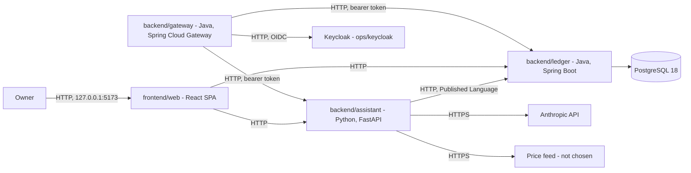

# FinAssist — architecture

The system as it actually is. *What it must do* is
[requirements](../requirements/requirements.md); *why* a given solution was chosen is
[the ADRs](../ADRs/).

> **All six contexts have a domain and an application layer, and the ledger's store is
> PostgreSQL. Both backend services now have a transport, and the web client calls both: the
> ledger's from its accounting, budgeting and planning screens, and the assistant's from its
> portfolio screens.** The ledger's repository ports are backed by hand-written SQL
> ([ADR-006](../ADRs/ADR-006-postgresql-for-the-ledger-store.md),
> [ADR-024](../ADRs/ADR-024-jdbc-persistence-and-append-only-schema.md)). It serves accounting,
> budgeting and planning under `/api/v1`, through a component-scanned `@RestController` per
> context calling in-ports only, a `HostAllowListFilter` refusing an un-allow-listed `Host` with
> 403, and per-context problem advices plus a composition-root fallback answering every failure as
> `application/problem+json`. The assistant serves `portfolio` under `/api/v1` the same way in its
> own idiom: `portfolio_router` is a factory taking use cases as arguments rather than reading
> `app.state`, `HostAllowList` wraps Starlette's `TrustedHostMiddleware` with the ledger's own
> refusal shape, and every failure is a problem built in `adapters/problems.py` — the one
> assistant package allowed to see every context's exceptions. All of it decided in
> [ADR-026](../ADRs/ADR-026-web-client-calls-both-services-through-one-origin.md),
> [ADR-027](../ADRs/ADR-027-defer-authentication-and-bind-to-loopback.md) and
> [ADR-028](../ADRs/ADR-028-http-wire-conventions.md), alongside
> [ADR-004](../ADRs/ADR-004-http-openapi-service-contract.md), all now Accepted. Each service's
> generated OpenAPI document is pinned against its own committed contract — `LedgerContractIT`
> against `contracts/ledger-v1.openapi.json`, `tests/test_contract.py` against
> `contracts/assistant-v1.openapi.json` — and `adapters/openapi.py` rewrites FastAPI's own
> generated `422` body on every operation into the `Problem` the assistant actually sends. A
> development seed (`ASSISTANT_DEV_SEED`, off by default) can load a small set of fictional
> holdings and quotes from the composition root alone (`adapters/seed.py`), so the portfolio
> screens have something to show by hand — a development aid, never a data source. The assistant
> still has no store and no ledger client — its assembled use cases run over in-memory stand-ins
> regardless of the seed. Both services now run under Compose, alongside natively
> (`./mvnw spring-boot:run`, `uv run python -m finassist_assistant.adapters`) for the faster
> inner loop. Both emit structured logs and OTLP traces — see
> [Cross-cutting concerns](#cross-cutting-concerns). Where a structure
> is defined but not yet inhabited, this document says so.

## Architecture overview

Two independently deployable backend services, a web client, and a database.

The **ledger** (Java) owns financial records and the rules that govern them. The
**assistant** (Python) answers questions and computes analysis over those records, reading
them through the ledger's published API rather than its database. The **web client**
(TypeScript) is what a person talks to.

The split is [ADR-001](../ADRs/ADR-001-polyglot-java-python-split.md); the shape inside each
service is [ADR-007](../ADRs/ADR-007-asymmetric-hexagonal-architecture.md) as extended by
[ADR-010](../ADRs/ADR-010-bounded-context-map.md); the root layout is
[ADR-008](../ADRs/ADR-008-backend-frontend-root-layout.md).



`DB`, `Ledger`, `Assistant`, `Gateway` and `Keycloak` (with its own database, not drawn) all run
under Compose now (`docker compose up`); `Ledger` reaches `DB` over JDBC, and
`./mvnw spring-boot:run` / `uv run python -m finassist_assistant.adapters` against the Compose
`DB` still work for the native inner loop. `Web -> Ledger` and `Web -> Assistant` are the two
edges with a caller: the web client's accounting, budgeting and planning screens call the
ledger, and its portfolio screens call the assistant, both through one origin
([ADR-026](../ADRs/ADR-026-web-client-calls-both-services-through-one-origin.md)). The ledger
also serves its side of `Assistant -> Ledger`, which has no caller yet: the assistant has no
ledger client. **`Gateway` is a fourth, independently deployable service.** It signs the browser
in through OIDC, keeps every token server-side, and relays an authenticated request under
`/ledger/api/v1/**` or `/assistant/api/v1/**` to `Ledger` or `Assistant` with a bearer token
attached — both edges drawn above are real and exercised by `GatewayLoginFlowIT` against fakes,
never against the real services in a test. **`Owner -> Gateway` has no caller yet**: the web
client still reaches `Ledger` and `Assistant` directly through its own dev proxy. **`Gateway ->
Keycloak` is real now too**: `Keycloak` is built as code, from `ops/keycloak/Dockerfile` and the
`finassist` realm committed alongside it, and runs under Compose as `keycloak`, with its own
database, `keycloak-db` — see
[ADR-030](../ADRs/ADR-030-oidc-authentication-through-a-bff-gateway.md) and
[ADR-031](../ADRs/ADR-031-keycloak-as-the-identity-provider.md). `KeycloakRealmIT` proves this
edge against the real image, in Testcontainers, rather than against a fake — the one place this
document's fakes-not-reals caveat for `Gateway`'s own tests does not apply.

## Bounded contexts

Six contexts, each owned by exactly one service
([ADR-010](../ADRs/ADR-010-bounded-context-map.md), extended by
[ADR-015](../ADRs/ADR-015-planning-as-a-sixth-bounded-context.md)).

| Context | Owner | Holds | UI feature |
|---|---|---|---|
| `accounting` | `backend/ledger` | `Account`, `Entry`, `Balance` — the record of truth | yes |
| `budgeting` | `backend/ledger` | `Budget`, `Category`, `CategorisationRule` | yes |
| `portfolio` | `backend/assistant` | `Holding`, `Position`, `Valuation` | yes |
| `assistance` | `backend/assistant` | `Question`, `Evidence`, `GroundedAnswer` | no — excluded until the privacy question is answered |
| `marketdata` | `backend/assistant` | `Instrument`, `Quote` — feed not chosen | no |
| `planning` | `backend/ledger` | `PlannedFlow`, `Scenario`, `Projection`, `Comparison` — what is intended, not what happened | yes |

### The context map

| Role | Where | Consequence |
|---|---|---|
| Upstream, Supplier | `accounting` | Owns the records and the vocabulary; free to evolve its schema |
| Downstream, Customer | `portfolio`, `assistance` | Must not depend on the ledger's internals |
| Published Language | the OpenAPI document in [`contracts/`](../../contracts) | The only sanctioned way to read ledger data |
| Anti-corruption layer | `portfolio/adapters/outbound/ledger/`, `marketdata/adapters/outbound/feed/`, `assistance/adapters/outbound/llm/` | Foreign shapes become local model types here and nowhere else |

`budgeting` and `planning` name **no accounting type at all** — not an `Account`, and not an
`AccountId` either. `contexts_do_not_depend_on_each_other` admits no exception, so a context
needing a ledger figure takes it as a `Money` handed in from above rather than reaching for it:
`Budget.remaining` takes the spend, `Projection.of` takes the opening balance. Wiring those to
real accounting data is the application layer's job, and it is now done: each context declares
an out-port in its own vocabulary — `SpendJournal` returning `SpendRecord`,
`OpeningPositionProvider` returning `OpeningPosition` and addressed by a local `AccountRef` —
and the translation over accounting lives in `composition`, outside every context.

`planning` is the one context in the ledger that is not invariant-dense by nature, and it was
put there by choice rather than by ADR-007's criterion; see
[ADR-015](../ADRs/ADR-015-planning-as-a-sixth-bounded-context.md) for the obligation that
creates and the trigger for moving it.

There is deliberately **no shared kernel across languages**. `Money` is implemented once per
language; two implementations obliged to stay bit-identical would cost more than the
duplication. What keeps them equivalent is `contracts/money-vectors.v1.json`, read by both
suites, so a behavioural difference fails a build rather than waiting to be noticed — which it
had been: `times_rounded` raised on a large product in Python where Java returned a value
([ADR-018](../ADRs/ADR-018-cross-language-money-vectors.md)).

## Components

| Component | Responsibility | State |
|---|---|---|
| `backend/ledger` | Accounting, budgeting and planning. Sole writer of the ledger store. Java 21, Spring Boot 4.1.1, Maven wrapper 3.9.6 | Domain and application layers complete, with unit, seeded-property and shared-vector tests, **live architecture rules** (layering, context isolation, both framework-free layers, the two web-adapter direction rules, and DTO name uniqueness), and Spring tests covering the Actuator probes, the observability wiring, the Host allow-list, the problem+json fallback and the assembled composition root; structured logs, OTLP traces and Prometheus metrics. Every repository port is backed by PostgreSQL; the in-memory ones are gone. The only remaining in-memory adapters are the two event publishers, which nothing subscribes to yet. **It now has an inbound adapter**: a component-scanned `@RestController` per context under `/api/v1`, calling in-ports only, with its generated OpenAPI document pinned by `LedgerContractIT`. Runs under Compose (`build: ./backend/ledger`) as well as natively |
| `backend/assistant` | Portfolio, assistance and market data. Client of the ledger. Python 3.13, FastAPI, uv lockfile | Domain and application layers complete, with unit, Hypothesis-property and shared-vector tests, and 7 architecture rules parametrised over every source file (those that do not apply to a given file skip; one now forbids an inbound adapter reaching an outbound one). **It now has an inbound adapter**: `portfolio_router` under `/api/v1`, a `HostAllowList` middleware, and problem+json handling from the composition root, with its generated OpenAPI document pinned by `tests/test_contract.py`. Also serves `/health` and `/ready`. A development seed (`ASSISTANT_DEV_SEED`, off by default) loads fictional holdings and quotes from `adapters/seed.py` alone. `AnswerQuestion` is written and deliberately unwired — an LLM adapter would settle the privacy question by implication. Runs under Compose (`build: ./backend/assistant`) as well as natively |
| `frontend/web` | The only interface a person uses. React 19, Vite 8, TypeScript 6 | Builds and routes between four areas — accounting, budgets, planning and portfolio — each a feature under `src/features/` importing no other, composed in `src/app` inside a shared layout, under an error boundary per area and a TanStack Query client that retries a read once after a network failure or a 5xx other than a 503, and never retries a write. That rule is `isRetryable`, in `src/shared/api/retry.ts`, and it also decides whether a failed read's error state offers "Try again": every feature renders a failed read through `QueryErrorState` from `src/shared/ui`, which renders its `RetryButton`, and `useRetryFocus` moves focus to what a successful retry restores. Editing any field of a form whose mutation has settled clears its error or result (`clearSettledOutcome`, in `src/shared/lib`). **The accounting area is implemented**: `AccountsPage` lists accounts, reading each balance by its own request, and opens one through `OpenAccountForm`; `RecordTransactionPage`, at the static route `/accounts/transactions/new`, records a transaction by hand, mirroring a two-entry transaction's amount by string (ADR-029) and mapping each row to a signed `Entry` with no arithmetic; `AccountDetailPage` shows one account's balance and the transactions touching it, taking the account itself from the cached list because the ledger has no single-item read, and offers `Clear`, `Reconcile` and `Void` on each transaction's row, only for the states its `TransactionState` legally admits. **The budgeting area is implemented too**: `BudgetsPage` lists every budget with its period, currency and total, and defines one for a calendar month through `DefineBudgetForm`, whose month-to-period mapping (`monthInputToPeriod`) and period label (`periodMonthLabel`, `periodDisplayEnd`) are pure calendar-part arithmetic on year, month and day integers, never a `Date` parsed from a string; `BudgetReviewPage`, at `/budgets/:budgetId`, takes the budget's period and currency from the cached list and shows its review's spend by category (with an `Overspent`/`Within limit` status badge, text carrying the meaning rather than colour), its unbudgeted spend and its uncategorised amount, shown even when zero; `CategorisationRulesPage`, at the static route `/budgets/rules` — ranked above the dynamic `:budgetId` route at the same depth by React Router's own matching, not by array order — lists every rule in the order it was added and adds another through `AddCategorisationRuleForm`. The accounting, budgeting and planning screens call the ledger, and the portfolio screens the assistant, through the dev proxy, with wire types generated from `contracts/` into `src/shared/api/contracts/` and mapped, member by member, onto each feature's own types in `api/accountingApi.ts`, `api/budgetingApi.ts`, `api/planningApi.ts` and `api/portfolioApi.ts` — the anti-corruption layer ADR-029 requires; query keys come from the `accountKeys`, `budgetKeys`/`categorisationRuleKeys`, `planKeys` and `portfolioKeys` factories, so a mutation invalidates exactly what it can have changed: recording a transaction or moving one through its lifecycle invalidates the balance and transaction-list queries of the accounts it touches and never the accounts list; defining a budget invalidates the budgets list alone; adding a categorisation rule invalidates the rules list and every cached budget-review query, since a new rule can change how any budget's spend categorises, and never the budgets list, which a rule cannot change. **The planning area is implemented too**: `PlannedFlowsPage` plans a flow through `PlanFlowForm` and moves each through `Commit`, `Realise` or `Cancel`, offering only what its `PlanState` legally admits; `ScenariosPage` lists scenarios and defines one through `DefineScenarioForm`, offering only flows in the scenario's currency; `ProjectionPage`, at `/planning/projection`, projects a scenario against the cash and invested accounts the owner chooses and shows whether cash ever falls below zero, with the within-step caveat, a hand-rolled SVG `ProjectionChart`, and a table of every step; `ComparisonPage`, at `/planning/compare`, compares two or more scenarios against a baseline in tables of end states and of each scenario's divergence, and draws no chart. Both offer accounts only in the currency being projected, and take them from accounting through `PlanningAccountsBridge` in `src/app` (see [Cross-cutting concerns](#cross-cutting-concerns)). Realising or cancelling a flow invalidates the flows list and every cached projection and comparison, by the `planKeys.projections` and `planKeys.comparisons` prefixes, since the ledger projects only planned and committed flows; planning a flow, committing one and defining a scenario each invalidate their own list alone. **The portfolio area is implemented too**, the one area the assistant serves: `PortfolioPage` looks a holding up by symbol through `SymbolLookup`, which trims the symbol and otherwise keeps it as typed, percent-encoded as one path segment; `HoldingPage`, at `/portfolio/:symbol`, reads the position and the valuation side by side, shows nothing held (404 `HOLDING_NOT_FOUND`) in place of every section — or in the valuation's section, when the valuation's 404 lands before the position's — and no usable price (503 `PRICE_UNAVAILABLE`) in the valuation's alone, each a calm empty state offering no retry, words an unrealised gain or loss from the amount's leading minus and nothing else, and reads both afresh when the symbol already shown is looked up again, by invalidating the `portfolioKeys.holding(symbol)` prefix; `DisposalSection`, offered once the position has loaded and starting its proceeds in the holding's own currency, the only one the assistant prices them in, prices a disposal by `POST` as a calculation that records nothing, and so invalidates no query, shows the quantity and proceeds it priced, the cost of sale, the realised gain or loss and the lots that would remain, oldest first, and is keyed by symbol, so another holding starts it afresh. Every portfolio page says its figures are not financial advice. Design tokens and the shared UI primitives every screen is built from, in `src/shared/ui`; test helpers in `src/shared/testing` that render routes with their providers and fake `fetch`; architecture rules, HTTP-client tests, jsdom tests of the shell, of each primitive and of every accounting, budgeting, planning and portfolio screen, and a structured logger that generates the `traceparent` every request carries |
| `backend/gateway` | Backend-for-frontend: terminates the browser's session, signs it in through OIDC and keeps every token server-side, and relays an authenticated request to the ledger or the assistant. Java 21, Spring Boot 4.1.1, Spring Cloud Gateway Server Web MVC 5.0.3, Maven wrapper 3.9.6 | `HostAllowListFilter` refuses an un-allow-listed `Host` before anything else, Actuator's health probes included. `GatewaySecurityConfiguration` runs the OIDC authorization-code-plus-PKCE login against a `ClientRegistration` built by hand in `KeycloakRegistration` (no discovery, so the browser-facing and backchannel Keycloak addresses can differ under Compose); the session — held only in this process's memory — carries the access and refresh tokens through an `HttpSessionOAuth2AuthorizedClientRepository`, and the browser is left with an `HttpOnly` session cookie and a script-readable CSRF cookie, never a token. `GET /bff/me` and `POST /bff/logout` are the only endpoints the gateway serves itself; every other permitted path — `/ledger/api/v1/**` and `/assistant/api/v1/**`, `GET` and `POST` — is a Spring Cloud Gateway MVC route matched by `Path=`/`Method=`, with `StripPrefix=1` removing the gateway's own prefix, `RemoveRequestHeader=` removing the browser's `Cookie` and CSRF header, and `TokenRelay=` attaching the session's access token, refreshing it first if it has expired. `GatewayRelayProblems`, a `@RestControllerAdvice`, turns a refused refresh into an invalidated session and a 401, a refused connection into a 502 `UPSTREAM_UNAVAILABLE`, and anything else into a logged 500 — logged by exception class name alone, never a message or a token — while a downstream problem+json response passes through unchanged. Every failure the gateway raises itself is the same RFC 9457 shape, written by `GatewayProblems`. Proven by `GatewayApplicationIT`, `GatewaySecurityTest`, `KeycloakRegistrationTest`, `HostAllowListFilterTest`, `SignInFailureHandlerTest`, `SpaLogoutSuccessHandlerTest` and `GatewayLoginFlowIT` — the last driving a real code-plus-PKCE login against a fake OpenID provider and relaying to two fake downstream services, never a mock. **It now publishes its own OpenAPI document**, generated by springdoc and pinned by `GatewayContractIT`, describing `GET /bff/me`, `POST /bff/logout` — added by an `OpenApiCustomizer` in `GatewayOpenApiConfiguration`, since sign-out is a security filter and springdoc never sees it — the `sessionCookie`/`xsrfToken` security schemes, and a `Problem` schema kept identical to the ledger's by that same test. `GatewayContractIT` generates the document by calling springdoc's resource bean directly rather than over HTTP, so `/v3/api-docs` stays denied by the security chain even though its document is committed; the relay routes are deliberately absent from it, since the ledger and the assistant already publish their own. No authentication yet reaches the ledger or the assistant: both still answer whatever the gateway relays, unchecked. Runs under Compose (`build: ./backend/gateway`) as well as natively (`./mvnw spring-boot:run`) |
| `contracts/` | The versioned wire contract, and the cross-language `Money` conformance vectors | `money-vectors.v1.json`, the README, `ledger-v1.openapi.json` — generated by springdoc, pinned by `LedgerContractIT` — `assistant-v1.openapi.json` — generated by FastAPI, pinned by `tests/test_contract.py` — and `gateway-v1.openapi.json` — generated by springdoc, pinned by `GatewayContractIT` |
| PostgreSQL 18 | The ledger's store | Runs via Compose. Three schemas — `accounting`, `budgeting`, `planning` — with no foreign key crossing one; migrated by Flyway from a directory per context. The journal is append-only in the database, enforced by triggers |

## Structure: context first, hexagon inside

A context is one directory, so it can be extracted by moving it. Tactical DDD — aggregates,
value objects, domain events — is used **only in the ledger**, where the invariants are; the
assistant's cores are pure functions over frozen dataclasses.

```
backend/ledger/src/main/java/io/github/naimelijah/finassist/ledger/
  accounting/   domain/{account,entry,event}/  application/{port/in,port/out,service}/  adapter/{in/web,out/persistence}/
  budgeting/    domain/{budget,category,event}/  application/…  adapter/…
  planning/     domain/{plan,forecast}/          application/…  adapter/…
  shared/       Money, Currency — in-language kernel
  composition/  the composition root: Spring wiring, and the two cross-context translations
  LedgerApplication.java

backend/assistant/src/finassist_assistant/
  portfolio/    domain/{model,analysis}/       application/{port,usecase}/  adapters/{inbound/api,outbound/ledger}/
  assistance/   domain/{model,grounding}/      application/…                adapters/{inbound/api,outbound/llm}/
  marketdata/   domain/{model,normalisation}/  application/…                adapters/outbound/feed/
  shared/
  adapters/     the composition root: settings, observability, the FastAPI app, and wiring.py,
                which assembles the use cases and holds MarketDataQuotes. Not a context

frontend/web/src/
  features/{accounting,budgeting,planning,portfolio,assistance}/{api,components,hooks,types}/
                each index.ts exports its area's routes; assistance has no route
  shared/{ui,api,lib,testing}/
  app/          the only place that knows every feature at once: routes.tsx composes their routes,
                and PlanningAccountsBridge.tsx adapts accounting's accounts into planning's terms
```

`LedgerApplication` sits in the root package so component scanning covers every context. The
wiring lives in `composition`, which is Spring-aware by design and is the only ledger package
permitted to see two contexts at once; the application layer carries no annotation and is wired
by constructor ([ADR-022](../ADRs/ADR-022-ledger-composition-root.md)).

The assistant's top-level `adapters/` is its composition root — the one package that imports
FastAPI, structlog and OpenTelemetry. It sits beside the contexts because it belongs to none,
and it is named `adapters` because that is what it is: the architecture rules key on that path
segment, so the exemption it needs is one it already earns rather than a special case.

Operational configuration lives in `ops/` — the collector, Prometheus and Grafana provisioning
that the `monitoring` Compose profile mounts, and `ops/keycloak/`: the `Dockerfile` that builds
the identity provider and the `finassist` realm it imports at start-up (ADR-031).

## Communication

- **Owner to web** — HTTP, from the owner's browser to the Vite dev server on
  `http://127.0.0.1:5173`. Nothing terminates TLS: the server binds loopback only (ADR-027), so
  the connection never leaves the machine.
- **Web to ledger** — HTTP, for the accounting, budgeting and planning screens. **Implemented on
  both sides for all three.** The ledger serves `/api/v1/accounts`, `/api/v1/transactions`,
  `/api/v1/budgets`, `/api/v1/categorisation-rules`, `/api/v1/planned-flows`, `/api/v1/scenarios`
  and `/api/v1/scenario-comparisons`. The web client's accounting screens call `GET` and
  `POST /api/v1/accounts`, `GET /api/v1/accounts/{id}/balance` — one request per account on the
  list (ADR-028) — and `GET /api/v1/accounts/{id}/transactions`, then `POST /api/v1/transactions`
  to record one and `POST /api/v1/transactions/{id}/clear`, `.../reconcile` or `.../void` to move
  it through its lifecycle. The budgeting screens call `GET` and `POST /api/v1/budgets`,
  `GET /api/v1/budgets/{id}/review` — no single-item read for a budget itself, so the review page
  takes its period and currency from the already-loaded list (ADR-028) — and `GET` and
  `POST /api/v1/categorisation-rules`. The planning screens call `GET` and
  `POST /api/v1/planned-flows`, `POST /api/v1/planned-flows/{id}/commit`, `.../realise` or
  `.../cancel`, `GET` and `POST /api/v1/scenarios`, `GET /api/v1/scenarios/{id}/projection` and
  `GET /api/v1/scenario-comparisons` — the last two carrying only ids, dates and the step in their
  query, one repeated `scenario`, `cash` or `invested` parameter per value, never an amount
  (ADR-028). In development the browser calls `/ledger/…` on the Vite origin, and the dev proxy
  forwards to the ledger on loopback so no call crosses an origin
  ([ADR-026](../ADRs/ADR-026-web-client-calls-both-services-through-one-origin.md)).
- **Web to assistant** — HTTP, for the portfolio screens, through the same proxy under
  `/assistant/…`. **Implemented on both sides.** The assistant serves
  `/api/v1/portfolio/holdings/{symbol}/position` (`GET`),
  `/api/v1/portfolio/holdings/{symbol}/valuation` (`GET`) and
  `/api/v1/portfolio/holdings/{symbol}/disposal` (`POST`, a JSON body, never query parameters,
  because its proceeds are an amount of money — ADR-028), each behind `HostAllowList` and each
  refusal a problem. The web client's holding page calls the position and the valuation side by
  side for the symbol it shows, and the disposal when the owner prices one, the symbol
  percent-encoded as one path segment. In development the browser calls `/assistant/…` on the Vite
  origin, and the dev proxy forwards to the assistant on loopback
  ([ADR-026](../ADRs/ADR-026-web-client-calls-both-services-through-one-origin.md),
  `tests/devServer.test.ts`).
- **Assistant to ledger** — HTTP, described by the ledger's OpenAPI document under `contracts/`
  and versioned in the URL path ([ADR-004](../ADRs/ADR-004-http-openapi-service-contract.md),
  Accepted). **The ledger side exists and is published as a contract; the assistant's client
  still does not.** `LedgerPort` remains an in-memory stand-in.
- **Assistant to Anthropic** — HTTPS via the pinned SDK, behind `LlmPort`.
- **Assistant to price feed** — not chosen; the port and its ACL exist, the client does not.
- **Ledger to Postgres** — JDBC, hand-written SQL over Spring's `JdbcClient`, with Flyway
  running the migrations at start-up ([ADR-006](../ADRs/ADR-006-postgresql-for-the-ledger-store.md),
  [ADR-024](../ADRs/ADR-024-jdbc-persistence-and-append-only-schema.md)). No ORM: an entity is
  not an aggregate, and every statement the ledger issues is readable in one place.
- **Browser to gateway** — HTTP, everything under `/bff/` — the OIDC login entry and callback,
  `GET /bff/me` and `POST /bff/logout` — and, once authenticated, `GET`/`POST` under
  `/ledger/api/v1/**` and `/assistant/api/v1/**`. **`HostAllowListFilter` runs first, ahead of
  the session and every route** ([ADR-030](../ADRs/ADR-030-oidc-authentication-through-a-bff-gateway.md)).
  **No caller reaches it yet**: the web client's dev proxy still forwards `/ledger/…` and
  `/assistant/…` straight to the ledger and the assistant, unchanged from the bullets above,
  which is why every gateway test drives this edge by hand with a JDK `HttpClient` rather than
  through the running web client.
- **Gateway to Keycloak** — HTTP, the authorization-code-plus-PKCE login and the `refresh_token`
  grant `TokenRelay=` uses to renew an expired access token, against a `ClientRegistration` built
  by hand in `KeycloakRegistration` rather than discovered. **Keycloak itself is not yet part of
  this repository** ([ADR-031](../ADRs/ADR-031-keycloak-as-the-identity-provider.md)); every
  gateway test stands a real, fake OpenID provider up instead —
  `composition.support.FakeOpenIdProvider`, a JDK `HttpServer` signing genuine RSA JWTs — so the
  login and refresh paths are proven against real HTTP and a real signature check, never a mock.
- **Gateway to ledger, and gateway to assistant** — HTTP, relaying `GET`/`POST
  /ledger/api/v1/**` and `/assistant/api/v1/**` once each request is authenticated. A Spring
  Cloud Gateway Server Web MVC route strips the gateway's own path prefix, removes the browser's
  `Cookie` and `X-FINASSIST-XSRF-TOKEN` headers, and attaches the session's access token —
  refreshed first if it had expired. **Neither the ledger nor the assistant checks that token
  yet**: both still answer whatever a request carries, exactly as they do for the web client's
  own direct calls above; a later task adds the resource-server side (ADR-032).

The ledger never calls the assistant, and the assistant never calls the web client.

## Data flow

**A ledger request now reaches a use case.** `HostAllowListFilter` runs first, ahead of every
other filter, Actuator included (ADR-027): a request whose `Host` is not on
`LEDGER_ALLOWED_HOSTS` is refused 403 before the dispatcher sees it. What passes reaches a
component-scanned `@RestController` for its context, which validates the body, builds a command
and calls its in-port; the in-port's implementation is a hand-wired application service, which
enforces the domain's invariants and calls its repository, which issues hand-written SQL over
`JdbcClient` against PostgreSQL. A response DTO is built from the domain result and serialised —
every decimal as a string, every sealed lifecycle flattened to a required `status` with optional
`on`/`reason` members, mapped by hand rather than by a Jackson polymorphism annotation
(ADR-028): HTTP → `HostAllowListFilter` → controller → in-port → service → repository →
PostgreSQL.

**A failure becomes a problem.** A well-formed request a domain or adapter rule refuses raises
`IllegalArgumentException` and is answered 422; an illegal lifecycle transition raises
`IllegalTransitionException` (accounting) or `IllegalPlanTransitionException` (planning) and is
answered 409, each by its own context's advice, which runs at the highest precedence. Spring
MVC's own failures — an unknown route, a non-JSON body, a malformed decimal or UUID — keep their
own statuses (404, 415, 400) through the composition root's fallback, `LedgerProblemHandler`, at
the lowest precedence, which answers everything no context's advice claimed. **A stored row a
JDBC mapper cannot reconstruct — an unknown enum constant, or an amount `Money` refuses — raises
`IllegalStateException`, which the fallback answers as a logged 500; only a domain refusal
reaches 422** — the accepted trade-off ADR-028 records for `IllegalArgumentException`. **A JSON
number carrying a fractional part or a decimal point — `1.5` and `1.0` alike — is refused as 400
wherever an integer field expects one**, before the domain sees it:
`spring.jackson.deserialization.accept-float-as-int: false` stops Jackson silently truncating
one. **A JSON number is refused as 400 wherever a text field expects one**, a decimal sent as
`12.50` included: `StrictTextCoercion`, registered in `composition`, stops Jackson reading the
number as text that would then pass the decimal pattern.

The two probe paths stay outside all of this: `GET /actuator/health` on the ledger → Spring
Boot's health contributors → `{"status":"UP"}`, and `GET /health` on the assistant → a constant
response. The ledger's readiness probe does reach Postgres — it includes the `db` indicator, so
a ledger that cannot connect reports `DOWN` rather than ready.

The in-process paths below are real, assembled at start-up, and exercised by tests. They are also
what each service's HTTP adapter calls: the ledger's, described above, and the assistant's,
described where its own valuation path appears below.

**Recording a transaction, from the browser.** `RecordTransactionPage`'s form state → its pure
mapper, `entryRowAmount`, turns each row's debit/credit pair into the signed amount `Entry`
carries, with no arithmetic anywhere in the browser (ADR-029) → `accountingApi.recordTransaction`
maps the feature's `RecordTransactionInput` onto the generated `RecordTransactionRequest` and
calls `sendJson` → the Vite dev proxy forwards `POST /ledger/api/v1/transactions` to the ledger on
loopback with its prefix stripped ([ADR-026](../ADRs/ADR-026-web-client-calls-both-services-through-one-origin.md))
→ the ledger's own path, below, runs unchanged and answers 201 with the recorded transaction, or a
problem. A 422 `RULE_VIOLATED`, `UNKNOWN_ACCOUNT` or `CURRENCY_MISMATCH`, or a 400 listing field
`errors`, comes back as `application/problem+json` and is parsed onto `ApiError.problem` by the
shared client (ADR-028); the form shows a 400's field errors on their fields and anything else in
an `ErrorState` above the form. On success, `useRecordTransaction` invalidates the balance and
transaction-list queries of every account the entries name, and never the accounts list, which
recording cannot change; the browser moves to the first entry's account.

**Recording a purchase, ledger.** `RecordTransactionCommand` → `TransactionService` loads every
referenced `Account` and refuses an entry whose currency the account does not hold →
`Transaction.record` refuses entries that do not sum to zero → `TransactionRepository.save`,
which inserts the transaction, its entries and its opening state in one database transaction,
and whose deferred constraint refuses at commit anything the aggregate somehow let through →
`AccountingEvents.publish`. Nothing consumes the event; see
[ADR-023](../ADRs/ADR-023-domain-events-in-the-ledger.md).

**Clearing it.** `TransactionService.clear` loads the transaction, the aggregate returns a new
value in the `Cleared` state, and `save` **appends** a row to
`accounting.journal_transaction_state`. Nothing is overwritten and nothing is deleted; the
earlier states stay readable, which is what makes the journal the audit record
([ADR-020](../ADRs/ADR-020-audit-trail-follows-persistence.md)).

**Reviewing a budget, from the browser.** `BudgetReviewPage` reads the budget's period and
currency from `useBudgets()`'s own cache rather than a request of its own, since the ledger has
no single-item read (ADR-028), and calls `useBudgetReview(budgetId)` for the rest →
`budgetingApi.reviewBudget` calls `requestJson` against `/budgets/{id}/review` → the Vite dev
proxy forwards it to the ledger on loopback
([ADR-026](../ADRs/ADR-026-web-client-calls-both-services-through-one-origin.md)) → the ledger's
own path, below, runs unchanged and answers 200 with the review, or a problem → the response maps
onto the feature's `BudgetReview`, `unbudgeted` kept as the ordered array the wire sends (ADR-028)
rather than turned into a map. A 404 `BUDGET_NOT_FOUND` - or the budget's id being absent from the
loaded list while no read of that list is in flight - renders a not-found message with a link back
to the budgets list, never a bare 404. While a list lacking the id is being read again, the page
says it is loading instead, since that list may only be out of date.
Each budgeted category's status badge reads its text from `overspent` (`Overspent` or
`Within limit`), never colour alone, and `remaining` is rendered exactly as received, negative
values included, with no arithmetic in the browser (ADR-029).

**Reviewing a budget, ledger, and the one path that crosses a context boundary.**
`ReviewBudgetUseCase` → `BudgetReviewService` loads the `Budget` → asks its own `SpendJournal`
port for spend in the budget's period and currency → `AccountingSpendJournal`, in the
composition root, calls accounting's `ViewJournalUseCase`, keeps the `EXPENSE` lines and maps
each to a `SpendRecord` → each record is categorised by the first matching `CategorisationRule`
→ `Budget.remaining` per category. Budgeting names no accounting type anywhere on that path.

**Projecting a strategy, from the browser.** `ProjectionPage`'s form holds the chosen scenario,
horizon, step and checked accounts, the accounts offered arriving through `AccountOptionsContext`,
which `PlanningAccountsBridge` fills from accounting's `useAccounts` →
`toProjectionSettings` keeps only the checked accounts in the scenario's currency, in the order
offered (ADR-012) → submitting sets the parameters `useProjection` is keyed by,
`planKeys.projection(params)` → `planningApi.projectScenario` builds the query with
`URLSearchParams.append` — `from`, `to`, `step`, then one `cash` and one `invested` per account,
never an amount (ADR-028) — and calls `requestJson` → the Vite dev proxy forwards
`GET /ledger/api/v1/scenarios/{id}/projection` to the ledger on loopback
([ADR-026](../ADRs/ADR-026-web-client-calls-both-services-through-one-origin.md)) → the ledger's
own path, below, answers 200 with the projection, or a problem → the response maps onto the
feature's `Projection`, refusing one with no points or with a step or currency the contract does
not name → the callout states the first shortfall, or that there is none at that cadence, with the
within-step caveat; `ProjectionChart` places each point through `scalePoints`, the one place an
amount becomes a number, and labels its extremes and horizon with the ledger's own strings through
`MoneyText` and `DateText` (ADR-029); a `DataTable` lists every step. A 404 `SCENARIO_NOT_FOUND` or
a 422 `RULE_VIOLATED` shows its detail in an `ErrorState` that takes focus and offers no retry,
since a second attempt would get the same answer; a network failure, or a 5xx other than a 503,
offers one.

**Projecting a strategy, ledger.** `ProjectScenarioCommand`, carrying the `AccountRef`s the
caller considers cash and invested → `ForecastService` loads the `Scenario` and **re-reads its
flows**, so a plan cancelled since it was named stops counting → `OpeningPositionProvider` →
`AccountingOpeningPositions` translates each `AccountRef` to an `AccountId` and sums
`ViewBalanceUseCase` → `Projection.of`.

**Looking up and valuing a holding, from the browser.** `SymbolLookup` trims the symbol,
invalidates its `portfolioKeys.holding(symbol)` prefix, so looking up the symbol already on screen
reads it afresh, and navigates to `/portfolio/:symbol` → `HoldingPage` calls `usePosition` and
`useValuation` side by side → `portfolioApi.readPosition` and `valueHolding` call `requestJson`
against `/assistant/api/v1/portfolio/holdings/{symbol}/position` and `.../valuation`, the symbol
encoded with `encodeURIComponent` → the Vite dev proxy forwards each to the assistant on loopback
with its prefix stripped
([ADR-026](../ADRs/ADR-026-web-client-calls-both-services-through-one-origin.md)) → the assistant
answers 200 or a problem, its valuation by the path below → each response maps onto the feature's
`Position` or `Valuation`, refusing a currency the contract does not name. A 404
`HOLDING_NOT_FOUND` on the position is a calm empty state in place of every section, and on the
valuation, which can land first, the same calm state in the valuation's section; a 503
`PRICE_UNAVAILABLE` on the valuation is one in the valuation's section alone, and the position
still shows. The app's query client retries neither: a 404 is the server's considered answer, and
a stale feed does not recover within a retry's backoff. Anything else is an `ErrorState`, offering a
retry only when `isRetryable` holds.

**Pricing a disposal, from the browser.** `DisposalSection`, mounted once the position has loaded,
holds a quantity and proceeds exactly as typed, the proceeds' currency starting at the position's
cost currency → `usePriceDisposal`, a mutation because it runs on submit and nothing should
cache it → `portfolioApi.priceDisposal` sends `{quantity, proceeds}` with `sendJson` as
`POST /assistant/api/v1/portfolio/holdings/{symbol}/disposal`, never a query string (ADR-028) →
the dev proxy forwards it to the assistant, which prices the lots oldest first and records nothing
([ADR-013](../ADRs/ADR-013-fifo-lot-based-cost-basis.md)) → the `DispositionModel` maps onto a
`Disposition`, its remaining lots in the order received, shown beside the quantity and proceeds it
priced. The mutation invalidates nothing, since nothing has changed, and editing any input clears
the result. A 400's field errors land on Quantity or Proceeds amount; a 422
`INSUFFICIENT_HOLDING`, `RULE_VIOLATED` or `CURRENCY_MISMATCH` shows its detail in an `ErrorState`
above the form, which takes focus.

**Valuing a holding, assistant, over HTTP.** `GET /api/v1/portfolio/holdings/{symbol}/valuation`
→ `HostAllowList` refuses a request whose `Host` is not on `ASSISTANT_ALLOWED_HOSTS`, the same
defence the ledger's filter runs, ahead of every route → `portfolio_router`'s handler builds a
`Symbol` and calls `ValueHolding` → `LedgerPort.lots_for` → `analysis.position` →
`QuotePort.unit_price`, satisfied by `MarketDataQuotes` in the composition root, which turns the
`Symbol` into a `Ticker`, calls marketdata's `LatestQuote`, and collapses both a missing and a
stale quote into `PriceUnavailableError` → `market_value` and `unrealised_gain` →
`ValuationModel.of` serialises the result, every decimal a string and every member camelCase
(ADR-028) → JSON. Nothing held for the symbol is `HoldingNotFoundError`, answered 404; no usable
price is `PriceUnavailableError`, answered 503 and logged at WARNING with the symbol alone, never
a traceback — each mapped by a handler in `adapters/problems.py`, the one assistant package
allowed to see every context's exceptions. A `ValueError` any other rule raises — including the
domain's own, wherever one is not given a more specific handler — is answered 422 `RULE_VIOLATED`
by the same catch-all the ledger's fallback uses for `IllegalArgumentException`, so a bug that
happens to raise `ValueError` reads as a refusal rather than a 500 (ADR-028's accepted
trade-off, mirrored here rather than narrowed to a smaller exception type).

**Relaying a request, from a signed-in session.** `HostAllowListFilter` runs first, exactly as it
does on the ledger, and refuses a foreign `Host` before a session or a route is even looked at →
Spring Security requires an authenticated session for `GET`/`POST /ledger/api/v1/**` and
`/assistant/api/v1/**` → a Spring Cloud Gateway Server Web MVC route matches the path and method →
`StripPrefix=1` removes the gateway's own segment → `RemoveRequestHeader=` removes the browser's
`Cookie` and `X-FINASSIST-XSRF-TOKEN`, so neither ever leaves this process → `TokenRelay=` asks
`OAuth2AuthorizedClientManager` for the session's access token, which refreshes it against
Keycloak first if it has expired, and attaches it as `Authorization: Bearer` → `RestClient`
proxies the request to `GATEWAY_LEDGER_URI` or `GATEWAY_ASSISTANT_URI`. **A downstream
`application/problem+json` response passes back through unchanged** — the gateway's `RestClient`
call applies no status handler of its own, so the browser sees the ledger's or the assistant's own
refusal, not a gateway rewrite. **A failure in this path becomes a gateway problem instead**:
`GatewayRelayProblems`, a `@RestControllerAdvice`, catches an `OAuth2AuthorizationException` —
Keycloak refusing the refresh — by invalidating the session and answering 401, a
`ResourceAccessException` — the ledger or the assistant unreachable — with 502
`UPSTREAM_UNAVAILABLE`, and anything else with a 500 logged by exception class name alone, never a
message or a token. `GatewayLoginFlowIT` drives every step of this against fake, real HTTP
services rather than mocks.

The telemetry path is real end to end and is described below.

## Cross-cutting concerns

Logging, correlation and telemetry are the same decision applied three times, recorded in
[ADR-019](../ADRs/ADR-019-opentelemetry-and-structured-logging.md).

| Concern | Ledger | Assistant | Web client |
|---|---|---|---|
| Log format | ECS JSON on stdout, from Spring Boot's built-in structured logging | JSON on stdout, from `structlog` | JSON on the console, from `shared/lib/logger.ts` |
| Boundary | Logback, configured in `application.yml` | `adapters/observability.py` | `shared/lib/logger.ts`, the only file allowed to call `console` |
| Redaction | No secret reaches it — Actuator's `env` endpoint is not exposed | Key names plus registered values, as a `structlog` processor | Key names, depth-bounded |
| Correlation | `traceId` in the MDC, from Micrometer Tracing | `contextvar`, seeded from an inbound `traceparent` | Generates the `traceparent` every request carries |
| Traces | OTLP over HTTP, off unless `OTEL_EXPORT_ENABLED` is true | The same | None; no browser SDK |
| Metrics | Micrometer, scraped at `/actuator/prometheus` | None yet | None |

**The correlation id is a W3C trace context.** The browser generates a `traceparent`; the
assistant reads its trace-id field and binds it for the request; the ledger's OpenTelemetry
instrumentation continues the same trace. One id spans all three, which is the reason for using
the standard rather than a private header.

**Telemetry is a no-op when unconfigured.** With no collector named, both services start
normally and drop their spans — asserted by `LedgerObservabilityIT` and
`test_observability.py`, because a service that refused to start without a collector would make
the collector a production dependency of local development.

**Redaction is a property of the boundary, not a duty of the caller.** Every event passes
through a processor that removes secret-named keys, so a new call site inherits it. This is what
the requirements mean by "redacted at the logging boundary, not at each call site".

**Diagnostics are not an audit trail.** Logs are dropped when no collector is attached and are
explicitly not a record anyone may rely on after the fact.
[ADR-020](../ADRs/ADR-020-audit-trail-follows-persistence.md) makes the append-only journal the
audit record and defers its implementation to the first repository.

**The composition root is a package, not a framework, and both services now have one.** The
assistant's `src/finassist_assistant/adapters/` wires FastAPI, structlog and OpenTelemetry
together and is the only place allowed to. The ledger's `composition` package is its mirror:
Spring wiring plus the two translations that carry a figure between contexts. Neither is a
bounded context, and each is fenced by a rule forbidding any context from importing it.

**A cross-context translation is where it is because nowhere else is legal.**
`contexts_do_not_depend_on_each_other` matches `ROOT.(*)..` with no layer qualifier, so a
budgeting *adapter* importing accounting fails exactly as a budgeting domain class would. The
composition root is the only place outside every slice, and its exemption is one-way: it may
depend on anything, nothing may depend on it. Removing the exemption fails the slice rule three
times over, once per context the root wires
([ADR-022](../ADRs/ADR-022-ledger-composition-root.md)).

**A translation calls the upstream context's in-port, never its repositories.** That is the
in-process equivalent of the Published Language, so extracting a context later is a change of
transport rather than of design. Upstream exceptions stop at the boundary too: a bad
`AccountRef` reaches planning as an `IllegalArgumentException` naming the reference it gave, not
as an `AccountNotFoundException` carrying an id it never saw.

**The web client has its own cross-context translation, in `src/app`.** A web feature imports no
other feature (`tests/architecture.test.ts`), so planning declares what it needs from accounting
in its own words — `AccountOptionsContext`, whose value is a list of `AccountOption`s, each a ref,
a label and a currency, or says the list is still loading or failed — and
`PlanningAccountsBridge`, a pathless layout route around the planning routes, fills it from
accounting's `useAccounts`, mapping each `Account` onto an `AccountOption`. It is the web client's
counterpart of `AccountingOpeningPositions` in the ledger's `composition`: the consumer owns the
port, and the translation sits in the one place that sees both contexts
([ADR-010](../ADRs/ADR-010-bounded-context-map.md),
[ADR-022](../ADRs/ADR-022-ledger-composition-root.md)). Planning names no accounting type, and
`useAccountOptions` throws when no provider is above it rather than offering no accounts silently.
Because the bridge wraps every planning route, the flows and scenarios screens read the accounts
list too — one cached request, shared with the accounting screens.

**Domain events are raised by the application service, not by the aggregate.** `Transaction` and
`PlannedFlow` are records whose value semantics the suites rely on, so a mutable pending-events
list would break their equality. The event types live in each context's `domain/event/`; only
`accounting` and `planning` have them, being the two contexts with sealed lifecycles. Nothing
consumes them — the accepted cost, and its trigger, are in
[ADR-023](../ADRs/ADR-023-domain-events-in-the-ledger.md).

**The repository ports cannot express a destructive write.** None exposes a delete, and every
lifecycle change is stored by saving the aggregate in its new state. ADR-020's append-only
obligation is therefore honoured as a port contract, and the durable adapter inherited it when
ADR-006 was ratified; [ADR-024](../ADRs/ADR-024-jdbc-persistence-and-append-only-schema.md) then put
the journal's half of it in the database too, where a trigger refuses an `UPDATE` or a `DELETE`.

## External dependencies and integration points

| Dependency | Used for | Pinned in |
|---|---|---|
| PostgreSQL 18.6 | Ledger store | `docker-compose.yml` (by hand — Dependabot covers no Compose file) |
| Keycloak 26.7.4 | The identity provider (ADR-031): issues the tokens the gateway's OIDC login and the future assistant-to-ledger call both use. The gateway reaches it at a public URL the browser also uses for sign-in and sign-out, and at a separate backchannel URL — its own Compose service name — for the token and JWK-set requests only it makes; the issuer is always the public one | `ops/keycloak/Dockerfile` (Dependabot); `ops/keycloak/finassist-realm.json`, pinned by `KeycloakRealmTest` and proved against the real image by `KeycloakRealmIT` |
| PostgreSQL 17.11 | Keycloak's own store, `keycloak-db` — a separate database, role, volume and failure domain from the ledger's (ADR-031) | `docker-compose.yml` (by hand) |
| Anthropic API | The LLM behind `assistance` | `backend/assistant/pyproject.toml`, `uv.lock` |
| Price feed | `marketdata` | **Not chosen** — see the open questions |
| Maven Central / PyPI / npm | Dependencies | `pom.xml`, `uv.lock`, `package-lock.json` |
| OTel Collector, Prometheus, Grafana | Local telemetry backend, `monitoring` Compose profile | `docker-compose.yml`, configured in `ops/` |

## Structural decisions not visible from the file layout

**Every structural rule is enforced by a test, in all three codebases.** Each was verified by
introducing a deliberate violation and confirming the build failed, then reverting.

Alongside them, the domain enforces its own rules — the balancing invariant, derived balances,
currency isolation, the transaction lifecycle, and the grounding rule. Those are listed against
the classes and tests that enforce them in
[requirements](../requirements/requirements.md#business-rules-and-invariants).

| Rule | Enforced by |
|---|---|
| Layers point inward, in every ledger context | `LedgerArchitectureTest.layers_point_inward` |
| **No ledger context depends on another** (`shared` exempt) | `LedgerArchitectureTest.contexts_do_not_depend_on_each_other` |
| The ledger domain imports no framework (now also Jackson 3's `tools.jackson`, `io.swagger` and `org.springdoc`, widened with the HTTP adapters) | `LedgerArchitectureTest.domain_depends_on_no_framework` |
| No floating-point field in a ledger domain | `LedgerArchitectureTest.money_is_never_floating_point` |
| No cycles between aggregates in a context | `LedgerArchitectureTest.aggregates_are_free_of_cycles` |
| **No foreign key crosses a schema**, so context isolation holds in the database too | `SchemaBoundariesIT` |
| **The journal is append-only**: no `UPDATE` or `DELETE` on a transaction, its entries or its states | `V1_1__accounting_schema.sql` triggers; `JournalIsAppendOnlyIT` |
| **Nothing outside the ledger's composition root depends on it** | `LedgerArchitectureTest.no_context_depends_on_the_composition_root` |
| **The ledger's application layer imports no framework** (same widened package list as the domain rule) | `LedgerArchitectureTest.the_application_layer_depends_on_no_framework` |
| **A controller reaches the application only through its in-ports** — never a repository, an outbound adapter, or a concrete `application.service` class | `LedgerArchitectureTest.inbound_adapters_reach_only_in_ports` |
| **An outbound adapter never reaches an inbound one**, so the store never names a transport type | `LedgerArchitectureTest.outbound_adapters_do_not_reach_inbound` |
| **A web DTO's simple name is unique across every context** — `MoneyDto` alone is exempt, since each context declares an identical copy on purpose | `LedgerArchitectureTest.web_dto_names_are_unique_across_contexts`; `MoneyDtoShapesTest` keeps the three copies identical |
| **The ledger's generated OpenAPI document matches the committed `contracts/ledger-v1.openapi.json`** | `LedgerContractIT` |
| **No `operationId` carries a springdoc collision suffix** (`..._1` on a name reused across contexts) | `LedgerContractIT.Given_the_generated_document_When_operation_ids_are_read_Then_none_carries_a_springdoc_collision_suffix` |
| **Every response schema declares `required` for its always-present members**, so a client generated from the document trusts which fields it can rely on | `LedgerContractIT.Given_the_generated_document_When_response_schemas_are_read_Then_they_require_what_is_always_present` |
| No inward assistant layer imports a framework | `test_architecture.py::…Then_it_imports_no_framework` |
| No inward assistant layer imports the adapters | `test_architecture.py::…Then_it_imports_no_adapter` |
| **No assistant context imports another** | `test_architecture.py::…Then_it_imports_no_other_context` |
| **No assistant context imports the composition root** | `test_architecture.py::…Then_it_imports_no_composition_root` |
| No floating point in an assistant domain module | `test_architecture.py::…Then_it_names_no_float` |
| No assistant domain module reads the wall clock | `test_architecture.py::…Then_it_reads_no_clock` |
| **No assistant inbound adapter imports an outbound one** — a route reaches a client only through a use case | `test_architecture.py::Given_an_inbound_adapter_When_parsed_Then_it_imports_no_outbound_adapter` |
| **No web feature imports another**, and `shared` imports no feature | `frontend/web/tests/architecture.test.ts` |
| **`src/app` imports a web feature only through its `index.ts`**, and no feature imports `src/app` | `frontend/web/tests/architecture.test.ts` (`composition direction`) |
| **`src/shared` imports nothing from `src/app`**, the composition root nothing may import back into | `frontend/web/tests/architecture.test.ts` |

All three are **static**: ArchUnit scans bytecode, the assistant's rules parse every source
file with `ast`, and the web client's walk the source tree. None of them import the code they
check.

The assistant's scanner is itself under test. Its rules are only as good as the helper that
resolves imports, and nothing checked that helper — so a refactor could have neutered every
rule while all of them stayed green, which is the same failure the `sys.modules` version below
had. Dropping the `ImportFrom` branch now fails four helper cases and none of the parametrised
rule cases, which is why the helper cases exist.

That matters, and was got wrong once. An earlier version of the assistant's rules imported a
package and inspected `sys.modules`; because Python does not import subpackages on its own,
importing `finassist_assistant.portfolio` executed only its `__init__.py`, and a forbidden
import inside `portfolio/domain/analysis/returns.py` was invisible. The rule passed green on a
file containing both a `pandas` import and a cross-context import. Reading the source is the
only way these rules see code that has not been written yet.

**The ledger's rules are no longer dormant.** `archunit.properties`, and with it the
`archRule.failOnEmptyShould=false` escape hatch, was deleted alongside the first domain class,
exactly as every commit since the scaffold said it would be. Two rules became provable for the
first time: a `double` field in an accounting domain class fails
`money_is_never_floating_point`, and an accounting class importing
`budgeting.domain.category.Category` fails `contexts_do_not_depend_on_each_other` — each with
exactly one violation, both reverted.

**Anti-corruption layers are per context, by design.** If `portfolio` and `assistance` both
need ledger data, each translates it into its own vocabulary. The duplicated translation is
the point: a shared translation would smuggle one context's model into the other.

**Persistence entities are not aggregates.** JPA's requirements — no-arg constructors, mutable
fields, lazy proxies — stay in `adapter/out/persistence`.

**The database is private to the ledger.** The assistant has no connection string, by design.

**A validation failure the assistant logs never quotes the input it rejected.** The guarantee is
`adapters/problems.py`: `_withheld` logs a 5xx caused by a pydantic `ValidationError` or by
FastAPI's `ResponseValidationError` through `_rejections` alone — each failure's `loc` and `type`,
never its message, its input or `exc_info` — because FastAPI's error quotes the input however a
model is configured, and a validator's own message can quote it too. Every `_WireModel` also sets
`hide_input_in_errors=True`, so its own `ValidationError` text leaves the value out: defence in
depth for anything else that prints one. These models carry the owner's money, and
`tests/test_problems.py` pins the log line.

**Both Host allow-lists refuse, at start-up, an entry naming a port or an IPv6 literal.**
`ASSISTANT_ALLOWED_HOSTS` refuses a `:` or a `[`, the same way a wildcard is refused:
`TrustedHostMiddleware` compares only the text before a `Host` header's first colon, so a port,
`[::1]` or a bare `::1` would match no request, and admitting one would look like a working entry
that defends nothing. `HostAllowListFilter` refuses a `:`, a `[` or a `]` in
`LEDGER_ALLOWED_HOSTS` for the same reason: it compares a header's host name with the port
removed, and reads a bracketed header as malformed, so no such entry could match either.

**Neither service serves a Swagger UI.** `docs_url` and `redoc_url` are both `None` on the
assistant's `FastAPI` app, matching the ledger, which configures no springdoc UI either; both
pages would load their scripts from a CDN. `/openapi.json` (and the ledger's own document route)
still serves the contract itself.

**Currency is resolved by its ISO code, never by enum member name.** `currency_for` looks
`Currency` up in a table keyed by `Currency.code` — the value `CurrencyCode`'s `Literal` lists
and the parity test in `tests/test_portfolio_api.py` compares against — so a member whose name
happened to differ from its code cannot pass the parity test and still fail every request as an
uncaught `KeyError` at 500.

**On the web client, an amount becomes a number only to place a pixel.** The browser does no
arithmetic on money ([ADR-029](../ADRs/ADR-029-web-client-stack.md)), yet a chart needs
coordinates. `scalePoints`, the projection chart's scale function in
`features/planning/components/chartScale.ts`, is the one place an amount is converted with
`Number`, and only to compute a position. Every figure a person reads — the chart's highest and
lowest labels, its horizon dates, and the table beneath it — is the ledger's own string through
`MoneyText` or `DateText`: each extreme carries the `Money` that holds it, never the number it was
placed by, and the chart's SVG title and description carry no figure at all. No build rule
enforces this; it is held in review, and `ProjectionChart.test.tsx` pins the extreme labels to an
amount beyond a double's precision, which a re-formatted float would fail.

**The Makefile is an interface, not a mechanism.** Every target wraps `docker compose`,
`./mvnw`, `uv` or `npm`, and CI calls the same targets, so the pipeline and the local commands
cannot drift ([ADR-005](../ADRs/ADR-005-docker-compose-as-the-run-mechanism.md)).

**Two linter rules are relaxed with recorded reasons.** Ruff's `N802` for `tests/**`, because
test names are `Given<scenario>_When<action>_Then<result>`; and TypeScript is pinned to 6.0.3
rather than 7.x because `typescript-eslint` does not yet support 7
([ADR-009](../ADRs/ADR-009-react-vite-spa-for-the-web-client.md)).
